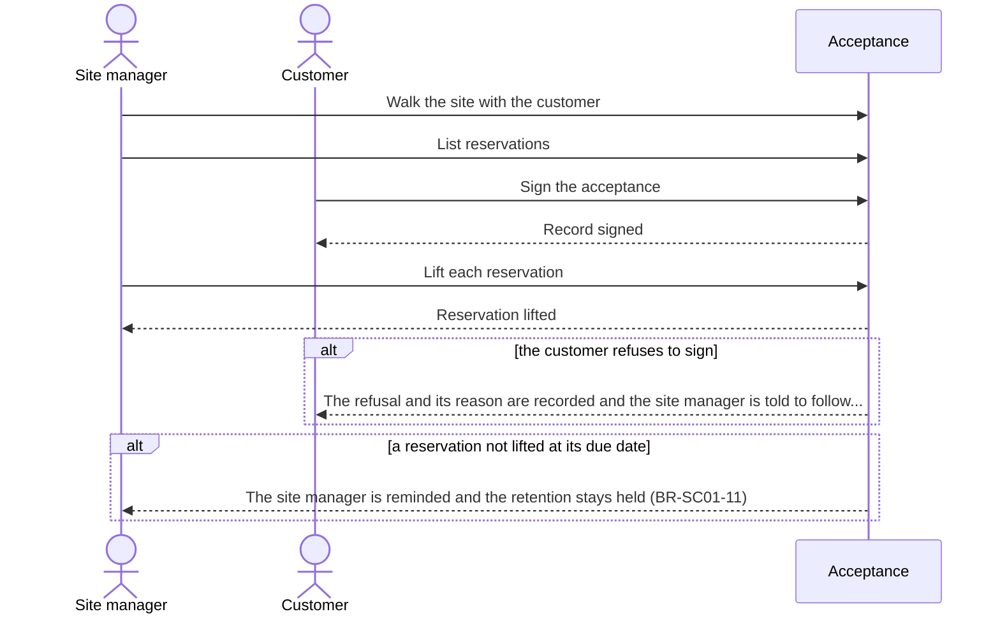

🏠 [Specs](../../../../README.md) › 🏷️ [Sectors](../../../README.md) › 🏗️ [SC01 Construction](../../README.md) ›
📝 [Use cases](../README.md) › 📝 [Use cases: FL-SC01-05 Hand over and follow up](README.md) ›
📝 UC-SC01-10 Accept the works with reservations and lift them

# 📝 UC-SC01-10 Accept the works with reservations and lift them

**Status:** ✅ specified

## Summary

The site manager walks the site with the customer, records the acceptance with its reservations and photos, has it
signed, then lifts each reservation as it is fixed.

## Personas

- [U22 Site manager](../../../../01-users/personas/u22-site-manager.md)
- [U09 Customer](../../../../01-users/personas/u09-customer.md)

## Goal

A signed acceptance that starts the warranties, and every reservation lifted.

## Trigger

The works are finished.

## Frequency

Once per site, then one lifting per reservation.

## Preconditions

- The SC01 sector pack is installed for the company,
  [UC-F14-02](../../../../02-functional/f14-plugin-store/use-cases/01-find-and-install/uc-f14-02-install-a-plugin-or-sector-pack.md),
  and its users have their roles,
  [UC-F1-06](../../../../02-functional/f01-administration/use-cases/04-edit-a-role/uc-f01-06-edit-a-role-and-its-record-rules.md).
- The last phase is done.

## Postconditions

- **Success:** the acceptance is signed; the warranties and the retention's release date start
  ([BR-SC01-10](../../business-rules/br-sc01-10-acceptance-starts-the-warranties.md)).
- **Failed:** the acceptance is not signed; the site stays running.

## Main flow

1. The site manager opens [S-SC01-10 Acceptance](../../screens/05-hand-over-and-follow-up/s-sc01-10-acceptance.md) on
   the tablet at the site with the customer.
2. The site manager lists each reservation with its lot, photo and due date.
3. The customer and the site manager sign on the tablet,
   [UC-F2-14](../../../../02-functional/f02-no-code-configuration/use-cases/07-benchmark-additions/uc-f02-14-send-documents-for-e-signature.md).
4. As each is fixed, the site manager records its lifting with a photo, and the customer confirms it.

## Alternative flows

- 2a. Acceptance without reservations: the record is signed with none and the retention can be released at its date.

## Error flows

- 3e. The customer refuses to sign: the refusal and its reason are recorded and the site manager is told to follow up.
- 4e. A reservation not lifted at its due date: the site manager is reminded and the retention stays held
  ([BR-SC01-11](../../business-rules/br-sc01-11-retention-released-when-due.md)).
- Any step: a call to a service or an outside system fails: it is retried first
  ([BR-F3-32](../../../../02-functional/f03-assistant/business-rules/br-f03-32-retry-before-an-error.md)), then the
  error message pattern ([D122](../../../../06-decisions/ux/d122-error-message-standard.md)) says what failed; what was
  typed is kept.

## Business rules

- [BR-SC01-10 Acceptance starts the warranties](../../business-rules/br-sc01-10-acceptance-starts-the-warranties.md)
- [BR-SC01-11 Retention released when due](../../business-rules/br-sc01-11-retention-released-when-due.md)

## Entities

- [E-SC01-10 Acceptance record](../../data/e-sc01-10-acceptance-record.md)
- [E-SC01-11 Warranty](../../data/e-sc01-11-warranty.md)

## Permissions

The site manager and customer roles; the record rules of their role and site apply,
[UC-F1-06](../../../../02-functional/f01-administration/use-cases/04-edit-a-role/uc-f01-06-edit-a-role-and-its-record-rules.md).

## Notifications

- The customer gets the signed record.
- The site manager is reminded of reservations due.

## Audit events

Every creation, change and state change of acceptance record, warranty records, with who, when and the values before and
after (T3).

## AI involvement

The AI assistant answers questions on the acceptance record, warranty records of this use case, with links, and prepares
them as drafts the user confirms. It works within the user's rights,
[BR-F3-34](../../../../02-functional/f03-assistant/business-rules/br-f03-34-every-capability-is-reachable-from-the-assistant.md),
and never deletes or does anything irreversible without the user's confirmation,
[BR-F3-07](../../../../02-functional/f03-assistant/business-rules/br-f03-07-no-deletes-no-irreversible-acts.md).

## API, MCP and A2A exposure

Through the API and webhooks (T5) and the MCP and A2A gateway (T6), with the caller's rights,
[BR-F3-34](../../../../02-functional/f03-assistant/business-rules/br-f03-34-every-capability-is-reachable-from-the-assistant.md),
reading, creating and changing the records of this use case; nothing irreversible without a person's confirmation.

## Screens

- [S-SC01-10 Acceptance](../../screens/05-hand-over-and-follow-up/s-sc01-10-acceptance.md)

## Flowchart

See [FL-SC01-05 Hand over and follow up](../../flows/fl-sc01-05-hand-over-and-follow-up.md#flowchart).

## Sequence diagram

## Acceptance criteria

1. **Given** the example construction company's site S-14 with 3 reservations **when** the acceptance is signed on 12
   December **then** the 1-, 2- and 10-year warranties start on 12 December and the retention's release date is 12
   December 2027.
2. **Given** 1 of 3 reservations lifted **when** the site manager opens the record **then** it shows 2 reservations
   open.
3. **Given** the customer refusing on 12 December **when** the site manager records it **then** the refusal and its
   reason are recorded and the site manager is told to follow up.

## Non-functional notes

[D408](../../../../06-decisions/technical/d408-performance-and-profiles.md)'s targets
([performance](../../../../05-non-functional/performance.md)): 95 % of screens within 1 second; lists paged on the
server, the first page within 1 second; reports within 5 seconds or in the background. WCAG 2.2 AA and RGAA
([D46](../../../../06-decisions/ux/d46-accessibility-standard.md)).

## Regulatory references

Legal values from the France country pack:
[CR-FR-090 Builders' warranties and acceptance](../../../../10-country-packs/france/construction/cr-fr-090-builders-warranties.md),
[CR-FR-021 Construction retention guarantee](../../../../10-country-packs/france/invoicing/cr-fr-021-construction-retention-guarantee.md).

## Related use cases

- [UC-SC01-11 Hand over the as-built file and follow the warranties](uc-sc01-11-hand-over-the-as-built-file-and-follow-the-warranties.md)
- [UC-SC01-06 Bill progress with the retention guarantee](../04-bill-and-subcontract/uc-sc01-06-bill-progress-with-the-retention-guarantee.md)

## Open questions

None.

---

⬅️ [UC-SC01-09](../02-prepare-the-site/uc-sc01-09-declare-works-near-networks-and-keep-the-safety-documents.md) ·
⬆️ [Up](README.md) · ➡️ [UC-SC01-11](uc-sc01-11-hand-over-the-as-built-file-and-follow-the-warranties.md)
