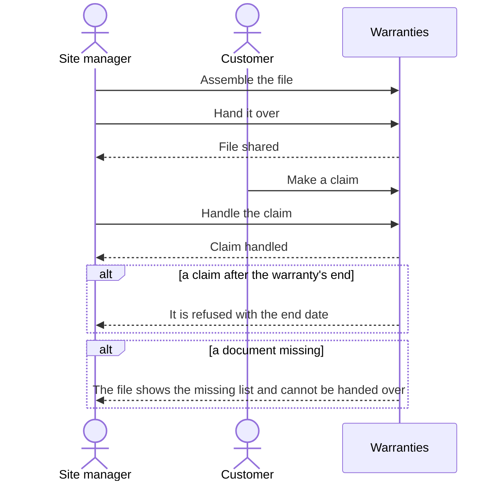

🏠 [Specs](../../../../README.md) › 🏷️ [Sectors](../../../README.md) › 🏗️ [SC01 Construction](../../README.md) ›
📝 [Use cases](../README.md) › 📝 [Use cases: FL-SC01-05 Hand over and follow up](README.md) ›
📝 UC-SC01-11 Hand over the as-built file and follow the warranties

# 📝 UC-SC01-11 Hand over the as-built file and follow the warranties

**Status:** ✅ specified

## Summary

The site manager assembles the as-built file, hands it to the customer, and follows the one-, two- and ten-year
warranties and the claims made under them.

## Personas

- [U22 Site manager](../../../../01-users/personas/u22-site-manager.md)
- [U09 Customer](../../../../01-users/personas/u09-customer.md)

## Goal

A complete as-built file handed over, and every claim handled within its warranty.

## Trigger

Acceptance, then a customer's claim.

## Frequency

Once per site; claims a few times a year.

## Preconditions

- The SC01 sector pack is installed for the company,
  [UC-F14-02](../../../../02-functional/f14-plugin-store/use-cases/01-find-and-install/uc-f14-02-install-a-plugin-or-sector-pack.md),
  and its users have their roles,
  [UC-F1-06](../../../../02-functional/f01-administration/use-cases/04-edit-a-role/uc-f01-06-edit-a-role-and-its-record-rules.md).
- The acceptance is signed ([UC-SC01-10](uc-sc01-10-accept-the-works-with-reservations-and-lift-them.md)).

## Postconditions

- **Success:** the file is handed over; each claim is handled or refused with its warranty's end date.
- **Failed:** the file stays incomplete and the list of missing documents is shown.

## Main flow

1. The site manager assembles the as-built file on
   [S-SC01-11 Warranties](../../screens/05-hand-over-and-follow-up/s-sc01-11-warranties.md): plans, technical notices,
   guarantees.
2. The site manager shares it with the customer on the portal,
   [UC-F6-11](../../../../02-functional/f06-customers-and-sales/use-cases/02-quote-to-order/uc-f06-11-use-the-customer-portal.md).
3. The customer reports a defect from the portal with a photo.
4. The site manager checks which warranty covers it and plans the repair as a short site.

## Alternative flows

- 4a. A claim under the ten-year warranty: the insurer is declared and the claim follows its file.

## Error flows

- 4e. A claim after the warranty's end: it is refused with the end date.
- 1e. A document missing: the file shows the missing list and cannot be handed over.
- Any step: a call to a service or an outside system fails: it is retried first
  ([BR-F3-32](../../../../02-functional/f03-assistant/business-rules/br-f03-32-retry-before-an-error.md)), then the
  error message pattern ([D122](../../../../06-decisions/ux/d122-error-message-standard.md)) says what failed; what was
  typed is kept.

## Business rules

- [BR-SC01-10 Acceptance starts the warranties](../../business-rules/br-sc01-10-acceptance-starts-the-warranties.md)

## Entities

- [E-SC01-11 Warranty](../../data/e-sc01-11-warranty.md)
- [E-SC01-10 Acceptance record](../../data/e-sc01-10-acceptance-record.md)
- [E-SC01-13 As-built file](../../data/e-sc01-13-as-built-file.md)

## Permissions

The site manager and customer roles; the record rules of their role and site apply,
[UC-F1-06](../../../../02-functional/f01-administration/use-cases/04-edit-a-role/uc-f01-06-edit-a-role-and-its-record-rules.md).

## Notifications

- The customer gets the file's link.
- The site manager is told of each new claim.

## Audit events

Every creation, change and state change of warranty, acceptance record records, with who, when and the values before and
after (T3).

## AI involvement

The AI assistant answers questions on the warranty, acceptance record records of this use case, with links, and prepares
them as drafts the user confirms. It works within the user's rights,
[BR-F3-34](../../../../02-functional/f03-assistant/business-rules/br-f03-34-every-capability-is-reachable-from-the-assistant.md),
and never deletes or does anything irreversible without the user's confirmation,
[BR-F3-07](../../../../02-functional/f03-assistant/business-rules/br-f03-07-no-deletes-no-irreversible-acts.md).

## API, MCP and A2A exposure

Through the API and webhooks (T5) and the MCP and A2A gateway (T6), with the caller's rights,
[BR-F3-34](../../../../02-functional/f03-assistant/business-rules/br-f03-34-every-capability-is-reachable-from-the-assistant.md),
reading, creating and changing the records of this use case; nothing irreversible without a person's confirmation.

## Screens

- [S-SC01-11 Warranties](../../screens/05-hand-over-and-follow-up/s-sc01-11-warranties.md)

## Flowchart

See [FL-SC01-05 Hand over and follow up](../../flows/fl-sc01-05-hand-over-and-follow-up.md#flowchart).

## Sequence diagram

## Acceptance criteria

1. **Given** the example construction company's site S-14 accepted on 2026-12-12 **when** the customer claims a crack in
   the walls in 2031 **then** the claim is under the ten-year warranty, running to 2036-12-12.
2. **Given** a claim on S-14's paintwork in January 2029 under the 1-year warranty **when** it is checked **then** it is
   refused with the end date.

## Non-functional notes

[D408](../../../../06-decisions/technical/d408-performance-and-profiles.md)'s targets
([performance](../../../../05-non-functional/performance.md)): 95 % of screens within 1 second; lists paged on the
server, the first page within 1 second; reports within 5 seconds or in the background. WCAG 2.2 AA and RGAA
([D46](../../../../06-decisions/ux/d46-accessibility-standard.md)).

## Regulatory references

Legal values from the France country pack:
[CR-FR-090 Builders' warranties and acceptance](../../../../10-country-packs/france/construction/cr-fr-090-builders-warranties.md),
[CR-FR-082 Ten-year liability insurance](../../../../10-country-packs/france/construction/cr-fr-082-ten-year-insurance.md).

## Related use cases

- [UC-SC01-10 Accept the works with reservations and lift them](uc-sc01-10-accept-the-works-with-reservations-and-lift-them.md)

## Open questions

None.

---

⬅️ [UC-SC01-10](uc-sc01-10-accept-the-works-with-reservations-and-lift-them.md) · ⬆️ [Up](README.md) ·
➡️ [UC-SC01-12 Sell renovation to consumers](../01-win-the-work/uc-sc01-12-sell-renovation-to-consumers.md)
