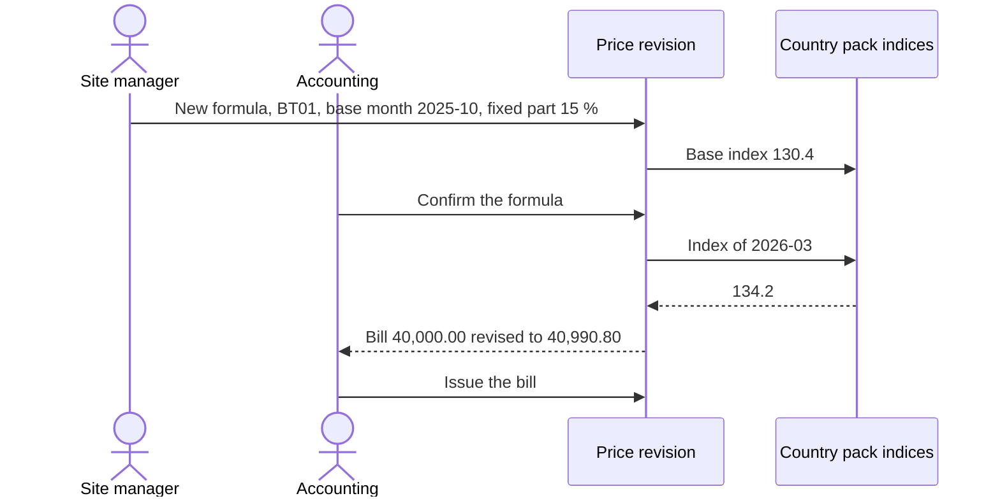

🏠 [Specs](../../../../README.md) › 🏷️ [Sectors](../../../README.md) › 🏗️ [SC01 Construction](../../README.md) ›
📝 [Use cases](../README.md) › 📝 [Use cases: FL-SC01-06 Price revision, off-plan sales, BIM and grants](README.md) ›
📝 UC-SC01-16 Revise prices with the BT and TP indices

# 📝 UC-SC01-16 Revise prices with the BT and TP indices

**Status:** 🔄 waiting for the owner

## Summary

The site manager and accounting revise the prices of a works contract with the building (BT) or public works (TP) index
its clause names. The formula of the contract (a fixed part and a variable part weighted by one or more indices) is kept
with its base month, and every progress bill is revised with the index of the month the contract says. When the index of
that month is not yet published, the bill is revised provisionally and corrected when it is.

## Personas

- [U22 Site manager](../../../../01-users/personas/u22-site-manager.md)
- [U05 Accounting](../../../../01-users/personas/u05-accounting.md)

## Goal

Every progress bill carries the revision its contract allows, computed from the published index of the right month, and
no revision is invented or forgotten.

## Trigger

A contract with a revision clause is signed, a progress bill is prepared, or a new monthly index is published.

## Frequency

One formula per contract with a clause; one revision per progress bill, monthly on a running site.

## Preconditions

- The site and its quote lots exist ([E-SC01-01 Construction site](../../data/e-sc01-01-construction-site.md),
  [E-SC01-02 Quote lot](../../data/e-sc01-02-quote-lot.md)).
- The contract states its revision clause: index series, base month, fixed part and weights.
- The index series of the country pack are loaded for the months concerned.

## Postconditions

- **Succeeded:** the formula is saved ([E-SC01-15 Revision formula](../../data/e-sc01-15-revision-formula.md)) and each
  progress bill ([E-SC01-06 Progress bill](../../data/e-sc01-06-progress-bill.md)) shows its revision with the index and
  the month used.
- **Failed:** no revision is applied, the bill keeps its unrevised amount and the missing index or clause detail is
  listed.

## Main flow

1. The site manager opens the price revision screen
   ([S-SC01-16](../../screens/06-revision-developers-bim-and-grants/s-sc01-16-price-revision.md)) on a site and creates
   the formula from the contract: the index series (BT or TP), the base month, the fixed part and the weight of each
   index.
2. SimpleERP reads the base index from the series of the country pack and shows the formula with its result on an
   example amount.
3. Accounting confirms the formula; it becomes Active and is attached to the contract's progress bills.
4. When a progress bill is prepared
   ([UC-SC01-06](../04-bill-and-subcontract/uc-sc01-06-bill-progress-with-the-retention-guarantee.md)), SimpleERP picks
   the index of the month the contract names for that bill
   ([BR-SC01-16](../../business-rules/br-sc01-16-revisions-use-the-index-of-the-contracts-month.md)) and computes the
   revision.
5. The bill shows the unrevised amount, the revision, the index and its month; accounting checks and issues it.
6. When the works are accepted and the last revision is settled, the formula is Closed.

## Alternative flows

- 4a. The index of the month is not published yet: the bill is revised with the last published index, marked
  provisional, and corrected by a later line when the real index appears.
- 1a. The contract asks for a price update (a single adjustment at a set date) instead of a revision of every bill: the
  formula is typed as an update and applied once.
- 1b. The clause has a cap or a floor on the total revision: the formula keeps it and the bill shows when it applies.

## Error flows

- 2e. The index series of the clause is not in the country pack: the formula stays Draft and asks for the series or its
  values to be entered by hand with their source.
- 4e. The month the contract names is before the base month: no revision is computed and the reason is shown.
- 5e. A provisional revision older than three months is still not corrected: accounting is reminded and the bill is
  flagged.
- Any step: a service does not answer; the call is retried first
  ([BR-F3-32](../../../../02-functional/f03-assistant/business-rules/br-f03-32-retry-before-an-error.md)), then the
  message follows the error pattern ([D122](../../../../06-decisions/ux/d122-error-message-standard.md)) and what the
  user typed stays on the screen.

## Business rules

- [BR-SC01-16](../../business-rules/br-sc01-16-revisions-use-the-index-of-the-contracts-month.md)
- [BR-SC01-03](../../business-rules/br-sc01-03-progress-bills-follow-progress.md)
- [BR-SC01-14 Margin at completion](../../business-rules/br-sc01-14-margin-at-completion.md)

## Entities

- [E-SC01-15 Revision formula](../../data/e-sc01-15-revision-formula.md): created, changed, closed
- [E-SC01-06 Progress bill](../../data/e-sc01-06-progress-bill.md): read and changed, the revision line of each progress
  bill
- [E-SC01-02 Quote lot](../../data/e-sc01-02-quote-lot.md): read, the amounts the formula applies to
- [E-SC01-01 Construction site](../../data/e-sc01-01-construction-site.md): read, the site and its contract dates

## Permissions

Site manager creates and changes a formula; accounting confirms it and issues the revised bills. The owner
reads every formula; a subcontractor sees nothing.

## Notifications

Accounting, in the app: a new index is published for a series with Active formulas, or a provisional revision waits for
its index.

## Audit events

Each formula created, confirmed or closed; each index value used by a bill, with its series, month and source; each
provisional revision and its correction; who and when.

## AI involvement

No AI step of its own. The AI assistant may open the screen and prefill it from the user's words; the user checks and
confirms
[BR-F3-07](../../../../02-functional/f03-assistant/business-rules/br-f03-07-no-deletes-no-irreversible-acts.md).

## API, MCP and A2A exposure

T5 operations of the capability for the personas above: create, read, update and list. The MCP tool of the
capability may read and propose, never confirm alone. No A2A skill.

## Screens

- [S-SC01-16](../../screens/06-revision-developers-bim-and-grants/s-sc01-16-price-revision.md)

## Flowchart

See
[FL-SC01-06 Price revision, off-plan sales, BIM and grants](../../flows/fl-sc01-06-revision-developers-bim-and-grants.md#flowchart).

## Sequence diagram

## Acceptance criteria

1. **Given** a formula with a fixed part of 15 %, a weight of 85 %, a base index of 130.4 and an index of 134.2 for the
   month of the bill **when** a progress bill of 40,000.00 EUR is revised **then** it shows 40,990.80 EUR with the index
   and its month.
2. **Given** the index of the bill's month is not yet published **when** the bill is prepared **then** it is revised
   with the last published index and marked provisional.
3. **Given** a provisional revision and the real index now published **when** the index is loaded **then** a correction
   line is proposed for the difference.
4. **Given** a clause naming a series the country pack does not hold **when** the formula is confirmed **then** it stays
   Draft and asks for the series.

## Non-functional notes

The screen answers within 2 seconds for 10,000 records; every change is audited.

## Regulatory references

A works contract may carry a clause that revises the price with the monthly building (BT) or public works
(TP) index published by the national statistics office; the clause names the index, the base month and the formula.
Public works contracts above a certain length must carry such a clause. The France-pack rule is listed below. Related:
[CR-FR-021](../../../../10-country-packs/france/invoicing/cr-fr-021-construction-retention-guarantee.md),
[CR-FR-091](../../../../10-country-packs/france/invoicing/cr-fr-091-public-contracts-payment-and-chorus-pro.md).

- France-pack rule, (Proposed) until its law is read:
  [CR-FR-224 Price revision with BT and TP indices](../../../../10-country-packs/france/construction/cr-fr-224-price-revision-indices.md)

## Related use cases

- [UC-SC01-17 Sell off-plan homes](uc-sc01-17-sell-off-plan-homes.md)
- [UC-SC01-02](../01-win-the-work/uc-sc01-02-quote-by-lots-and-unit-price-schedules.md)
- [UC-SC01-06](../04-bill-and-subcontract/uc-sc01-06-bill-progress-with-the-retention-guarantee.md)
- [UC-F8-20](../../../../02-functional/f08-accounting/use-cases/06-benchmark-additions/uc-f08-20-analyse-profitability.md)

## Open questions

None.

---

⬅️ [UC-SC01-15 Ask the AI assistant about a site](../03-run-the-site/uc-sc01-15-ask-the-assistant-about-a-site.md) ·
⬆️ [Up](README.md) · ➡️ [UC-SC01-17 Sell off-plan homes](uc-sc01-17-sell-off-plan-homes.md)
