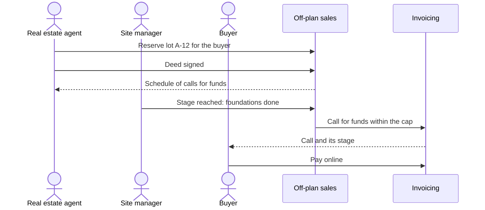

🏠 [Specs](../../../../README.md) › 🏷️ [Sectors](../../../README.md) › 🏗️ [SC01 Construction](../../README.md) ›
📝 [Use cases](../README.md) › 📝 [Use cases: FL-SC01-06 Price revision, off-plan sales, BIM and grants](README.md) ›
📝 UC-SC01-17 Sell off-plan homes

# 📝 UC-SC01-17 Sell off-plan homes

**Status:** ✅ specified

## Summary

A property developer sells homes before they are built (off-plan sales, in French VEFA). The real estate agent records
each lot, its reservation and the notarial deed; the customer follows the building stages from the phone and pays each
call for funds, which can never exceed the share the law allows at that stage of the works.

## Personas

- [U35 Real-estate agent](../../../../01-users/personas/u35-real-estate-agent.md)
- [U09 Customer](../../../../01-users/personas/u09-customer.md)

## Goal

Every lot is sold with its price, its payments and its works stage visible, and no call for funds asks more than the law
allows at the stage reached.

## Trigger

A developer opens a programme for sale, a buyer reserves a lot, or the site manager records a stage reached.

## Frequency

A programme of 10 to 60 lots over one to two years; one call for funds per stage and per lot.

## Preconditions

- The programme is a site of the company ([E-SC01-01 Construction site](../../data/e-sc01-01-construction-site.md)) with
  its stages planned ([E-SC01-03 Site phase](../../data/e-sc01-03-site-phase.md)).
- The lots and their prices are entered; the buyer is a customer record
  ([E-F6-01](../../../../02-functional/f06-customers-and-sales/data/e-f06-01-customer-record.md)).
- The financial completion guarantee of the programme is recorded.

## Postconditions

- **Succeeded:** the lot is saved ([E-SC01-16 Off-plan lot](../../data/e-sc01-16-off-plan-lot.md)) with its buyer, its
  price and its schedule of calls for funds; each call is invoiced when its stage is certified.
- **Failed:** the lot stays available, no call is sent, and the missing paper or the cap exceeded is shown.

## Main flow

1. The real estate agent opens the off-plan sales screen
   ([S-SC01-17](../../screens/06-revision-developers-bim-and-grants/s-sc01-17-off-plan-sales.md)) on a programme and
   sees its lots with their state (available, reserved, sold).
2. The agent reserves a lot for a buyer: price, reservation deposit and the date of the notarial deed.
3. After the deed, the lot is Sold and SimpleERP builds its schedule of calls for funds from the stages of the
   programme and the legal caps
   ([BR-SC01-17](../../business-rules/br-sc01-17-calls-for-funds-follow-the-legal-stage-caps.md)).
4. When the site manager certifies a stage, the matching call for funds is prepared and invoiced to the buyer
   [UC-F6-06](../../../../02-functional/f06-customers-and-sales/use-cases/03-invoice-and-get-paid/uc-f06-06-invoice-deposits-progress-and-final.md).
5. The buyer sees on the phone the stage reached, the call and what is paid; they pay online
   [UC-F6-07](../../../../02-functional/f06-customers-and-sales/use-cases/03-invoice-and-get-paid/uc-f06-07-get-paid-online-and-reconcile.md).
6. At delivery the balance is called, the lot is Delivered and its warranties start
   [UC-SC01-11](../05-hand-over-and-follow-up/uc-sc01-11-hand-over-the-as-built-file-and-follow-the-warranties.md).

## Alternative flows

- 2a. The buyer withdraws during the reflection period: the deposit is returned and the lot is Available again.
- 4a. A stage is certified late: the call waits and the buyer is told the new date.
- 3a. A buyer changes the finishing options: the price and the schedule are recomputed and signed again.

## Error flows

- 3e. The financial completion guarantee is missing: the deed date cannot be set and the missing paper is named.
- 4e. A call would bring the total above the cap of its stage: it is cut to the allowed amount and the difference moves
  to the next stage.
- 5e. The buyer does not pay a call: the usual reminders start
  [UC-F6-08](../../../../02-functional/f06-customers-and-sales/use-cases/03-invoice-and-get-paid/uc-f06-08-remind-late-payers.md)
  and the lot is flagged.
- Any step: a service does not answer; the call is retried first
  ([BR-F3-32](../../../../02-functional/f03-assistant/business-rules/br-f03-32-retry-before-an-error.md)), then the
  message follows the error pattern ([D122](../../../../06-decisions/ux/d122-error-message-standard.md)) and what the
  user typed stays on the screen.

## Business rules

- [BR-SC01-17](../../business-rules/br-sc01-17-calls-for-funds-follow-the-legal-stage-caps.md)
- [BR-SC01-03](../../business-rules/br-sc01-03-progress-bills-follow-progress.md)
- [BR-SC01-10](../../business-rules/br-sc01-10-acceptance-starts-the-warranties.md)

## Entities

- [E-SC01-16 Off-plan lot](../../data/e-sc01-16-off-plan-lot.md): created, changed
- [E-SC01-03 Site phase](../../data/e-sc01-03-site-phase.md): read, the stages that release each call
- [E-F6-05 Invoice](../../../../02-functional/f06-customers-and-sales/data/e-f06-05-invoice.md): created, the invoice of
  each call
- [E-F6-01](../../../../02-functional/f06-customers-and-sales/data/e-f06-01-customer-record.md): read, the buyer

## Permissions

Real estate agent creates and changes lots and reservations; site manager certifies stages; accounting invoices.
The buyer sees only their own lot, through the customer portal.

## Notifications

The buyer, by email and in the portal: a stage is reached and its call is due. The real estate agent: a call is unpaid
after its date.

## Audit events

Each lot created, reserved, sold or delivered; each stage certified; each call computed, cut and issued, with who and
when.

## AI involvement

No AI step of its own. The AI assistant may open the screen and prefill it from the user's words; the user checks and
confirms
[BR-F3-07](../../../../02-functional/f03-assistant/business-rules/br-f03-07-no-deletes-no-irreversible-acts.md).

## API, MCP and A2A exposure

T5 operations of the capability for the personas above: create, read, update and list. The MCP tool of the
capability may read and propose, never confirm alone. No A2A skill.

## Screens

- [S-SC01-17](../../screens/06-revision-developers-bim-and-grants/s-sc01-17-off-plan-sales.md)

## Flowchart

See
[FL-SC01-06 Price revision, off-plan sales, BIM and grants](../../flows/fl-sc01-06-revision-developers-bim-and-grants.md#flowchart).

## Sequence diagram

## Acceptance criteria

1. **Given** a lot at 300,000.00 EUR and a first-stage cap of 35 % in the programme's rule data **when** the foundations
   are certified **then** the first call is at most 105,000.00 EUR.
2. **Given** calls already paid for 70 % and a stage that allows 70 % **when** the next call is computed **then** it is
   0.00 EUR and the stage shows fully called.
3. **Given** a programme with no completion guarantee recorded **when** the agent sets a deed date **then** the date is
   refused with the missing guarantee.
4. **Given** a buyer who withdraws inside the reflection period **when** the agent records it **then** the deposit is
   returned and the lot becomes Available.

## Non-functional notes

The screen answers within 2 seconds for 10,000 records; every change is audited.

## Regulatory references

In an off-plan sale the seller may call for funds only as the works advance, up to a ceiling that rises with
each stage and leaves a balance for delivery. The reservation deposit is held aside, the buyer has a reflection period,
and a financial completion guarantee protects the buyer. The ceilings are kept as data of the France pack, not in the
page. The France-pack rule is listed below. Related:
[CR-FR-090](../../../../10-country-packs/france/construction/cr-fr-090-builders-warranties.md).

- France-pack rule:
  [CR-FR-225 Off-plan sales (VEFA) calls for funds](../../../../10-country-packs/france/real-estate/cr-fr-225-off-plan-sales.md)

## Related use cases

- [UC-SC01-16](uc-sc01-16-revise-prices-with-the-bt-and-tp-indices.md)
- [UC-SC01-18 Take quantities from a BIM model](uc-sc01-18-take-quantities-from-a-bim-model.md)
- [UC-SC10-01](../../../sc10-real-estate/use-cases/01-mandates-and-listings/uc-sc10-01-take-a-mandate-and-record-it-in-the-register.md)

## Open questions

None.

---

⬅️ [UC-SC01-16 Revise prices with the BT and TP indices](uc-sc01-16-revise-prices-with-the-bt-and-tp-indices.md) ·
⬆️ [Up](README.md) · ➡️ [UC-SC01-18 Take quantities from a BIM model](uc-sc01-18-take-quantities-from-a-bim-model.md)
