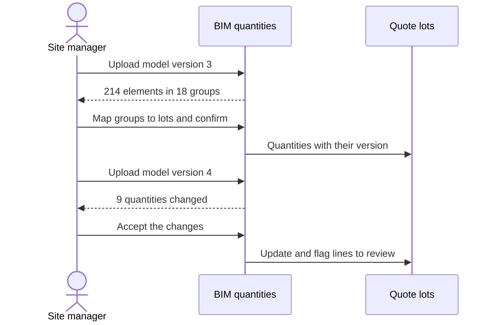

🏠 [Specs](../../../../README.md) › 🏷️ [Sectors](../../../README.md) › 🏗️ [SC01 Construction](../../README.md) ›
📝 [Use cases](../README.md) › 📝 [Use cases: FL-SC01-06 Price revision, off-plan sales, BIM and grants](README.md) ›
📝 UC-SC01-18 Take quantities from a BIM model

# 📝 UC-SC01-18 Take quantities from a BIM model

**Status:** ✅ specified

## Summary

The site manager imports a building information model (BIM) and takes quantities from it (areas, volumes, lengths,
counts) to fill the lots of a quote. Each quantity keeps its link to the model version it came from, so that when the
architect sends a new version, SimpleERP shows what changed and which quote lines to review.

## Personas

- [U22 Site manager](../../../../01-users/personas/u22-site-manager.md)

## Goal

Quotes start from measured quantities instead of retyped ones, and every change of the model is seen before it reaches a
price.

## Trigger

An architect or a design office sends a model, or a new version of it, for a site or a quote.

## Frequency

One import per quote, then one per model version, a few a month on a busy site.

## Preconditions

- The site or quote exists ([E-SC01-01 Construction site](../../data/e-sc01-01-construction-site.md),
  [E-SC01-02 Quote lot](../../data/e-sc01-02-quote-lot.md)).
- The model is an open exchange file (an IFC file) of an accepted version.

## Postconditions

- **Succeeded:** the import is saved ([E-SC01-17 BIM import](../../data/e-sc01-17-bim-import.md)) with its version and
  its quantities; the quote lots show the linked quantities and their source.
- **Failed:** nothing is added to the quote; the file's problems are listed and the previous version stays in use.

## Main flow

1. The site manager opens the BIM quantities screen
   ([S-SC01-18](../../screens/06-revision-developers-bim-and-grants/s-sc01-18-bim-quantities.md)) and uploads the model
   file for a quote.
2. SimpleERP reads the elements, groups them by type and floor, and proposes quantities per quote lot (slab area, wall
   length, door count).
3. The site manager maps each group to a quote lot and a unit of the schedule, then confirms; the quantities enter the
   lots with a link to the model version
   ([BR-SC01-18](../../business-rules/br-sc01-18-quantities-keep-a-link-to-the-model-version.md)).
4. A new version arrives: the site manager imports it and SimpleERP compares it with the version in use, listing each
   quantity that moved.
5. The site manager accepts or refuses each change; accepted changes update the quote lots and flag the lines whose
   price needs a review.
6. The version in use is kept as the quote's reference.

## Alternative flows

- 2a. An element has no matching lot: it is listed as unmapped and priced only when the site manager adds a lot for it.
- 4a. The change is a different floor layout: the whole group is shown as removed and added, not as a quantity change.
- 3a. The model uses another unit (square feet): quantities are converted to the schedule's unit and the conversion is
  shown.

## Error flows

- 1e. The file is not a readable model: the import is refused with the reason and the previous version stays.
- 5e. A quote line already signed by the customer would change: the change is held until an amendment is created
  ([UC-SC01-02](../01-win-the-work/uc-sc01-02-quote-by-lots-and-unit-price-schedules.md)).
- 2e. A group has no quantity for its unit (a wall with no length): it is listed with the missing measure.
- Any step: a service does not answer; the call is retried first
  ([BR-F3-32](../../../../02-functional/f03-assistant/business-rules/br-f03-32-retry-before-an-error.md)), then the
  message follows the error pattern ([D122](../../../../06-decisions/ux/d122-error-message-standard.md)) and what the
  user typed stays on the screen.

## Business rules

- [BR-SC01-18](../../business-rules/br-sc01-18-quantities-keep-a-link-to-the-model-version.md)
- [BR-SC01-03](../../business-rules/br-sc01-03-progress-bills-follow-progress.md)

## Entities

- [E-SC01-17 BIM import](../../data/e-sc01-17-bim-import.md): created, changed
- [E-SC01-02 Quote lot](../../data/e-sc01-02-quote-lot.md): changed, the quantities of each lot with their source
- [E-SC01-01 Construction site](../../data/e-sc01-01-construction-site.md): read, the site

## Permissions

Site manager imports and maps; sales reads the quantities; the owner reads imports. An architect outside the
company sends files through the portal and sees nothing else.

## Notifications

The site manager, in the app: a new model version changed N quantities of a quote.

## Audit events

Each file imported, each version compared, each quantity accepted or refused, with who and when.

## AI involvement

No AI step of its own. The AI assistant may open the screen and prefill it from the user's words; the user checks and
confirms
[BR-F3-07](../../../../02-functional/f03-assistant/business-rules/br-f03-07-no-deletes-no-irreversible-acts.md).

## API, MCP and A2A exposure

T5 operations of the capability for the personas above: create, read, update and list. The MCP tool of the
capability may read and propose, never confirm alone. No A2A skill.

## Screens

- [S-SC01-18](../../screens/06-revision-developers-bim-and-grants/s-sc01-18-bim-quantities.md)

## Flowchart

See
[FL-SC01-06 Price revision, off-plan sales, BIM and grants](../../flows/fl-sc01-06-revision-developers-bim-and-grants.md#flowchart).

## Sequence diagram

## Acceptance criteria

1. **Given** a model with a slab of 412.6 m2 mapped to the lot Slabs **when** the import is confirmed **then** the lot
   shows 412.6 m2 and the version it came from.
2. **Given** a new version where the slab is 428.1 m2 **when** it is imported **then** the change of +15.5 m2 is listed
   and the line is flagged for review.
3. **Given** a file that is not a readable model **when** it is uploaded **then** it is refused and version 3 stays in
   use.
4. **Given** a signed quote line affected by a change **when** the change is accepted **then** it is held until an
   amendment exists.

## Non-functional notes

The screen answers within 2 seconds for 10,000 records; every change is audited.

## Regulatory references

None specific to this use case beyond the rules above.

## Related use cases

- [UC-SC01-17 Sell off-plan homes](uc-sc01-17-sell-off-plan-homes.md)
- [UC-SC01-19 Prepare renovation grant files](uc-sc01-19-prepare-renovation-grant-files.md)
- [UC-SC01-02](../01-win-the-work/uc-sc01-02-quote-by-lots-and-unit-price-schedules.md)
- [UC-SC01-03 Plan the site](../02-prepare-the-site/uc-sc01-03-plan-the-site.md)

## Open questions

None.

---

⬅️ [UC-SC01-17 Sell off-plan homes](uc-sc01-17-sell-off-plan-homes.md) · ⬆️ [Up](README.md) ·
➡️ [UC-SC01-19 Prepare renovation grant files](uc-sc01-19-prepare-renovation-grant-files.md)
