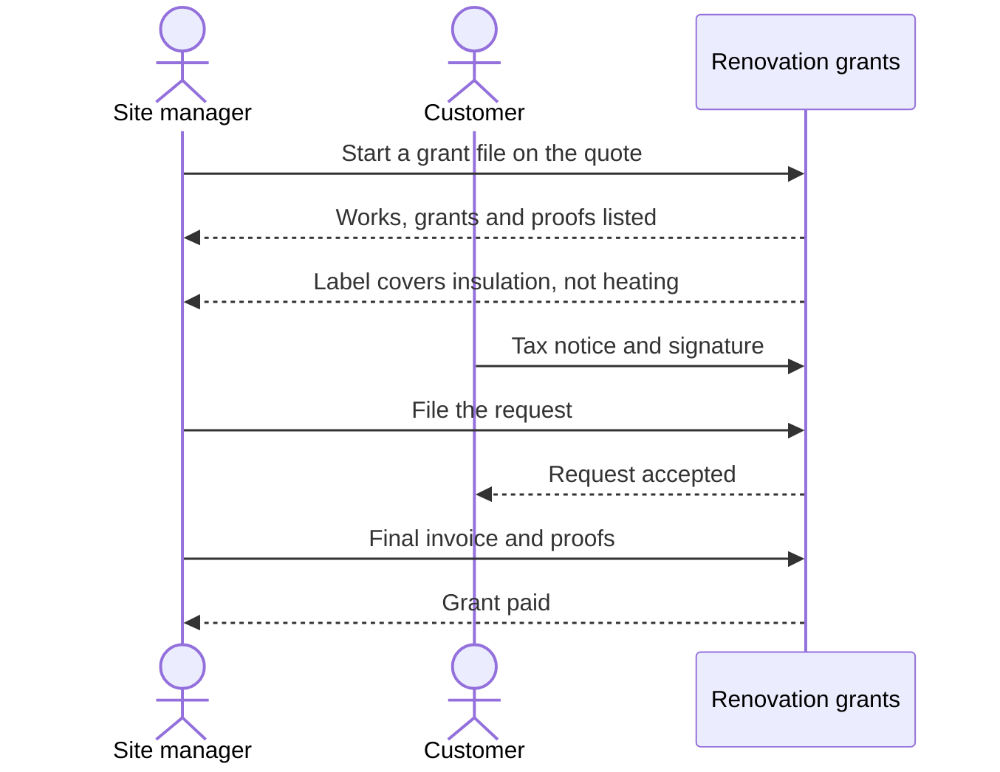

🏠 [Specs](../../../../README.md) › 🏷️ [Sectors](../../../README.md) › 🏗️ [SC01 Construction](../../README.md) ›
📝 [Use cases](../README.md) › 📝 [Use cases: FL-SC01-06 Price revision, off-plan sales, BIM and grants](README.md) ›
📝 UC-SC01-19 Prepare renovation grant files

# 📝 UC-SC01-19 Prepare renovation grant files

**Status:** 🔄 waiting for the owner

## Summary

A renovation company prepares the grant files of its customers: the national renovation grant (MaPrimeRénov) and the
energy-saving certificate premiums (CEE). The file lists the works, the customer's resources and the proofs, and the
company checks that it holds the RGE label for each domain of work on the day the quote is signed.

## Personas

- [U22 Site manager](../../../../01-users/personas/u22-site-manager.md)
- [U09 Customer](../../../../01-users/personas/u09-customer.md)

## Goal

A customer's grant file is complete, filed in time and backed by a company that holds the label the grant requires, so
the grant is not refused afterwards.

## Trigger

A customer asks for a renovation quote with a grant, or the site manager prepares a grant file for a signed quote.

## Frequency

One file per renovation job, tens a month for a company that renovates housing.

## Preconditions

- The quote exists and lists energy-saving works
  ([UC-SC01-12](../01-win-the-work/uc-sc01-12-sell-renovation-to-consumers.md)).
- The company's labels and their domains and end dates are recorded in its company record.

## Postconditions

- **Succeeded:** the file is saved ([E-SC01-18 Grant file](../../data/e-sc01-18-grant-file.md)) with its works, its
  proofs and its filing date; the customer sees its progress on the phone.
- **Failed:** the file stays a draft; the missing label, proof or filing is listed and the quote is not signed as a
  grant job.

## Main flow

1. The site manager opens the renovation grants screen
   ([S-SC01-19](../../screens/06-revision-developers-bim-and-grants/s-sc01-19-renovation-grants.md)) on a quote and
   starts a grant file for the customer.
2. SimpleERP lists the works, the grants each work may open and the proofs asked (invoice, technical data sheet, label
   certificate).
3. SimpleERP checks the company's labels against the works on the day the quote is to be signed
   ([BR-SC01-19](../../business-rules/br-sc01-19-grants-need-the-rge-label-at-signature.md)) and shows each domain as
   covered or not.
4. The customer, on the phone, adds their tax notice and signs the file with the quote
   [UC-F6-04](../../../../02-functional/f06-customers-and-sales/use-cases/02-quote-to-order/uc-f06-04-accept-or-sign-a-quote.md).
5. The site manager files the grant request before the works start and records the filing number; the works can begin
   once the request is accepted.
6. After the works, the site manager attaches the final invoice and proofs and asks for payment; the grant is recorded
   as paid.

## Alternative flows

- 3a. A subcontractor with the label does the work: the subcontractor's label and end date are recorded in the file and
  checked in the same way.
- 5a. The customer is paid the grant directly: the file shows the net amount of the invoice instead of the grant to
  collect.
- 6a. The grant is refused: the reason is recorded and the customer is told before any further work.

## Error flows

- 3e. The label does not cover the domain or has expired on the signature date: the quote cannot be signed as a grant
  job and the gap is shown.
- 5e. The works started before the request was accepted: the file is flagged as at risk and the customer is told.
- 4e. The customer's resources are missing: the file cannot be filed and lists what is needed.
- Any step: a service does not answer; the call is retried first
  ([BR-F3-32](../../../../02-functional/f03-assistant/business-rules/br-f03-32-retry-before-an-error.md)), then the
  message follows the error pattern ([D122](../../../../06-decisions/ux/d122-error-message-standard.md)) and what the
  user typed stays on the screen.

## Business rules

- [BR-SC01-19](../../business-rules/br-sc01-19-grants-need-the-rge-label-at-signature.md)
- [BR-SC01-05](../../business-rules/br-sc01-05-reduced-vat-needs-the-certificate.md)

## Entities

- [E-SC01-18 Grant file](../../data/e-sc01-18-grant-file.md): created, changed
- [E-SC01-01 Construction site](../../data/e-sc01-01-construction-site.md): read, the site and its works
- [E-F6-03 Quote](../../../../02-functional/f06-customers-and-sales/data/e-f06-03-quote.md): read, the signed quote
- [E-F6-01](../../../../02-functional/f06-customers-and-sales/data/e-f06-01-customer-record.md): read, the customer

## Permissions

Site manager prepares the file; sales signs the quote; accounting records the payment. The customer sees
their own file and adds their documents through the portal.

## Notifications

The customer, by email and in the portal: a document is missing, the request is accepted or refused, the grant is paid.
The site manager: a label ends in 60 days.

## Audit events

Each file created, filed, accepted, refused or paid; each label check with its result and date; each document added,
with who and when.

## AI involvement

No AI step of its own. The AI assistant may open the screen and prefill it from the user's words; the user checks and
confirms
[BR-F3-07](../../../../02-functional/f03-assistant/business-rules/br-f03-07-no-deletes-no-irreversible-acts.md).

## API, MCP and A2A exposure

T5 operations of the capability for the personas above: create, read, update and list. The MCP tool of the
capability may read and propose, never confirm alone. No A2A skill.

## Screens

- [S-SC01-19](../../screens/06-revision-developers-bim-and-grants/s-sc01-19-renovation-grants.md)

## Flowchart

See
[FL-SC01-06 Price revision, off-plan sales, BIM and grants](../../flows/fl-sc01-06-revision-developers-bim-and-grants.md#flowchart).

## Sequence diagram

## Acceptance criteria

1. **Given** a label for insulation valid to 2027-03-31 and a quote signed on 2026-11-20 **when** the file is checked
   **then** the insulation domain is covered.
2. **Given** a label for insulation only and heating works on the quote **when** the quote is to be signed **then** the
   heating works are shown as not covered and the signature as a grant job is blocked.
3. **Given** a label that ended on 2026-10-31 and a signature on 2026-11-20 **when** the file is checked **then** no
   domain is covered and the end date is shown.
4. **Given** works started before the request is accepted **when** the site manager records the start **then** the file
   is flagged at risk.

## Non-functional notes

The screen answers within 2 seconds for 10,000 records; every change is audited.

## Regulatory references

The national renovation grant and the energy-saving certificate premiums are paid for works done by a company
holding the RGE quality label for the domain of the work; the label's validity is checked on the day the quote is
signed, and a grant request is filed before the works start. The France-pack rule is listed below. Related:
[CR-FR-084](../../../../10-country-packs/france/tax-and-vat/cr-fr-084-renovation-reduced-vat.md).

- France-pack rule, (Proposed) until its law is read:
  [CR-FR-226 Renovation grants and the RGE label](../../../../10-country-packs/france/construction/cr-fr-226-renovation-grants-and-rge.md)

## Related use cases

- [UC-SC01-18 Take quantities from a BIM model](uc-sc01-18-take-quantities-from-a-bim-model.md)
- [UC-SC01-12](../01-win-the-work/uc-sc01-12-sell-renovation-to-consumers.md)
- [UC-SC01-07 Subcontract](../04-bill-and-subcontract/uc-sc01-07-subcontract.md)
- [UC-SC01-17 Sell off-plan homes](uc-sc01-17-sell-off-plan-homes.md)

## Open questions

None.

---

⬅️ [UC-SC01-18 Take quantities from a BIM model](uc-sc01-18-take-quantities-from-a-bim-model.md) · ⬆️ [Up](README.md)
