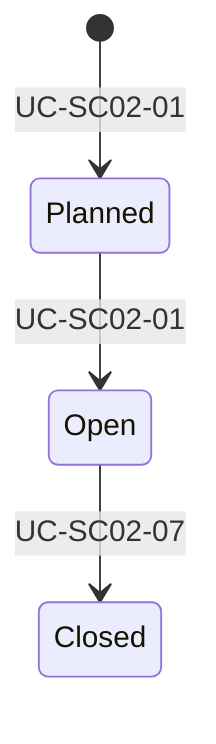

🏠 [Specs](../../../README.md) › 🏷️ [Sectors](../../README.md) › 🛍️ [SC02 Retail](../README.md) › 🗃️ [Data](README.md) ›
🗃️ E-SC02-01 Store

# 🗃️ E-SC02-01 Store

**Status:** ✅ specified

## Purpose

A shop of the company.

## Fields

| Name | Type | Required | Validation | Default | Example | Personal data | Custom fields |
|---|---|---|---|---|---|---|---|
| name, address | text | yes | unique name | - | Lyon 2, rue de la République | no | yes |
| surface | m2 | yes | > 0 | - | 420 | no | no |
| hours, exemptions | schedule, list | no | BR-SC02-11 | - | mayor's Sundays | no | no |
| state | planned, open, closed | yes | - | planned | open | no | no |

## Relations

As its use cases.

## Lifecycle

## Indexes and search

By number, date, partner.

## Retention

Kept for the period of its kind of record in the country pack (D293), or else its kind's default in the
[retention schedule](../../../05-non-functional/data-retention.md).

## Audit

Every change.

## Import and export

CSV, FEC where relevant.

## Used by

- [UC-SC02-01](../use-cases/01-set-up-the-stores/uc-sc02-01-set-up-stores-and-their-assortments.md)
- [UC-SC02-07](../use-cases/02-keep-stock-right/uc-sc02-07-count-stock-in-store.md)
- [UC-SC02-08](../use-cases/03-sell-and-return-across-channels/uc-sc02-08-sell-across-channels.md)
- [UC-SC02-09](../use-cases/03-sell-and-return-across-channels/uc-sc02-09-return-across-channels.md)
- [UC-SC02-12](../use-cases/04-customers-and-staff/uc-sc02-12-plan-staff-schedules-and-sunday-openings.md)
- [UC-SC02-14](../use-cases/05-unsold-goods-and-performance/uc-sc02-14-follow-store-performance.md)
- [UC-SC02-15](../use-cases/05-unsold-goods-and-performance/uc-sc02-15-ask-the-assistant-about-a-store.md)

## Open questions

None.

---

⬆️ [Up](README.md) · ➡️ [E-SC02-02 Assortment](e-sc02-02-assortment.md)
