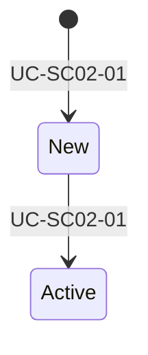

🏠 [Specs](../../../README.md) › 🏷️ [Sectors](../../README.md) › 🛍️ [SC02 Retail](../README.md) › 🗃️ [Data](README.md) ›
🗃️ E-SC02-02 Assortment

# 🗃️ E-SC02-02 Assortment

**Status:** ✅ specified

## Purpose

The products a store sells.

## Fields

| Name | Type | Required | Validation | Default | Example | Personal data | Custom fields |
|---|---|---|---|---|---|---|---|
| store | store | yes | - | - | Lyon 2 | no | no |
| products or categories | list | yes | - | - | Women, Home | no | no |
| from, to | dates | no | - | - | SS27 | no | no |

## Relations

As its use cases.

## Lifecycle

## Indexes and search

By number, date, partner.

## Retention

Kept for the period of its kind of record in the country pack (D293), or else its kind's default in the
[retention schedule](../../../05-non-functional/data-retention.md).

## Audit

Every change.

## Import and export

CSV, FEC where relevant.

## Used by

- [UC-SC02-01](../use-cases/01-set-up-the-stores/uc-sc02-01-set-up-stores-and-their-assortments.md)

## Open questions

None.

---

⬅️ [E-SC02-01 Store](e-sc02-01-store.md) · ⬆️ [Up](README.md) · ➡️ [E-SC02-03 Product grid](e-sc02-03-product-grid.md)
