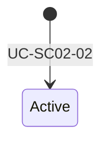

🏠 [Specs](../../../README.md) › 🏷️ [Sectors](../../README.md) › 🛍️ [SC02 Retail](../README.md) › 🗃️ [Data](README.md) ›
🗃️ E-SC02-03 Product grid

# 🗃️ E-SC02-03 Product grid

**Status:** 🔄 waiting for the owner

## Purpose

Sizes and colours of a product.

## Fields

| Name | Type | Required | Validation | Default | Example | Personal data | Custom fields |
|---|---|---|---|---|---|---|---|
| product | product | yes | - | - | Shirt S1 | no | no |
| sizes, colours | lists | yes | - | - | S to XL, blue, white | no | no |
| variant codes | barcodes | yes | unique | - | 3700... | no | no |

## Relations

(Proposed) As its use cases.

## Lifecycle

## Indexes and search

(Proposed) By number, date, partner.

## Retention

Kept for the period of its kind of record in the country pack (D293), or else its kind's default in the
[retention schedule](../../../05-non-functional/data-retention.md).

## Audit

Every change.

## Import and export

(Proposed) CSV, FEC where relevant.

## Used by

- [UC-SC02-02](../use-cases/01-set-up-the-stores/uc-sc02-02-manage-size-and-colour-grids-and-seasons.md)

## Open questions

None.

---

⬅️ [E-SC02-02 Assortment](e-sc02-02-assortment.md) · ⬆️ [Up](README.md) · ➡️ [E-SC02-04 Season](e-sc02-04-season.md)
