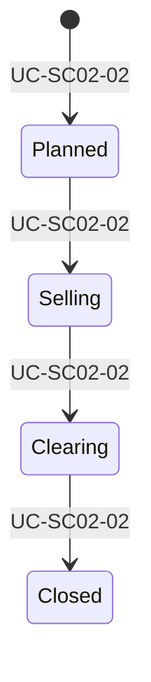

🏠 [Specs](../../../README.md) › 🏷️ [Sectors](../../README.md) › 🛍️ [SC02 Retail](../README.md) › 🗃️ [Data](README.md) ›
🗃️ E-SC02-04 Season

# 🗃️ E-SC02-04 Season

**Status:** ✅ specified

## Purpose

A collection period.

## Fields

| Name | Type | Required | Validation | Default | Example | Personal data | Custom fields |
|---|---|---|---|---|---|---|---|
| name | text | yes | unique | - | Spring-summer 2027 | no | no |
| dates | from, to | yes | - | - | Feb to Jul | no | no |
| state | planned, selling, clearing, closed | yes | - | planned | selling | no | no |

## Relations

As its use cases.

## Lifecycle

## Indexes and search

By number, date, partner.

## Retention

Kept for the period of its kind of record in the country pack (D293), or else its kind's default in the
[retention schedule](../../../05-non-functional/data-retention.md).

## Audit

Every change.

## Import and export

CSV, FEC where relevant.

## Used by

- [UC-SC02-02](../use-cases/01-set-up-the-stores/uc-sc02-02-manage-size-and-colour-grids-and-seasons.md)

## Open questions

None.

---

⬅️ [E-SC02-03 Product grid](e-sc02-03-product-grid.md) · ⬆️ [Up](README.md) ·
➡️ [E-SC02-05 Replenishment rule](e-sc02-05-replenishment-rule.md)
