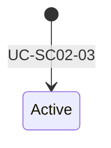

🏠 [Specs](../../../README.md) › 🏷️ [Sectors](../../README.md) › 🛍️ [SC02 Retail](../README.md) › 🗃️ [Data](README.md) ›
🗃️ E-SC02-05 Replenishment rule

# 🗃️ E-SC02-05 Replenishment rule

**Status:** 🔄 waiting for the owner

## Purpose

Min and max of a product in a store.

## Fields

| Name | Type | Required | Validation | Default | Example | Personal data | Custom fields |
|---|---|---|---|---|---|---|---|
| store, product | records | yes | unique pair | - | Lyon 2, Shirt S1 M | no | no |
| min, max | numbers | yes | min <= max | - | 2, 6 | no | no |

## Relations

(Proposed) As its use cases.

## Lifecycle

## Indexes and search

(Proposed) By number, date, partner.

## Retention

Kept for the period of its kind of record in the country pack (D293), or else its kind's default in the
[retention schedule](../../../05-non-functional/data-retention.md).

## Audit

Every change.

## Import and export

(Proposed) CSV, FEC where relevant.

## Used by

- [UC-SC02-03](../use-cases/02-keep-stock-right/uc-sc02-03-replenish-stores-from-the-warehouse.md)

## Open questions

None.

---

⬅️ [E-SC02-04 Season](e-sc02-04-season.md) · ⬆️ [Up](README.md) ·
➡️ [E-SC02-06 Store transfer](e-sc02-06-store-transfer.md)
