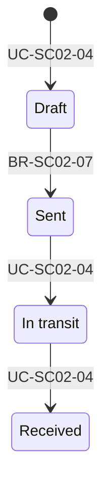

🏠 [Specs](../../../README.md) › 🏷️ [Sectors](../../README.md) › 🛍️ [SC02 Retail](../README.md) › 🗃️ [Data](README.md) ›
🗃️ E-SC02-06 Store transfer

# 🗃️ E-SC02-06 Store transfer

**Status:** 🔄 waiting for the owner

## Purpose

Stock moved between stores.

## Fields

| Name | Type | Required | Validation | Default | Example | Personal data | Custom fields |
|---|---|---|---|---|---|---|---|
| from, to | stores | yes | different | - | Lyon 2 to Lyon 1 | no | no |
| lines | product, quantity | yes | > 0 | - | 3 x Shirt S1 M | no | no |
| state | draft, sent, in transit, received | yes | BR-SC02-07 | draft | received | no | no |

## Relations

(Proposed) As its use cases.

## Lifecycle

## Indexes and search

(Proposed) By number, date, partner.

## Retention

As an accounting record:
[CR-FR-002 Accounting records kept 10 years](../../../10-country-packs/france/accounting/cr-fr-002-accounting-records-kept-ten-years.md).

## Audit

Every change.

## Import and export

(Proposed) CSV, FEC where relevant.

## Used by

- [UC-SC02-04](../use-cases/02-keep-stock-right/uc-sc02-04-transfer-stock-between-stores.md)
- [UC-SC02-15](../use-cases/05-unsold-goods-and-performance/uc-sc02-15-ask-the-assistant-about-a-store.md)

## Open questions

None.

---

⬅️ [E-SC02-05 Replenishment rule](e-sc02-05-replenishment-rule.md) · ⬆️ [Up](README.md) ·
➡️ [E-SC02-07 Shelf label](e-sc02-07-shelf-label.md)
