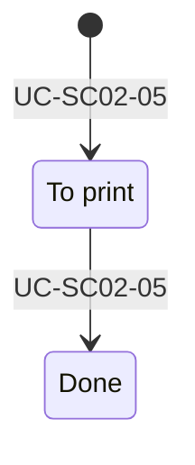

🏠 [Specs](../../../README.md) › 🏷️ [Sectors](../../README.md) › 🛍️ [SC02 Retail](../README.md) › 🗃️ [Data](README.md) ›
🗃️ E-SC02-07 Shelf label

# 🗃️ E-SC02-07 Shelf label

**Status:** ✅ specified

## Purpose

A label to print or update.

## Fields

| Name | Type | Required | Validation | Default | Example | Personal data | Custom fields |
|---|---|---|---|---|---|---|---|
| product, store | records | yes | - | - | Coffee 250 g, Lyon 2 | no | no |
| price, unit price | amounts | yes | BR-SC02-02 | - | 4.20, 16.80/kg | no | no |
| state | to print, done | yes | - | to print | done | no | no |

## Relations

As its use cases.

## Lifecycle

## Indexes and search

By number, date, partner.

## Retention

Kept for the period of its kind of record in the country pack (D293), or else its kind's default in the
[retention schedule](../../../05-non-functional/data-retention.md).

## Audit

Every change.

## Import and export

CSV, FEC where relevant.

## Used by

- [UC-SC02-05](../use-cases/01-set-up-the-stores/uc-sc02-05-print-shelf-labels-with-unit-prices.md)

## Open questions

None.

---

⬅️ [E-SC02-06 Store transfer](e-sc02-06-store-transfer.md) · ⬆️ [Up](README.md) ·
➡️ [E-SC02-08 Markdown](e-sc02-08-markdown.md)
