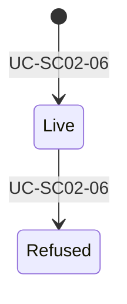

🏠 [Specs](../../../README.md) › 🏷️ [Sectors](../../README.md) › 🛍️ [SC02 Retail](../README.md) › 🗃️ [Data](README.md) ›
🗃️ E-SC02-08 Markdown

# 🗃️ E-SC02-08 Markdown

**Status:** 🔄 waiting for the owner

## Purpose

A price reduction over a period.

## Fields

| Name | Type | Required | Validation | Default | Example | Personal data | Custom fields |
|---|---|---|---|---|---|---|---|
| kind | sales period, promotion, clearance | yes | BR-SC02-04 | promotion | sales period | no | no |
| products, rate | list, percent | yes | - | - | SS26, -30 % | no | no |
| reference price | amount | yes | BR-SC02-05 | - | 39.90 | no | no |

## Relations

(Proposed) As its use cases.

## Lifecycle

## Indexes and search

(Proposed) By number, date, partner.

## Retention

Kept for the period of its kind of record in the country pack (D293), or else its kind's default in the
[retention schedule](../../../05-non-functional/data-retention.md).

## Audit

Every change.

## Import and export

(Proposed) CSV, FEC where relevant.

## Used by

- [UC-SC02-06](../use-cases/01-set-up-the-stores/uc-sc02-06-run-sales-periods-and-markdowns.md)

## Open questions

None.

---

⬅️ [E-SC02-07 Shelf label](e-sc02-07-shelf-label.md) · ⬆️ [Up](README.md) ·
➡️ [E-SC02-09 Store target](e-sc02-09-store-target.md)
