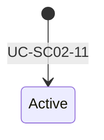

🏠 [Specs](../../../README.md) › 🏷️ [Sectors](../../README.md) › 🛍️ [SC02 Retail](../README.md) › 🗃️ [Data](README.md) ›
🗃️ E-SC02-09 Store target

# 🗃️ E-SC02-09 Store target

**Status:** 🔄 waiting for the owner

## Purpose

A store's sales target split by day and staff member; the target and commission plan themselves are the shared
[E-F6-18 Commission plan and target](../../../02-functional/f06-customers-and-sales/data/e-f06-18-commission-plan-and-target.md).

## Fields

| Name | Type | Required | Validation | Default | Example | Personal data | Custom fields |
|---|---|---|---|---|---|---|---|
| store, staff, period | records | yes | - | - | Lyon 2, L. B., Nov | yes | no |
| amount | amount | yes | >= 0 | - | 42 000 | no | no |

## Relations

(Proposed) As its use cases.

## Lifecycle

## Indexes and search

(Proposed) By number, date, partner.

## Retention

Kept for the period of its kind of record in the country pack (D293), or else its kind's default in the
[retention schedule](../../../05-non-functional/data-retention.md).

## Audit

Every change.

## Import and export

(Proposed) CSV, FEC where relevant.

## Used by

- [UC-SC02-11](../use-cases/04-customers-and-staff/uc-sc02-11-set-store-targets-and-follow-sales-per-staff.md)

## Open questions

None.

---

⬅️ [E-SC02-08 Markdown](e-sc02-08-markdown.md) · ⬆️ [Up](README.md) ·
➡️ [E-SC02-10 Unsold goods donation](e-sc02-10-unsold-goods-donation.md)
