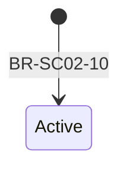

🏠 [Specs](../../../README.md) › 🏷️ [Sectors](../../README.md) › 🛍️ [SC02 Retail](../README.md) › 🗃️ [Data](README.md) ›
🗃️ E-SC02-10 Unsold goods donation

# 🗃️ E-SC02-10 Unsold goods donation

**Status:** 🔄 waiting for the owner

## Purpose

A donation or recycling of unsold goods.

## Fields

| Name | Type | Required | Validation | Default | Example | Personal data | Custom fields |
|---|---|---|---|---|---|---|---|
| store, partner | records | yes | BR-SC02-10 | - | Lyon 2, Restos | no | no |
| lines | product, quantity | yes | - | - | 24 shampoos | no | no |
| slip | file | yes | - | - | slip-118.pdf | no | no |

## Relations

(Proposed) As its use cases.

## Lifecycle

## Indexes and search

(Proposed) By number, date, partner.

## Retention

As an accounting record:
[CR-FR-002 Accounting records kept 10 years](../../../10-country-packs/france/accounting/cr-fr-002-accounting-records-kept-ten-years.md).

## Audit

Every change.

## Import and export

(Proposed) CSV, FEC where relevant.

## Used by

- [UC-SC02-13](../use-cases/05-unsold-goods-and-performance/uc-sc02-13-handle-unsold-goods.md)

## Open questions

None.

---

⬅️ [E-SC02-09 Store target](e-sc02-09-store-target.md) · ⬆️ [Up](README.md) ·
➡️ [E-SC02-11 Customer profile](e-sc02-11-customer-profile.md)
