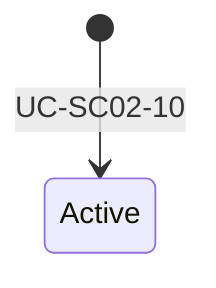

🏠 [Specs](../../../README.md) › 🏷️ [Sectors](../../README.md) › 🛍️ [SC02 Retail](../README.md) › 🗃️ [Data](README.md) ›
🗃️ E-SC02-11 Customer profile

# 🗃️ E-SC02-11 Customer profile

**Status:** 🔄 waiting for the owner

## Purpose

What the store knows of a customer.

## Fields

| Name | Type | Required | Validation | Default | Example | Personal data | Custom fields |
|---|---|---|---|---|---|---|---|
| contact | contact | yes | - | - | J. Martin | yes | no |
| sizes, preferences | text | no | BR-SC02-14 | - | M, blue | yes | yes |
| consents | list | no | - | - | newsletter | yes | no |

## Relations

(Proposed) As its use cases.

## Lifecycle

## Indexes and search

(Proposed) By number, date, partner.

## Retention

While the customer is active and consents:
[CR-FR-052 Personal data kept no longer than needed](../../../10-country-packs/france/data-protection/cr-fr-052-storage-limitation.md).

## Audit

Every change.

## Import and export

(Proposed) CSV, FEC where relevant.

## Used by

- [UC-SC02-10](../use-cases/04-customers-and-staff/uc-sc02-10-know-the-customer.md)

## Open questions

None.

---

⬅️ [E-SC02-10 Unsold goods donation](e-sc02-10-unsold-goods-donation.md) · ⬆️ [Up](README.md) ·
➡️ [E-SC02-12 Footfall count](e-sc02-12-footfall-count.md)
