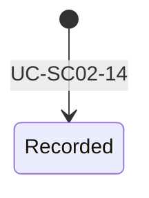

🏠 [Specs](../../../README.md) › 🏷️ [Sectors](../../README.md) › 🛍️ [SC02 Retail](../README.md) › 🗃️ [Data](README.md) ›
🗃️ E-SC02-12 Footfall count

# 🗃️ E-SC02-12 Footfall count

**Status:** ✅ specified

## Purpose

Visitors counted at a store's door.

## Fields

| Name | Type | Required | Validation | Default | Example | Personal data | Custom fields |
|---|---|---|---|---|---|---|---|
| store, hour | records | yes | - | - | Lyon 2, 11:00 | no | no |
| visitors | number | yes | >= 0 | - | 84 | no | no |
| source | connector | yes | - | - | counter C1 | no | no |

## Relations

As its use cases.

## Lifecycle

## Indexes and search

By number, date, partner.

## Retention

Kept for the period of its kind of record in the country pack (D293), or else its kind's default in the
[retention schedule](../../../05-non-functional/data-retention.md).

## Audit

Every change.

## Import and export

CSV, FEC where relevant.

## Used by

- [UC-SC02-14](../use-cases/05-unsold-goods-and-performance/uc-sc02-14-follow-store-performance.md)

## Open questions

None.

---

⬅️ [E-SC02-11 Customer profile](e-sc02-11-customer-profile.md) · ⬆️ [Up](README.md) ·
➡️ [E-SC02-13 Book title](e-sc02-13-book-title.md)
