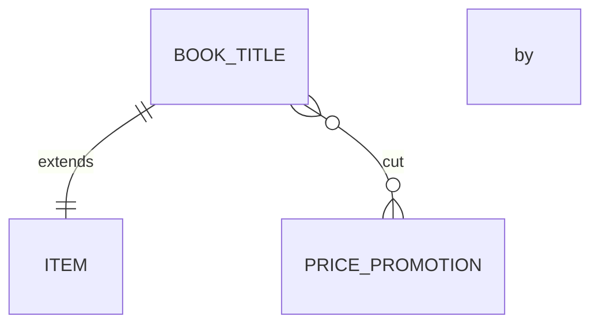
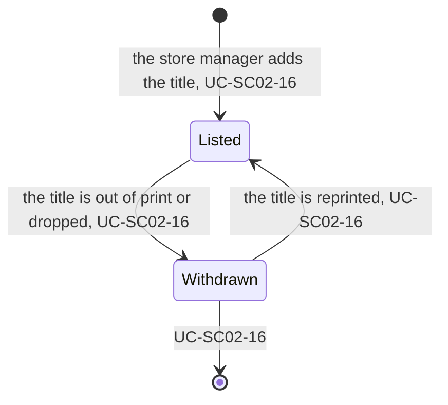

🏠 [Specs](../../../README.md) › 🏷️ [Sectors](../../README.md) › 🛍️ [SC02 Retail](../README.md) › 🗃️ [Data](README.md) ›
🗃️ E-SC02-13 Book title

# 🗃️ E-SC02-13 Book title

**Status:** ✅ specified

## Purpose

A book title sold under the fixed price: its ISBN, publisher, publisher's price and the lowest price allowed
([D546](../../../06-decisions/sectors/d546-benchmark-gaps-sc02-retail.md)). It extends the item of the catalogue
([E-F7-06 Item](../../../02-functional/f07-purchasing-and-stock/data/e-f07-06-item.md)) with the price rule of books.

## Fields

| Name | Type | Required | Validation | Default | Example | Personal data | Custom fields |
|---|---|---|---|---|---|---|---|
| ISBN | 13 digits | yes | valid check digit, unique | - | 978-2-00-000412-7 | no | no |
| title | text | yes | - | - | Les Jours clairs | no | no |
| publisher | text | yes | - | - | Editions du Nord | no | no |
| publisher's price | amount including VAT | yes | above 0 | - | 21.00 EUR | no | no |
| price valid from | date | yes | not in the future for a sale | today | 2026-09-01 | no | no |
| maximum discount | percentage | yes | from the country pack | 5 | 5 % | no | no |
| lowest price | amount | yes | computed from the price and the discount | computed | 19.95 EUR | no | no |
| item | item (E-F7-06) | yes | an item of the catalogue | - | ITM-30412 | no | no |
| state | Listed, Withdrawn | yes | the lifecycle below | Listed | Withdrawn | no | no |
| owner | user | yes | a user of the company | the creator | Claire P. | yes | no |

## Relations

- [E-F7-06 Item](../../../02-functional/f07-purchasing-and-stock/data/e-f07-06-item.md)
- [E-F10-08](../../../02-functional/f10-point-of-sale/data/e-f10-08-price-promotion.md)

## Lifecycle

## Indexes and search

By ISBN, title, publisher and state.

## Retention

Kept as long as the item exists in the catalogue and for the sales that cite it, six years
([CR-FR-029](../../../10-country-packs/france/point-of-sale/cr-fr-029-till-data-kept-six-years.md)).

## Audit

Every price change and every discount refused, with who, when and the values.

## Import and export

CSV import of a publisher's price list by ISBN; export of the titles and their prices.

## Used by

- [UC-SC02-16](../use-cases/06-books-furniture-second-hand-franchise/uc-sc02-16-sell-books-under-the-fixed-price-law.md)
- [UC-F10-06](../../../02-functional/f10-point-of-sale/use-cases/02-sell-at-the-counter/uc-f10-06-apply-prices-promotions-and-combos.md)

## Open questions

None.

---

⬅️ [E-SC02-12 Footfall count](e-sc02-12-footfall-count.md) · ⬆️ [Up](README.md) ·
➡️ [E-SC02-14 Furniture order](e-sc02-14-furniture-order.md)
