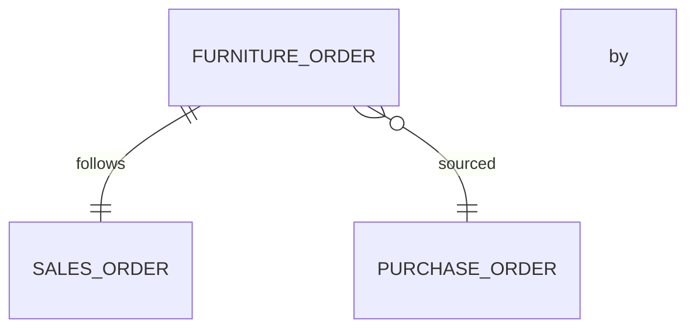
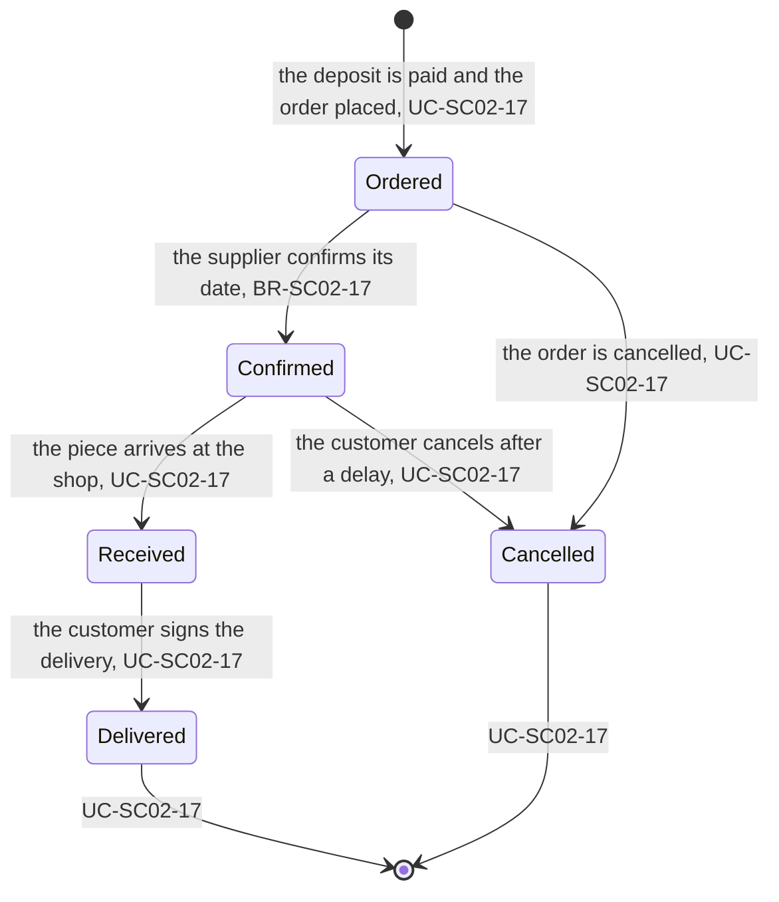

🏠 [Specs](../../../README.md) › 🏷️ [Sectors](../../README.md) › 🛍️ [SC02 Retail](../README.md) › 🗃️ [Data](README.md) ›
🗃️ E-SC02-14 Furniture order

# 🗃️ E-SC02-14 Furniture order

**Status:** ✅ specified

## Purpose

A piece made to order for a customer: options, deposit, supplier date, promised date and slot
([D546](../../../06-decisions/sectors/d546-benchmark-gaps-sc02-retail.md)). It follows the sales order
([E-F6-04 Order](../../../02-functional/f06-customers-and-sales/data/e-f06-04-order.md)) and the purchase order
([E-F7-03](../../../02-functional/f07-purchasing-and-stock/data/e-f07-03-purchase-order.md)) and adds what only
made-to-order furniture needs.

## Fields

| Name | Type | Required | Validation | Default | Example | Personal data | Custom fields |
|---|---|---|---|---|---|---|---|
| customer | customer (E-F6-01) | yes | a customer of the company | - | Claire P. | yes | no |
| piece | text | yes | - | - | Nordic sofa | no | no |
| options | model, fabric, dimensions | yes | valid for the model | - | grey, 240 cm | no | no |
| total | amount | yes | above 0 | - | 1,890.00 EUR | no | no |
| deposit | amount | yes | 0 to the total | 30 % of the total | 567.00 EUR | no | no |
| supplier | supplier (E-F7-01) | yes | a supplier of the company | - | Maison Lorrain | no | no |
| confirmed date | date | no | from the supplier's answer | - | 2027-01-04 | no | no |
| promised date | date | no | not before the confirmed date plus transport | - | 2027-01-07 | no | no |
| delivery slot | date and half day | no | not before the promised date | - | 2027-01-07 morning | no | no |
| state | Ordered, Confirmed, Received, Delivered, Cancelled | yes | the lifecycle below | Ordered | Confirmed | no | no |
| owner | user | yes | a user of the company | the creator | Claire P. | yes | no |

## Relations

- [E-F6-04 Order](../../../02-functional/f06-customers-and-sales/data/e-f06-04-order.md)
- [E-F7-03](../../../02-functional/f07-purchasing-and-stock/data/e-f07-03-purchase-order.md)
- [E-F6-01](../../../02-functional/f06-customers-and-sales/data/e-f06-01-customer-record.md)
- [E-F7-01](../../../02-functional/f07-purchasing-and-stock/data/e-f07-01-supplier-record.md)

## Lifecycle

## Indexes and search

By customer, supplier, state, promised date and slot.

## Retention

Kept with the invoice for ten years, as accounting records
([CR-FR-002](../../../10-country-packs/france/accounting/cr-fr-002-accounting-records-kept-ten-years.md)).

## Audit

Every date confirmed, promised and moved with its source, every slot and signature, with who and when.

## Import and export

Export of the open orders by supplier as a CSV.

## Used by

- [UC-SC02-17](../use-cases/06-books-furniture-second-hand-franchise/uc-sc02-17-sell-made-to-order-furniture.md)
- [UC-F7-02](../../../02-functional/f07-purchasing-and-stock/use-cases/01-procure/uc-f07-02-order-from-a-supplier.md)

## Open questions

None.

---

⬅️ [E-SC02-13 Book title](e-sc02-13-book-title.md) · ⬆️ [Up](README.md) ·
➡️ [E-SC02-15 Second-hand purchase](e-sc02-15-second-hand-purchase.md)
