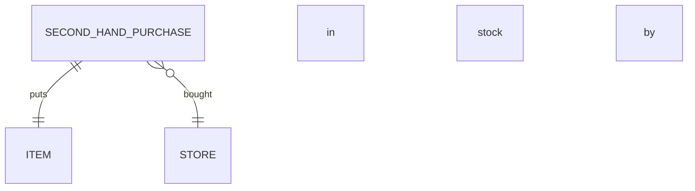
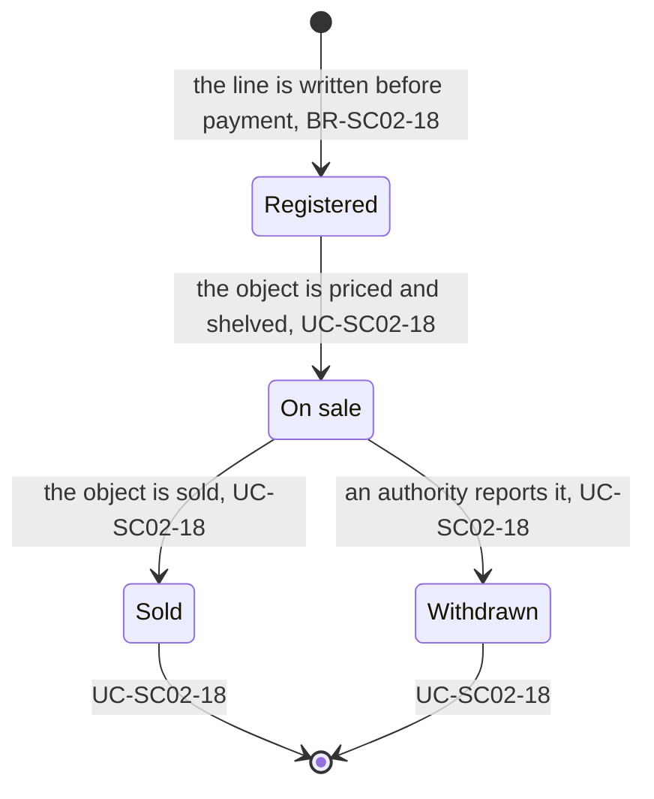

🏠 [Specs](../../../README.md) › 🏷️ [Sectors](../../README.md) › 🛍️ [SC02 Retail](../README.md) › 🗃️ [Data](README.md) ›
🗃️ E-SC02-15 Second-hand purchase

# 🗃️ E-SC02-15 Second-hand purchase

**Status:** ✅ specified

## Purpose

A purchase of a second-hand object from a person: the object, the seller as checked, the price and the register line
([D546](../../../06-decisions/sectors/d546-benchmark-gaps-sc02-retail.md)). The object then lives in stock as an item
([E-F7-06 Item](../../../02-functional/f07-purchasing-and-stock/data/e-f07-06-item.md)); this record is the legal proof
of the purchase.

## Fields

| Name | Type | Required | Validation | Default | Example | Personal data | Custom fields |
|---|---|---|---|---|---|---|---|
| register number | number | yes | continuous, set by the system | next | 2026-0412 | no | no |
| object | kind, brand, model, serial | yes | serial required when the object has one | - | watch, steel case, W809, 7A0412 | no | no |
| seller | name, address, document | yes | document checked and valid | - | Amir K., identity card | yes | no |
| price | amount | yes | above 0 | - | 120.00 EUR | no | no |
| means | cash, transfer, cheque | yes | cash within the legal limit | - | transfer | no | no |
| bought on | date and time | yes | set by the system | now | 2026-11-14 10:41 | no | no |
| item | item (E-F7-06) | yes | created at registration | - | ITM-90017 | no | no |
| sold on | date | no | after the purchase date | - | - | no | no |
| state | Registered, On sale, Sold, Withdrawn | yes | the lifecycle below | Registered | On sale | no | no |
| owner | user | yes | a user of the company | the creator | Claire P. | yes | no |

## Relations

- [E-F7-06 Item](../../../02-functional/f07-purchasing-and-stock/data/e-f07-06-item.md)
- [E-SC02-01 Store](e-sc02-01-store.md)

## Lifecycle

## Indexes and search

By register number, seller, object, state and date.

## Retention

Kept for the legal period of the register, then the seller's personal data is erased
([CR-FR-052](../../../10-country-packs/france/data-protection/cr-fr-052-storage-limitation.md)).

## Audit

Every line written or corrected, every export or print of the register, with who and when.

## Import and export

Export of the register as a file for an authority; no import.

## Used by

- [UC-SC02-18](../use-cases/06-books-furniture-second-hand-franchise/uc-sc02-18-buy-back-second-hand-goods.md)
- [UC-SC02-13](../use-cases/05-unsold-goods-and-performance/uc-sc02-13-handle-unsold-goods.md)

## Open questions

None.

---

⬅️ [E-SC02-14 Furniture order](e-sc02-14-furniture-order.md) · ⬆️ [Up](README.md) ·
➡️ [E-SC02-16 Franchisee](e-sc02-16-franchisee.md)
