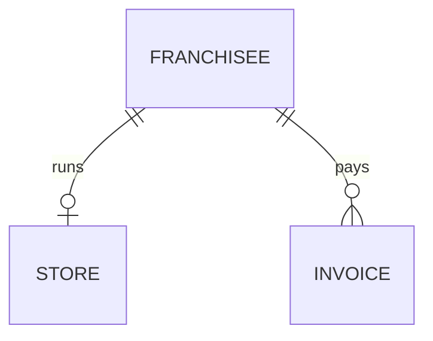
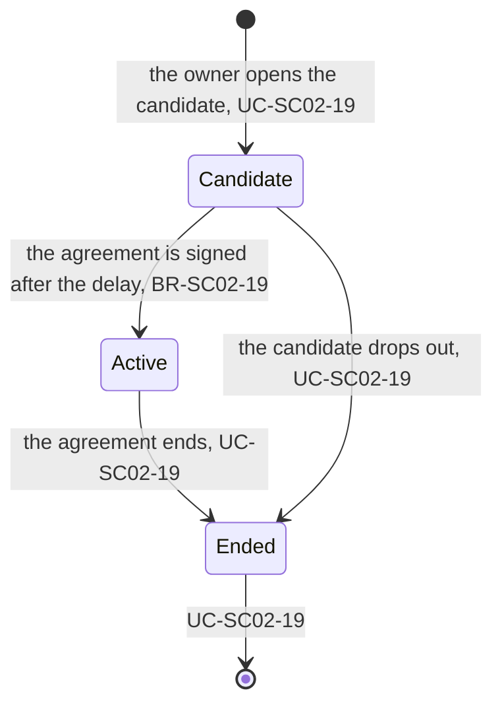

🏠 [Specs](../../../README.md) › 🏷️ [Sectors](../../README.md) › 🛍️ [SC02 Retail](../README.md) › 🗃️ [Data](README.md) ›
🗃️ E-SC02-16 Franchisee

# 🗃️ E-SC02-16 Franchisee

**Status:** ✅ specified

## Purpose

A franchisee: the company that runs a shop under the brand, with its territory, its agreement and its rates
([D546](../../../06-decisions/sectors/d546-benchmark-gaps-sc02-retail.md)). It is a company record
([E-F6-24](../../../02-functional/f06-customers-and-sales/data/e-f06-24-company-identifier.md)) with the franchise
terms, and its shop is a store of the network ([E-SC02-01 Store](e-sc02-01-store.md)).

## Fields

| Name | Type | Required | Validation | Default | Example | Personal data | Custom fields |
|---|---|---|---|---|---|---|---|
| company | company identifiers (E-F6-24) | yes | a valid identifier | - | Boutique Lyon 3 SAS | no | no |
| territory | text | yes | not overlapping another franchisee | - | Lyon 3 | no | no |
| agreement start | date | yes | after the disclosure delay | - | 2025-03-01 | no | no |
| agreement end | date | yes | after the start | - | 2030-02-28 | no | no |
| royalty rate | percentage of sales | yes | 0 to 100 | - | 5 % | no | no |
| marketing contribution | percentage of sales | yes | 0 to 100 | 0 | 1 % | no | no |
| entry fee | amount | no | 0 or more | 0 | 15,000.00 EUR | no | no |
| disclosure sent on | date | yes | before the signature | - | 2025-01-20 | no | no |
| store | store (E-SC02-01) | no | created at signature | - | Lyon 3 | no | no |
| state | Candidate, Active, Ended | yes | the lifecycle below | Candidate | Active | no | no |
| owner | user | yes | a user of the company | the creator | Claire P. | yes | no |

## Relations

- [E-F6-24](../../../02-functional/f06-customers-and-sales/data/e-f06-24-company-identifier.md)
- [E-SC02-01 Store](e-sc02-01-store.md)
- [E-F6-05 Invoice](../../../02-functional/f06-customers-and-sales/data/e-f06-05-invoice.md)

## Lifecycle

## Indexes and search

By company, territory, state and agreement end.

## Retention

Kept ten years after the agreement ends, as accounting and contract records
([CR-FR-002](../../../10-country-packs/france/accounting/cr-fr-002-accounting-records-kept-ten-years.md)).

## Audit

Every rate, date and statement, with who, when and the old and new value.

## Import and export

Export of the monthly statements of the network as a CSV.

## Used by

- [UC-SC02-19](../use-cases/06-books-furniture-second-hand-franchise/uc-sc02-19-run-a-franchise-network.md)
- [UC-SC02-01](../use-cases/01-set-up-the-stores/uc-sc02-01-set-up-stores-and-their-assortments.md)

## Open questions

None.

---

⬅️ [E-SC02-15 Second-hand purchase](e-sc02-15-second-hand-purchase.md) · ⬆️ [Up](README.md)
