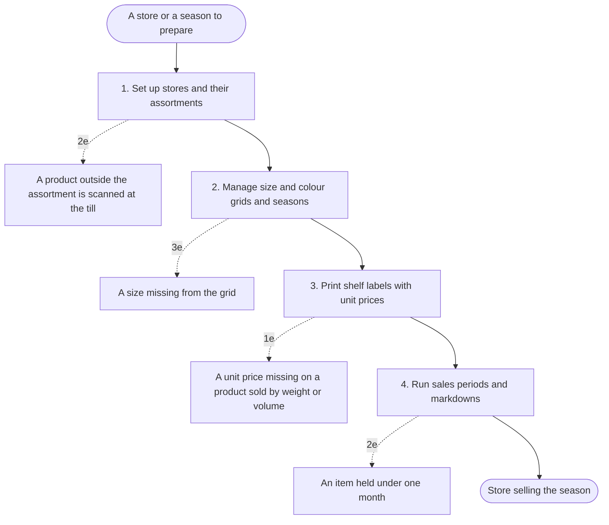

🏠 [Specs](../../../README.md) › 🏷️ [Sectors](../../README.md) › 🛍️ [SC02 Retail](../README.md) › 🔀 [Flows](README.md) ›
🔀 FL-SC02-01 Set up the stores

# 🔀 FL-SC02-01 Set up the stores

**Status:** ✅ specified

## Summary

Before selling: stores, assortments, grids and seasons, labels and markdowns. It covers
[UC-SC02-01 Set up stores and their assortments](../use-cases/01-set-up-the-stores/uc-sc02-01-set-up-stores-and-their-assortments.md),
[UC-SC02-02 Manage size and colour grids and seasons](../use-cases/01-set-up-the-stores/uc-sc02-02-manage-size-and-colour-grids-and-seasons.md),
[UC-SC02-05 Print shelf labels with unit prices](../use-cases/01-set-up-the-stores/uc-sc02-05-print-shelf-labels-with-unit-prices.md),
[UC-SC02-06 Run sales periods and markdowns](../use-cases/01-set-up-the-stores/uc-sc02-06-run-sales-periods-and-markdowns.md).

## Personas

- [U12 Marketing and communication](../../../01-users/personas/u12-marketing.md)
- [U13 Owner](../../../01-users/personas/u13-owner.md)
- [U17 Cashier](../../../01-users/personas/u17-cashier.md)
- [U23 Store manager](../../../01-users/personas/u23-store-manager.md)

## Flowchart

## Sequence diagram

See each use case.

## Steps

| Step | Persona | Screen | Use case | What happens |
|---|---|---|---|---|
| 1 | U23, U13 | [S-SC02-01](../screens/01-set-up-the-stores/s-sc02-01-stores.md) | [UC-SC02-01](../use-cases/01-set-up-the-stores/uc-sc02-01-set-up-stores-and-their-assortments.md) | The store manager sets up a store with its address, hours, surface, tills and Sunday exemptions, and chooses the assortment it sells, so that replenishment and the tills know what belongs there |
| 2 | U23, U12 | [S-SC02-02](../screens/01-set-up-the-stores/s-sc02-02-collections.md) | [UC-SC02-02](../use-cases/01-set-up-the-stores/uc-sc02-02-manage-size-and-colour-grids-and-seasons.md) | Marketing and the store manager create products with their size and colour grid, attach them to a collection and a season, and order them by grid |
| 3 | U23, U17 | [S-SC02-05](../screens/01-set-up-the-stores/s-sc02-05-labels.md) | [UC-SC02-05](../use-cases/01-set-up-the-stores/uc-sc02-05-print-shelf-labels-with-unit-prices.md) | When prices change, the store manager or a cashier prints the new shelf labels, or updates the electronic labels, with the price including VAT and the unit price, before the price applies |
| 4 | U12, U23 | [S-SC02-06](../screens/01-set-up-the-stores/s-sc02-06-sales-periods.md), [S-SC02-05](../screens/01-set-up-the-stores/s-sc02-05-labels.md) | [UC-SC02-06](../use-cases/01-set-up-the-stores/uc-sc02-06-run-sales-periods-and-markdowns.md) | Marketing prepares a markdown per store and channel, for the legal sales periods, SimpleERP checks each item's eligibility and shows the reference price, then applies it on the start date |

### Entities and screens

| Entity | States in this flow | Shown at step and screen | Aggregated view |
|---|---|---|---|
| [E-SC02-04 Season](../data/e-sc02-04-season.md) | Planned, Selling | 2 [S-SC02-02](../screens/01-set-up-the-stores/s-sc02-02-collections.md) | Seasons |
| [E-SC02-02 Assortment](../data/e-sc02-02-assortment.md) | New | 1 [S-SC02-01](../screens/01-set-up-the-stores/s-sc02-01-stores.md) | Assortments |
| [E-F7-06 Item](../../../02-functional/f07-purchasing-and-stock/data/e-f07-06-item.md) | Active | Shown elsewhere: [S-F7-21 Stock levels](../../../02-functional/f07-purchasing-and-stock/screens/03-replenish/s-f07-21-stock-levels.md) | Items |
| [E-SC02-03 Product grid](../data/e-sc02-03-product-grid.md) | Active | 2 [S-SC02-02](../screens/01-set-up-the-stores/s-sc02-02-collections.md) | Product grids |
| [E-SC02-07 Shelf label](../data/e-sc02-07-shelf-label.md) | To print | 3, 4 [S-SC02-05](../screens/01-set-up-the-stores/s-sc02-05-labels.md) | Shelf labels |
| [E-SC02-08 Markdown](../data/e-sc02-08-markdown.md) | Live, Refused | 3, 4 [S-SC02-05](../screens/01-set-up-the-stores/s-sc02-05-labels.md); 4 [S-SC02-06](../screens/01-set-up-the-stores/s-sc02-06-sales-periods.md) | Markdowns |

## Errors

- [UC-SC02-01](../use-cases/01-set-up-the-stores/uc-sc02-01-set-up-stores-and-their-assortments.md) 2e. A product
  outside the assortment is scanned at the till: the sale goes through and the store manager is warned.
- [UC-SC02-01](../use-cases/01-set-up-the-stores/uc-sc02-01-set-up-stores-and-their-assortments.md) 4e. No till linked:
  the store cannot be opened until one is set.
- [UC-SC02-02](../use-cases/01-set-up-the-stores/uc-sc02-02-manage-size-and-colour-grids-and-seasons.md) 3e. A size
  missing from the grid: the order line is refused with the grid's sizes.
- [UC-SC02-02](../use-cases/01-set-up-the-stores/uc-sc02-02-manage-size-and-colour-grids-and-seasons.md) 1e. A barcode
  already used: the variant is refused with the product that holds it.
- [UC-SC02-05](../use-cases/01-set-up-the-stores/uc-sc02-05-print-shelf-labels-with-unit-prices.md) 1e. A unit price
  missing on a product sold by weight or volume: the label is blocked until the quantity is set
  ([BR-SC02-02](../business-rules/br-sc02-02-every-product-priced.md)).
- [UC-SC02-05](../use-cases/01-set-up-the-stores/uc-sc02-05-print-shelf-labels-with-unit-prices.md) 2e. The label
  printer is offline: the batch stays to print and the store manager is told.
- [UC-SC02-06](../use-cases/01-set-up-the-stores/uc-sc02-06-run-sales-periods-and-markdowns.md) 2e. An item held under
  one month: it is left out of the sales markdown with the reason
  ([BR-SC02-04](../business-rules/br-sc02-04-sales-only-in-the-legal-periods.md)).
- [UC-SC02-06](../use-cases/01-set-up-the-stores/uc-sc02-06-run-sales-periods-and-markdowns.md) 4e. Dates outside the
  legal periods for a markdown marked sales: the markdown is refused with the period's dates.

## Images

Every step and error, for each persona taking part, in light and dark mode (D120). Steps are numbered as in the Steps
table; E rows are the error cases.

| Step | Persona | Device | Light | Dark |
|---|---|---|---|---|
| 1 | U13 | desktop | [light](../images/01-set-up-the-stores/u13-owner/1-stores-desktop-light.png) | [dark](../images/01-set-up-the-stores/u13-owner/1-stores-desktop-dark.png) |
| 1 | U13 | phone | [light](../images/01-set-up-the-stores/u13-owner/1-stores-phone-light.png) | [dark](../images/01-set-up-the-stores/u13-owner/1-stores-phone-dark.png) |
| 1 | U23 | desktop | [light](../images/01-set-up-the-stores/u23-store-manager/1-stores-desktop-light.png) | [dark](../images/01-set-up-the-stores/u23-store-manager/1-stores-desktop-dark.png) |
| 1 | U23 | phone | [light](../images/01-set-up-the-stores/u23-store-manager/1-stores-phone-light.png) | [dark](../images/01-set-up-the-stores/u23-store-manager/1-stores-phone-dark.png) |
| 1 | U23 | tablet | [light](../images/01-set-up-the-stores/u23-store-manager/1-stores-tablet-light.png) | [dark](../images/01-set-up-the-stores/u23-store-manager/1-stores-tablet-dark.png) |
| 2 | U12 | desktop | [light](../images/01-set-up-the-stores/u12-marketing/2-grids-and-seasons-desktop-light.png) | [dark](../images/01-set-up-the-stores/u12-marketing/2-grids-and-seasons-desktop-dark.png) |
| 2 | U12 | phone | [light](../images/01-set-up-the-stores/u12-marketing/2-grids-and-seasons-phone-light.png) | [dark](../images/01-set-up-the-stores/u12-marketing/2-grids-and-seasons-phone-dark.png) |
| 2 | U23 | desktop | [light](../images/01-set-up-the-stores/u23-store-manager/2-grids-and-seasons-desktop-light.png) | [dark](../images/01-set-up-the-stores/u23-store-manager/2-grids-and-seasons-desktop-dark.png) |
| 2 | U23 | phone | [light](../images/01-set-up-the-stores/u23-store-manager/2-grids-and-seasons-phone-light.png) | [dark](../images/01-set-up-the-stores/u23-store-manager/2-grids-and-seasons-phone-dark.png) |
| 2 | U23 | tablet | [light](../images/01-set-up-the-stores/u23-store-manager/2-grids-and-seasons-tablet-light.png) | [dark](../images/01-set-up-the-stores/u23-store-manager/2-grids-and-seasons-tablet-dark.png) |
| 3 | U23 | phone | [light](../images/01-set-up-the-stores/u23-store-manager/3-labels-phone-light.png) | [dark](../images/01-set-up-the-stores/u23-store-manager/3-labels-phone-dark.png) |
| 3 | U23 | desktop | [light](../images/01-set-up-the-stores/u23-store-manager/3-labels-desktop-light.png) | [dark](../images/01-set-up-the-stores/u23-store-manager/3-labels-desktop-dark.png) |
| 3 | U23 | tablet | [light](../images/01-set-up-the-stores/u23-store-manager/3-labels-tablet-light.png) | [dark](../images/01-set-up-the-stores/u23-store-manager/3-labels-tablet-dark.png) |
| 3 | U17 | desktop | [light](../images/01-set-up-the-stores/u17-cashier/3-labels-desktop-light.png) | [dark](../images/01-set-up-the-stores/u17-cashier/3-labels-desktop-dark.png) |
| 3 | U17 | phone | [light](../images/01-set-up-the-stores/u17-cashier/3-labels-phone-light.png) | [dark](../images/01-set-up-the-stores/u17-cashier/3-labels-phone-dark.png) |
| 3 | U17 | tablet | [light](../images/01-set-up-the-stores/u17-cashier/3-labels-tablet-light.png) | [dark](../images/01-set-up-the-stores/u17-cashier/3-labels-tablet-dark.png) |
| 4 | U12 | desktop | [light](../images/01-set-up-the-stores/u12-marketing/4-sales-period-desktop-light.png) | [dark](../images/01-set-up-the-stores/u12-marketing/4-sales-period-desktop-dark.png) |
| 4 | U12 | phone | [light](../images/01-set-up-the-stores/u12-marketing/4-sales-period-phone-light.png) | [dark](../images/01-set-up-the-stores/u12-marketing/4-sales-period-phone-dark.png) |
| 4 | U23 | desktop | [light](../images/01-set-up-the-stores/u23-store-manager/4-sales-period-desktop-light.png) | [dark](../images/01-set-up-the-stores/u23-store-manager/4-sales-period-desktop-dark.png) |
| 4 | U23 | phone | [light](../images/01-set-up-the-stores/u23-store-manager/4-sales-period-phone-light.png) | [dark](../images/01-set-up-the-stores/u23-store-manager/4-sales-period-phone-dark.png) |
| 4 | U23 | tablet | [light](../images/01-set-up-the-stores/u23-store-manager/4-sales-period-tablet-light.png) | [dark](../images/01-set-up-the-stores/u23-store-manager/4-sales-period-tablet-dark.png) |
| E1 | U12 | desktop | [light](../images/01-set-up-the-stores/u12-marketing/e1-sales-not-eligible-desktop-light.png) | [dark](../images/01-set-up-the-stores/u12-marketing/e1-sales-not-eligible-desktop-dark.png) |
| E1 | U12 | phone | [light](../images/01-set-up-the-stores/u12-marketing/e1-sales-not-eligible-phone-light.png) | [dark](../images/01-set-up-the-stores/u12-marketing/e1-sales-not-eligible-phone-dark.png) |

## Open questions

None.

---

⬆️ [Up](README.md) · ➡️ [FL-SC02-02 Keep stock right](fl-sc02-02-keep-stock-right.md)
