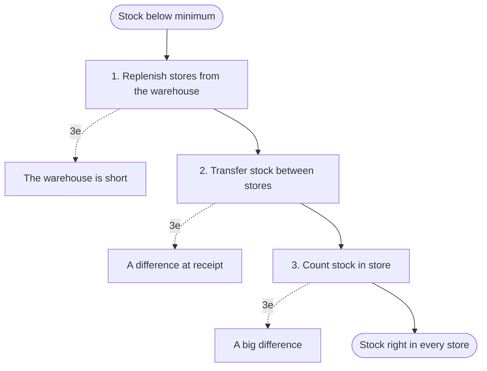

🏠 [Specs](../../../README.md) › 🏷️ [Sectors](../../README.md) › 🛍️ [SC02 Retail](../README.md) › 🔀 [Flows](README.md) ›
🔀 FL-SC02-02 Keep stock right

# 🔀 FL-SC02-02 Keep stock right

**Status:** ✅ specified

## Summary

Stock where it sells: replenishment, transfers and counts. It covers
[UC-SC02-03 Replenish stores from the warehouse](../use-cases/02-keep-stock-right/uc-sc02-03-replenish-stores-from-the-warehouse.md),
[UC-SC02-04 Transfer stock between stores](../use-cases/02-keep-stock-right/uc-sc02-04-transfer-stock-between-stores.md),
[UC-SC02-07 Count stock in store](../use-cases/02-keep-stock-right/uc-sc02-07-count-stock-in-store.md).

## Personas

- [U15 Warehouse operator](../../../01-users/personas/u15-warehouse-operator.md)
- [U17 Cashier](../../../01-users/personas/u17-cashier.md)
- [U23 Store manager](../../../01-users/personas/u23-store-manager.md)

## Flowchart

## Sequence diagram

See each use case.

## Steps

| Step | Persona | Screen | Use case | What happens |
|---|---|---|---|---|
| 1 | U23, U15 | [S-SC02-03](../screens/02-keep-stock-right/s-sc02-03-replenishment.md) | [UC-SC02-03](../use-cases/02-keep-stock-right/uc-sc02-03-replenish-stores-from-the-warehouse.md) | The store manager reviews replenishment proposals computed from each store's minimum, maximum and sales, the warehouse picks and delivers, the store receives |
| 2 | U23 | [S-SC02-04](../screens/02-keep-stock-right/s-sc02-04-transfers.md) | [UC-SC02-04](../use-cases/02-keep-stock-right/uc-sc02-04-transfer-stock-between-stores.md) | The store manager creates or accepts a transfer proposal, the goods leave the sending store's stock, stay in transit and enter the receiving store when scanned |
| 3 | U23, U17 | [S-SC02-07](../screens/02-keep-stock-right/s-sc02-07-store-count.md) | [UC-SC02-07](../use-cases/02-keep-stock-right/uc-sc02-07-count-stock-in-store.md) | The store manager runs cycle counts by area and full inventories, cashiers scan, differences are validated and posted |

### Entities and screens

| Entity | States in this flow | Shown at step and screen | Aggregated view |
|---|---|---|---|
| [E-F7-06 Item](../../../02-functional/f07-purchasing-and-stock/data/e-f07-06-item.md) | Active | Shown elsewhere: [S-F7-21 Stock levels](../../../02-functional/f07-purchasing-and-stock/screens/03-replenish/s-f07-21-stock-levels.md) | Items |
| [E-F7-07 Location](../../../02-functional/f07-purchasing-and-stock/data/e-f07-07-location.md) | Active | Shown elsewhere: [S-F7-23 Dangerous goods](../../../02-functional/f07-purchasing-and-stock/screens/02-receive-and-store/s-f07-23-dangerous-goods.md) | Locations |
| [E-SC02-06 Store transfer](../data/e-sc02-06-store-transfer.md) | Draft, Sent, In transit | 2 [S-SC02-04](../screens/02-keep-stock-right/s-sc02-04-transfers.md) | Store transfers |

## Errors

- [UC-SC02-03](../use-cases/02-keep-stock-right/uc-sc02-03-replenish-stores-from-the-warehouse.md) 3e. The warehouse is
  short: a partial delivery is shown and the rest stays proposed.
- [UC-SC02-03](../use-cases/02-keep-stock-right/uc-sc02-03-replenish-stores-from-the-warehouse.md) 4e. A difference at
  receipt: the reason is asked and the difference recorded.
- [UC-SC02-04](../use-cases/02-keep-stock-right/uc-sc02-04-transfer-stock-between-stores.md) 3e. A difference at
  receipt: the reason is asked and the difference recorded
  ([BR-SC02-07](../business-rules/br-sc02-07-transfers-in-transit.md)).
- [UC-SC02-04](../use-cases/02-keep-stock-right/uc-sc02-04-transfer-stock-between-stores.md) 2e. The goods are not in
  the sending store's stock: the line is refused.
- [UC-SC02-07](../use-cases/02-keep-stock-right/uc-sc02-07-count-stock-in-store.md) 3e. A big difference: a recount of
  that product is asked before validation.
- [UC-SC02-07](../use-cases/02-keep-stock-right/uc-sc02-07-count-stock-in-store.md) 2e. Sales during the count: they are
  counted from the time of each scan.

## Images

Every step and error, for each persona taking part, in light and dark mode (D120). Steps are numbered as in the Steps
table; E rows are the error cases.

| Step | Persona | Device | Light | Dark |
|---|---|---|---|---|
| 1 | U23 | desktop | [light](../images/02-keep-stock-right/u23-store-manager/1-replenishment-desktop-light.png) | [dark](../images/02-keep-stock-right/u23-store-manager/1-replenishment-desktop-dark.png) |
| 1 | U23 | phone | [light](../images/02-keep-stock-right/u23-store-manager/1-replenishment-phone-light.png) | [dark](../images/02-keep-stock-right/u23-store-manager/1-replenishment-phone-dark.png) |
| 1 | U23 | tablet | [light](../images/02-keep-stock-right/u23-store-manager/1-replenishment-tablet-light.png) | [dark](../images/02-keep-stock-right/u23-store-manager/1-replenishment-tablet-dark.png) |
| 1 | U15 | phone | [light](../images/02-keep-stock-right/u15-warehouse-operator/1-replenishment-phone-light.png) | [dark](../images/02-keep-stock-right/u15-warehouse-operator/1-replenishment-phone-dark.png) |
| 1 | U15 | tablet | [light](../images/02-keep-stock-right/u15-warehouse-operator/1-replenishment-tablet-light.png) | [dark](../images/02-keep-stock-right/u15-warehouse-operator/1-replenishment-tablet-dark.png) |
| 2 | U23 | phone | [light](../images/02-keep-stock-right/u23-store-manager/2-transfer-phone-light.png) | [dark](../images/02-keep-stock-right/u23-store-manager/2-transfer-phone-dark.png) |
| 2 | U23 | desktop | [light](../images/02-keep-stock-right/u23-store-manager/2-transfer-desktop-light.png) | [dark](../images/02-keep-stock-right/u23-store-manager/2-transfer-desktop-dark.png) |
| 2 | U23 | tablet | [light](../images/02-keep-stock-right/u23-store-manager/2-transfer-tablet-light.png) | [dark](../images/02-keep-stock-right/u23-store-manager/2-transfer-tablet-dark.png) |
| 3 | U17 | phone | [light](../images/02-keep-stock-right/u17-cashier/3-count-phone-light.png) | [dark](../images/02-keep-stock-right/u17-cashier/3-count-phone-dark.png) |
| 3 | U17 | desktop | [light](../images/02-keep-stock-right/u17-cashier/3-count-desktop-light.png) | [dark](../images/02-keep-stock-right/u17-cashier/3-count-desktop-dark.png) |
| 3 | U17 | tablet | [light](../images/02-keep-stock-right/u17-cashier/3-count-tablet-light.png) | [dark](../images/02-keep-stock-right/u17-cashier/3-count-tablet-dark.png) |
| 3 | U23 | desktop | [light](../images/02-keep-stock-right/u23-store-manager/3-count-desktop-light.png) | [dark](../images/02-keep-stock-right/u23-store-manager/3-count-desktop-dark.png) |
| 3 | U23 | phone | [light](../images/02-keep-stock-right/u23-store-manager/3-count-phone-light.png) | [dark](../images/02-keep-stock-right/u23-store-manager/3-count-phone-dark.png) |
| 3 | U23 | tablet | [light](../images/02-keep-stock-right/u23-store-manager/3-count-tablet-light.png) | [dark](../images/02-keep-stock-right/u23-store-manager/3-count-tablet-dark.png) |
| E1 | U23 | phone | [light](../images/02-keep-stock-right/u23-store-manager/e1-transfer-difference-phone-light.png) | [dark](../images/02-keep-stock-right/u23-store-manager/e1-transfer-difference-phone-dark.png) |
| E1 | U23 | desktop | [light](../images/02-keep-stock-right/u23-store-manager/e1-transfer-difference-desktop-light.png) | [dark](../images/02-keep-stock-right/u23-store-manager/e1-transfer-difference-desktop-dark.png) |
| E1 | U23 | tablet | [light](../images/02-keep-stock-right/u23-store-manager/e1-transfer-difference-tablet-light.png) | [dark](../images/02-keep-stock-right/u23-store-manager/e1-transfer-difference-tablet-dark.png) |

## Open questions

None.

---

⬅️ [FL-SC02-01 Set up the stores](fl-sc02-01-set-up-the-stores.md) · ⬆️ [Up](README.md) ·
➡️ [FL-SC02-03 Sell and return across channels](fl-sc02-03-sell-and-return-across-channels.md)
