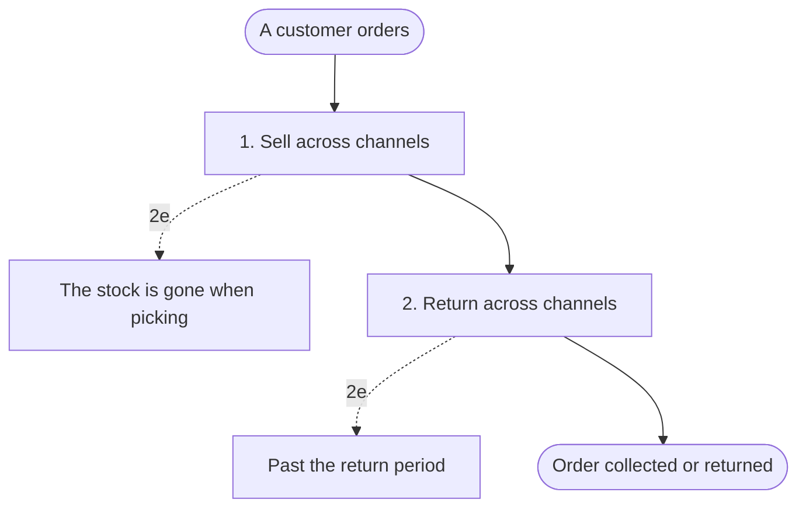

🏠 [Specs](../../../README.md) › 🏷️ [Sectors](../../README.md) › 🛍️ [SC02 Retail](../README.md) › 🔀 [Flows](README.md) ›
🔀 FL-SC02-03 Sell and return across channels

# 🔀 FL-SC02-03 Sell and return across channels

**Status:** ✅ specified

## Summary

One stock for all channels: selling and returning anywhere. It covers
[UC-SC02-08 Sell across channels](../use-cases/03-sell-and-return-across-channels/uc-sc02-08-sell-across-channels.md),
[UC-SC02-09 Return across channels](../use-cases/03-sell-and-return-across-channels/uc-sc02-09-return-across-channels.md).

## Personas

- [U09 Customer](../../../01-users/personas/u09-customer.md)
- [U17 Cashier](../../../01-users/personas/u17-cashier.md)

## Flowchart

## Sequence diagram

See each use case.

## Steps

| Step | Persona | Screen | Use case | What happens |
|---|---|---|---|---|
| 1 | U17, U09 | [S-SC02-08](../screens/03-sell-and-return-across-channels/s-sc02-08-cross-channel-orders.md) | [UC-SC02-08](../use-cases/03-sell-and-return-across-channels/uc-sc02-08-sell-across-channels.md) | Customers order online for click & collect or delivery, or the cashier orders at the till what the store does not hold, the store holding it picks, and the order is collected or shipped |
| 2 | U17, U09 | [S-SC02-09](../screens/03-sell-and-return-across-channels/s-sc02-09-returns.md) | [UC-SC02-09](../use-cases/03-sell-and-return-across-channels/uc-sc02-09-return-across-channels.md) | The cashier finds an order from any channel, checks the return policy and the withdrawal right, and refunds or exchanges in any store |

### Entities and screens

| Entity | States in this flow | Shown at step and screen | Aggregated view |
|---|---|---|---|
| [E-F6-04 Order](../../../02-functional/f06-customers-and-sales/data/e-f06-04-order.md) | Cancelled | Shown elsewhere: [S-F6-05 Order](../../../02-functional/f06-customers-and-sales/screens/02-quote-to-order/s-f06-05-order.md) | Orders |
| [E-F11-13 Channel listing](../../../02-functional/f11-online-shop/data/e-f11-13-channel-listing.md) | Active | Shown elsewhere: [S-F11-18 Channels](../../../02-functional/f11-online-shop/screens/06-channels-and-legal/s-f11-18-channels.md) | Channel listings |
| [E-F7-06 Item](../../../02-functional/f07-purchasing-and-stock/data/e-f07-06-item.md) | Active | Shown elsewhere: [S-F7-21 Stock levels](../../../02-functional/f07-purchasing-and-stock/screens/03-replenish/s-f07-21-stock-levels.md) | Items |
| [E-F11-08 Withdrawal request](../../../02-functional/f11-online-shop/data/e-f11-08-withdrawal-request.md) | Returned, Refunded | Shown elsewhere: [S-F11-09 Withdrawal](../../../02-functional/f11-online-shop/screens/03-after-the-order/s-f11-09-withdrawal.md) | Withdrawal requests |

## Errors

- [UC-SC02-08](../use-cases/03-sell-and-return-across-channels/uc-sc02-08-sell-across-channels.md) 2e. The stock is gone
  when picking: another store holding it is proposed.
- [UC-SC02-08](../use-cases/03-sell-and-return-across-channels/uc-sc02-08-sell-across-channels.md) 3e. Not collected in
  time: the order is cancelled and refunded and the item goes back on sale.
- [UC-SC02-09](../use-cases/03-sell-and-return-across-channels/uc-sc02-09-return-across-channels.md) 2e. Past the return
  period: the return is refused with the date.
- [UC-SC02-09](../use-cases/03-sell-and-return-across-channels/uc-sc02-09-return-across-channels.md) 1e. The order is
  not found: the cashier searches by customer or card.

## Images

Every step and error, for each persona taking part, in light and dark mode (D120). Steps are numbered as in the Steps
table; E rows are the error cases.

| Step | Persona | Device | Light | Dark |
|---|---|---|---|---|
| 1 | U17 | desktop | [light](../images/03-sell-and-return-across-channels/u17-cashier/1-endless-aisle-desktop-light.png) | [dark](../images/03-sell-and-return-across-channels/u17-cashier/1-endless-aisle-desktop-dark.png) |
| 1 | U17 | phone | [light](../images/03-sell-and-return-across-channels/u17-cashier/1-endless-aisle-phone-light.png) | [dark](../images/03-sell-and-return-across-channels/u17-cashier/1-endless-aisle-phone-dark.png) |
| 1 | U17 | tablet | [light](../images/03-sell-and-return-across-channels/u17-cashier/1-endless-aisle-tablet-light.png) | [dark](../images/03-sell-and-return-across-channels/u17-cashier/1-endless-aisle-tablet-dark.png) |
| 1 | U09 | phone | [light](../images/03-sell-and-return-across-channels/u09-customer/1-endless-aisle-phone-light.png) | [dark](../images/03-sell-and-return-across-channels/u09-customer/1-endless-aisle-phone-dark.png) |
| 2 | U17 | desktop | [light](../images/03-sell-and-return-across-channels/u17-cashier/2-return-anywhere-desktop-light.png) | [dark](../images/03-sell-and-return-across-channels/u17-cashier/2-return-anywhere-desktop-dark.png) |
| 2 | U17 | phone | [light](../images/03-sell-and-return-across-channels/u17-cashier/2-return-anywhere-phone-light.png) | [dark](../images/03-sell-and-return-across-channels/u17-cashier/2-return-anywhere-phone-dark.png) |
| 2 | U17 | tablet | [light](../images/03-sell-and-return-across-channels/u17-cashier/2-return-anywhere-tablet-light.png) | [dark](../images/03-sell-and-return-across-channels/u17-cashier/2-return-anywhere-tablet-dark.png) |
| 2 | U09 | phone | [light](../images/03-sell-and-return-across-channels/u09-customer/2-return-anywhere-phone-light.png) | [dark](../images/03-sell-and-return-across-channels/u09-customer/2-return-anywhere-phone-dark.png) |
| E1 | U17 | desktop | [light](../images/03-sell-and-return-across-channels/u17-cashier/e1-return-late-desktop-light.png) | [dark](../images/03-sell-and-return-across-channels/u17-cashier/e1-return-late-desktop-dark.png) |
| E1 | U17 | phone | [light](../images/03-sell-and-return-across-channels/u17-cashier/e1-return-late-phone-light.png) | [dark](../images/03-sell-and-return-across-channels/u17-cashier/e1-return-late-phone-dark.png) |
| E1 | U17 | tablet | [light](../images/03-sell-and-return-across-channels/u17-cashier/e1-return-late-tablet-light.png) | [dark](../images/03-sell-and-return-across-channels/u17-cashier/e1-return-late-tablet-dark.png) |

## Open questions

None.

---

⬅️ [FL-SC02-02 Keep stock right](fl-sc02-02-keep-stock-right.md) · ⬆️ [Up](README.md) ·
➡️ [FL-SC02-04 Customers and staff](fl-sc02-04-customers-and-staff.md)
