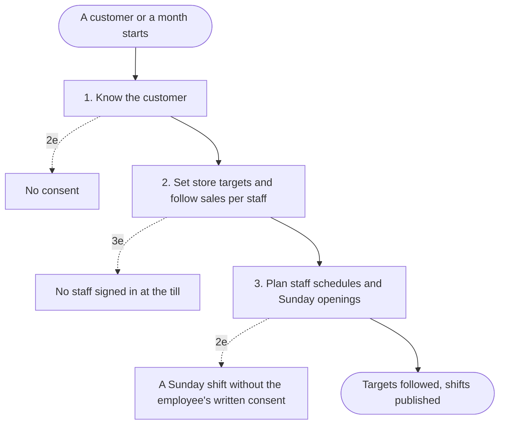

🏠 [Specs](../../../README.md) › 🏷️ [Sectors](../../README.md) › 🛍️ [SC02 Retail](../README.md) › 🔀 [Flows](README.md) ›
🔀 FL-SC02-04 Customers and staff

# 🔀 FL-SC02-04 Customers and staff

**Status:** ✅ specified

## Summary

The people: customers known with consent, staff targets and schedules. It covers
[UC-SC02-10 Know the customer](../use-cases/04-customers-and-staff/uc-sc02-10-know-the-customer.md),
[UC-SC02-11 Set store targets and follow sales per staff](../use-cases/04-customers-and-staff/uc-sc02-11-set-store-targets-and-follow-sales-per-staff.md),
[UC-SC02-12 Plan staff schedules and Sunday openings](../use-cases/04-customers-and-staff/uc-sc02-12-plan-staff-schedules-and-sunday-openings.md).

## Personas

- [U13 Owner](../../../01-users/personas/u13-owner.md)
- [U17 Cashier](../../../01-users/personas/u17-cashier.md)
- [U23 Store manager](../../../01-users/personas/u23-store-manager.md)

## Flowchart

## Sequence diagram

See each use case.

## Steps

| Step | Persona | Screen | Use case | What happens |
|---|---|---|---|---|
| 1 | U17, U23 | [S-SC02-10](../screens/04-customers-and-staff/s-sc02-10-customer-profile.md) | [UC-SC02-10](../use-cases/04-customers-and-staff/uc-sc02-10-know-the-customer.md) | The cashier or store manager finds a customer and sees their purchases, sizes, preferences and consents to suggest products, only with the customer's consent |
| 2 | U23, U13 | [S-SC02-11](../screens/04-customers-and-staff/s-sc02-11-targets.md) | [UC-SC02-11](../use-cases/04-customers-and-staff/uc-sc02-11-set-store-targets-and-follow-sales-per-staff.md) | The owner sets targets per store and month through the shared targets and commissions capability, the store manager splits them by day and staff member and follows sales live |
| 3 | U23 | [S-SC02-12](../screens/04-customers-and-staff/s-sc02-12-schedules.md) | [UC-SC02-12](../use-cases/04-customers-and-staff/uc-sc02-12-plan-staff-schedules-and-sunday-openings.md) | The store manager drafts the week's schedule, SimpleERP checks working-time rules, Sunday exemptions and consents, and the store manager publishes it |

### Entities and screens

| Entity | States in this flow | Shown at step and screen | Aggregated view |
|---|---|---|---|
| [E-F5-10 Consent and suppression record](../../../02-functional/f05-social-media/data/e-f05-10-consent-and-suppression-record.md) | Given, Withdrawn, Suppressed | Shown elsewhere: [S-F5-15 Consent register](../../../02-functional/f05-social-media/screens/06-audiences-consent-and-journeys/s-f05-15-consent-register.md) | Consent and suppression records |
| [E-SC02-09 Store target](../data/e-sc02-09-store-target.md) | Active | 2 [S-SC02-11](../screens/04-customers-and-staff/s-sc02-11-targets.md) | Store targets |
| [E-F10-03 Point of sale order](../../../02-functional/f10-point-of-sale/data/e-f10-03-point-of-sale-order.md) | Draft | Shown elsewhere: [S-F10-17 Delivery orders](../../../02-functional/f10-point-of-sale/screens/06-mobile-and-delivery/s-f10-17-delivery-orders.md) | Point of sale orders |
| [E-F9-16 Shift](../../../02-functional/f09-hr-and-projects/data/e-f09-16-shift.md) | Draft, Published | Shown elsewhere: [S-F9-30 Scheduling board](../../../02-functional/f09-hr-and-projects/screens/12-schedule-customer-requests/s-f09-30-scheduling-board.md) | Shifts |

## Errors

- [UC-SC02-10](../use-cases/04-customers-and-staff/uc-sc02-10-know-the-customer.md) 2e. No consent: only the purchase
  history shows, not sizes or preferences.
- [UC-SC02-10](../use-cases/04-customers-and-staff/uc-sc02-10-know-the-customer.md) 1e. Two profiles for the same
  person: the store manager merges them.
- [UC-SC02-11](../use-cases/04-customers-and-staff/uc-sc02-11-set-store-targets-and-follow-sales-per-staff.md) 3e. No
  staff signed in at the till: the sale counts for the store only.
- [UC-SC02-11](../use-cases/04-customers-and-staff/uc-sc02-11-set-store-targets-and-follow-sales-per-staff.md) 2e. The
  split does not add up to the store's target: the store manager is shown the gap.
- [UC-SC02-12](../use-cases/04-customers-and-staff/uc-sc02-12-plan-staff-schedules-and-sunday-openings.md) 2e. A Sunday
  shift without the employee's written consent: the shift is refused
  ([BR-SC02-11](../business-rules/br-sc02-11-sunday-work-needs-the-exemption.md)).
- [UC-SC02-12](../use-cases/04-customers-and-staff/uc-sc02-12-plan-staff-schedules-and-sunday-openings.md) 2f. A rest
  time not respected: the shift is flagged with the rule.

## Images

Every step and error, for each persona taking part, in light and dark mode (D120). Steps are numbered as in the Steps
table; E rows are the error cases.

| Step | Persona | Device | Light | Dark |
|---|---|---|---|---|
| 1 | U17 | desktop | [light](../images/04-customers-and-staff/u17-cashier/1-customer-profile-desktop-light.png) | [dark](../images/04-customers-and-staff/u17-cashier/1-customer-profile-desktop-dark.png) |
| 1 | U17 | phone | [light](../images/04-customers-and-staff/u17-cashier/1-customer-profile-phone-light.png) | [dark](../images/04-customers-and-staff/u17-cashier/1-customer-profile-phone-dark.png) |
| 1 | U17 | tablet | [light](../images/04-customers-and-staff/u17-cashier/1-customer-profile-tablet-light.png) | [dark](../images/04-customers-and-staff/u17-cashier/1-customer-profile-tablet-dark.png) |
| 1 | U23 | desktop | [light](../images/04-customers-and-staff/u23-store-manager/1-customer-profile-desktop-light.png) | [dark](../images/04-customers-and-staff/u23-store-manager/1-customer-profile-desktop-dark.png) |
| 1 | U23 | phone | [light](../images/04-customers-and-staff/u23-store-manager/1-customer-profile-phone-light.png) | [dark](../images/04-customers-and-staff/u23-store-manager/1-customer-profile-phone-dark.png) |
| 1 | U23 | tablet | [light](../images/04-customers-and-staff/u23-store-manager/1-customer-profile-tablet-light.png) | [dark](../images/04-customers-and-staff/u23-store-manager/1-customer-profile-tablet-dark.png) |
| 2 | U23 | desktop | [light](../images/04-customers-and-staff/u23-store-manager/2-targets-desktop-light.png) | [dark](../images/04-customers-and-staff/u23-store-manager/2-targets-desktop-dark.png) |
| 2 | U23 | phone | [light](../images/04-customers-and-staff/u23-store-manager/2-targets-phone-light.png) | [dark](../images/04-customers-and-staff/u23-store-manager/2-targets-phone-dark.png) |
| 2 | U23 | tablet | [light](../images/04-customers-and-staff/u23-store-manager/2-targets-tablet-light.png) | [dark](../images/04-customers-and-staff/u23-store-manager/2-targets-tablet-dark.png) |
| 2 | U13 | desktop | [light](../images/04-customers-and-staff/u13-owner/2-targets-desktop-light.png) | [dark](../images/04-customers-and-staff/u13-owner/2-targets-desktop-dark.png) |
| 2 | U13 | phone | [light](../images/04-customers-and-staff/u13-owner/2-targets-phone-light.png) | [dark](../images/04-customers-and-staff/u13-owner/2-targets-phone-dark.png) |
| 3 | U23 | desktop | [light](../images/04-customers-and-staff/u23-store-manager/3-schedule-desktop-light.png) | [dark](../images/04-customers-and-staff/u23-store-manager/3-schedule-desktop-dark.png) |
| 3 | U23 | phone | [light](../images/04-customers-and-staff/u23-store-manager/3-schedule-phone-light.png) | [dark](../images/04-customers-and-staff/u23-store-manager/3-schedule-phone-dark.png) |
| 3 | U23 | tablet | [light](../images/04-customers-and-staff/u23-store-manager/3-schedule-tablet-light.png) | [dark](../images/04-customers-and-staff/u23-store-manager/3-schedule-tablet-dark.png) |
| E1 | U23 | desktop | [light](../images/04-customers-and-staff/u23-store-manager/e1-sunday-no-consent-desktop-light.png) | [dark](../images/04-customers-and-staff/u23-store-manager/e1-sunday-no-consent-desktop-dark.png) |
| E1 | U23 | phone | [light](../images/04-customers-and-staff/u23-store-manager/e1-sunday-no-consent-phone-light.png) | [dark](../images/04-customers-and-staff/u23-store-manager/e1-sunday-no-consent-phone-dark.png) |
| E1 | U23 | tablet | [light](../images/04-customers-and-staff/u23-store-manager/e1-sunday-no-consent-tablet-light.png) | [dark](../images/04-customers-and-staff/u23-store-manager/e1-sunday-no-consent-tablet-dark.png) |

## Open questions

None.

---

⬅️ [FL-SC02-03 Sell and return across channels](fl-sc02-03-sell-and-return-across-channels.md) · ⬆️ [Up](README.md) ·
➡️ [FL-SC02-05 Unsold goods and performance](fl-sc02-05-unsold-goods-and-performance.md)
