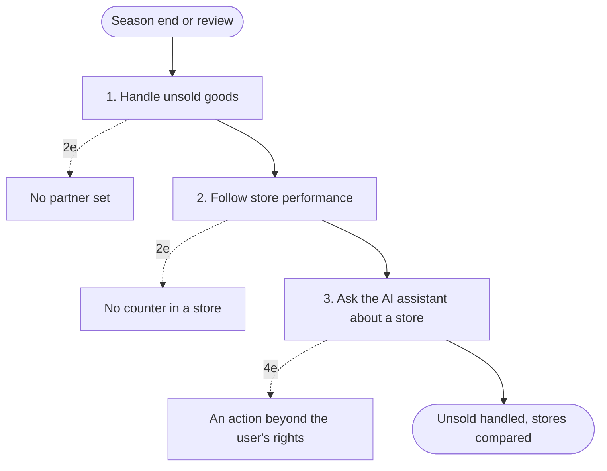

🏠 [Specs](../../../README.md) › 🏷️ [Sectors](../../README.md) › 🛍️ [SC02 Retail](../README.md) › 🔀 [Flows](README.md) ›
🔀 FL-SC02-05 Unsold goods and performance

# 🔀 FL-SC02-05 Unsold goods and performance

**Status:** ✅ specified

## Summary

Season end and steering: unsold goods, performance and the AI assistant. It covers
[UC-SC02-13 Handle unsold goods](../use-cases/05-unsold-goods-and-performance/uc-sc02-13-handle-unsold-goods.md),
[UC-SC02-14 Follow store performance](../use-cases/05-unsold-goods-and-performance/uc-sc02-14-follow-store-performance.md),
[UC-SC02-15 Ask the AI assistant about a store](../use-cases/05-unsold-goods-and-performance/uc-sc02-15-ask-the-assistant-about-a-store.md).

## Personas

- [U13 Owner](../../../01-users/personas/u13-owner.md)
- [U15 Warehouse operator](../../../01-users/personas/u15-warehouse-operator.md)
- [U17 Cashier](../../../01-users/personas/u17-cashier.md)
- [U23 Store manager](../../../01-users/personas/u23-store-manager.md)

## Flowchart

## Sequence diagram

See each use case.

## Steps

| Step | Persona | Screen | Use case | What happens |
|---|---|---|---|---|
| 1 | U23, U15 | [S-SC02-13](../screens/05-unsold-goods-and-performance/s-sc02-13-unsold-goods.md) | [UC-SC02-13](../use-cases/05-unsold-goods-and-performance/uc-sc02-13-handle-unsold-goods.md) | The store manager lists unsold goods, chooses donation, reuse or recycling, and records the partner's slip, nothing is destroyed |
| 2 | U13, U23 | [S-SC02-14](../screens/05-unsold-goods-and-performance/s-sc02-14-store-performance.md) | [UC-SC02-14](../use-cases/05-unsold-goods-and-performance/uc-sc02-14-follow-store-performance.md) | The owner and store managers follow sales per square metre, footfall, conversion, basket and stock cover, and compare stores |
| 3 | U23, U17 | [S-SC02-15](../screens/05-unsold-goods-and-performance/s-sc02-15-store-assistant.md) | [UC-SC02-15](../use-cases/05-unsold-goods-and-performance/uc-sc02-15-ask-the-assistant-about-a-store.md) | The store manager or a cashier asks the AI assistant about today's sales, a product in other stores or a transfer to propose, within their role's rights |

### Entities and screens

| Entity | States in this flow | Shown at step and screen | Aggregated view |
|---|---|---|---|
| [E-SC02-10 Unsold goods donation](../data/e-sc02-10-unsold-goods-donation.md) | Active | 1 [S-SC02-13](../screens/05-unsold-goods-and-performance/s-sc02-13-unsold-goods.md) | Unsold goods donations |
| [E-F3-04 Assistant change batch](../../../02-functional/f03-assistant/data/e-f03-04-assistant-change-batch.md) | Proposed, Cancelled, Done, Partly done, Undone | Shown elsewhere: [S-F3-01 Assistant panel](../../../02-functional/f03-assistant/screens/01-ask-the-assistant/s-f03-01-assistant-panel.md) | Assistant change batches |
| [E-F1-03 User](../../../02-functional/f01-administration/data/e-f01-03-user.md) | Invited, Active, Deactivated | Shown elsewhere: [S-F1-03 Users](../../../02-functional/f01-administration/screens/03-user-lifecycle/s-f01-03-users.md) | Users |
| [E-F1-06 Role](../../../02-functional/f01-administration/data/e-f01-06-role.md) | Active | Shown elsewhere: [S-F1-06 Role editor](../../../02-functional/f01-administration/screens/04-edit-a-role/s-f01-06-role-editor.md) | Roles |

## Errors

- [UC-SC02-13](../use-cases/05-unsold-goods-and-performance/uc-sc02-13-handle-unsold-goods.md) 2e. No partner set: the
  store manager is asked to set one.
- [UC-SC02-13](../use-cases/05-unsold-goods-and-performance/uc-sc02-13-handle-unsold-goods.md) 2f. Destruction chosen:
  it is refused ([BR-SC02-10](../business-rules/br-sc02-10-unsold-goods-never-destroyed.md)).
- [UC-SC02-14](../use-cases/05-unsold-goods-and-performance/uc-sc02-14-follow-store-performance.md) 2e. No counter in a
  store: conversion is not shown for that store.
- [UC-SC02-14](../use-cases/05-unsold-goods-and-performance/uc-sc02-14-follow-store-performance.md) 1e. A counter not
  sending data: the gap is shown with the last reading.
- [UC-SC02-15](../use-cases/05-unsold-goods-and-performance/uc-sc02-15-ask-the-assistant-about-a-store.md) 4e. An action
  beyond the user's rights: the AI assistant refuses and says which role can do it.
- [UC-SC02-15](../use-cases/05-unsold-goods-and-performance/uc-sc02-15-ask-the-assistant-about-a-store.md) 2e. No data
  to answer: the AI assistant says so and does not guess.

## Images

Every step and error, for each persona taking part, in light and dark mode (D120). Steps are numbered as in the Steps
table; E rows are the error cases.

| Step | Persona | Device | Light | Dark |
|---|---|---|---|---|
| 1 | U23 | phone | [light](../images/05-unsold-goods-and-performance/u23-store-manager/1-unsold-phone-light.png) | [dark](../images/05-unsold-goods-and-performance/u23-store-manager/1-unsold-phone-dark.png) |
| 1 | U23 | desktop | [light](../images/05-unsold-goods-and-performance/u23-store-manager/1-unsold-desktop-light.png) | [dark](../images/05-unsold-goods-and-performance/u23-store-manager/1-unsold-desktop-dark.png) |
| 1 | U23 | tablet | [light](../images/05-unsold-goods-and-performance/u23-store-manager/1-unsold-tablet-light.png) | [dark](../images/05-unsold-goods-and-performance/u23-store-manager/1-unsold-tablet-dark.png) |
| 1 | U15 | phone | [light](../images/05-unsold-goods-and-performance/u15-warehouse-operator/1-unsold-phone-light.png) | [dark](../images/05-unsold-goods-and-performance/u15-warehouse-operator/1-unsold-phone-dark.png) |
| 1 | U15 | tablet | [light](../images/05-unsold-goods-and-performance/u15-warehouse-operator/1-unsold-tablet-light.png) | [dark](../images/05-unsold-goods-and-performance/u15-warehouse-operator/1-unsold-tablet-dark.png) |
| 2 | U13 | desktop | [light](../images/05-unsold-goods-and-performance/u13-owner/2-performance-desktop-light.png) | [dark](../images/05-unsold-goods-and-performance/u13-owner/2-performance-desktop-dark.png) |
| 2 | U13 | phone | [light](../images/05-unsold-goods-and-performance/u13-owner/2-performance-phone-light.png) | [dark](../images/05-unsold-goods-and-performance/u13-owner/2-performance-phone-dark.png) |
| 2 | U23 | desktop | [light](../images/05-unsold-goods-and-performance/u23-store-manager/2-performance-desktop-light.png) | [dark](../images/05-unsold-goods-and-performance/u23-store-manager/2-performance-desktop-dark.png) |
| 2 | U23 | phone | [light](../images/05-unsold-goods-and-performance/u23-store-manager/2-performance-phone-light.png) | [dark](../images/05-unsold-goods-and-performance/u23-store-manager/2-performance-phone-dark.png) |
| 2 | U23 | tablet | [light](../images/05-unsold-goods-and-performance/u23-store-manager/2-performance-tablet-light.png) | [dark](../images/05-unsold-goods-and-performance/u23-store-manager/2-performance-tablet-dark.png) |
| 3 | U23 | phone | [light](../images/05-unsold-goods-and-performance/u23-store-manager/3-assistant-phone-light.png) | [dark](../images/05-unsold-goods-and-performance/u23-store-manager/3-assistant-phone-dark.png) |
| 3 | U23 | desktop | [light](../images/05-unsold-goods-and-performance/u23-store-manager/3-assistant-desktop-light.png) | [dark](../images/05-unsold-goods-and-performance/u23-store-manager/3-assistant-desktop-dark.png) |
| 3 | U23 | tablet | [light](../images/05-unsold-goods-and-performance/u23-store-manager/3-assistant-tablet-light.png) | [dark](../images/05-unsold-goods-and-performance/u23-store-manager/3-assistant-tablet-dark.png) |
| 3 | U17 | desktop | [light](../images/05-unsold-goods-and-performance/u17-cashier/3-assistant-desktop-light.png) | [dark](../images/05-unsold-goods-and-performance/u17-cashier/3-assistant-desktop-dark.png) |
| 3 | U17 | phone | [light](../images/05-unsold-goods-and-performance/u17-cashier/3-assistant-phone-light.png) | [dark](../images/05-unsold-goods-and-performance/u17-cashier/3-assistant-phone-dark.png) |
| 3 | U17 | tablet | [light](../images/05-unsold-goods-and-performance/u17-cashier/3-assistant-tablet-light.png) | [dark](../images/05-unsold-goods-and-performance/u17-cashier/3-assistant-tablet-dark.png) |
| E1 | U23 | phone | [light](../images/05-unsold-goods-and-performance/u23-store-manager/e1-no-partner-phone-light.png) | [dark](../images/05-unsold-goods-and-performance/u23-store-manager/e1-no-partner-phone-dark.png) |
| E1 | U23 | desktop | [light](../images/05-unsold-goods-and-performance/u23-store-manager/e1-no-partner-desktop-light.png) | [dark](../images/05-unsold-goods-and-performance/u23-store-manager/e1-no-partner-desktop-dark.png) |
| E1 | U23 | tablet | [light](../images/05-unsold-goods-and-performance/u23-store-manager/e1-no-partner-tablet-light.png) | [dark](../images/05-unsold-goods-and-performance/u23-store-manager/e1-no-partner-tablet-dark.png) |

## Open questions

None.

---

⬅️ [FL-SC02-04 Customers and staff](fl-sc02-04-customers-and-staff.md) · ⬆️ [Up](README.md) ·
➡️ [FL-SC02-06 Books, furniture, second-hand and franchise](fl-sc02-06-books-furniture-second-hand-franchise.md)
