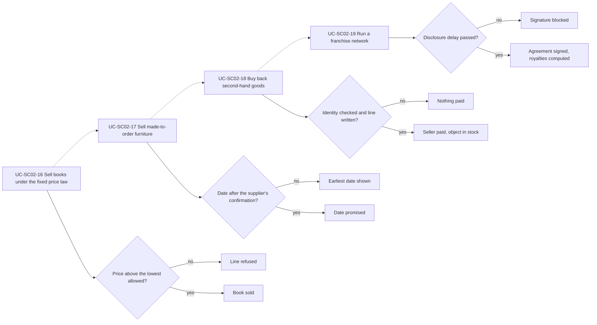
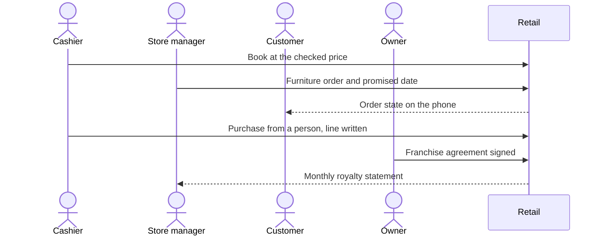

🏠 [Specs](../../../README.md) › 🏷️ [Sectors](../../README.md) › 🛍️ [SC02 Retail](../README.md) › 🔀 [Flows](README.md) ›
🔀 FL-SC02-06 Books, furniture, second-hand and franchise

# 🔀 FL-SC02-06 Books, furniture, second-hand and franchise

**Status:** 🔄 waiting for the owner

## Summary

Four situations of shops that retail suites handle: selling books under the fixed price law, selling made-to-order
furniture with a date tied to the supplier, buying back second-hand goods with the police register, and running a
franchise network with its royalties ([D546](../../../06-decisions/sectors/d546-benchmark-gaps-sc02-retail.md)).

## Personas

- [U17 Cashier](../../../01-users/personas/u17-cashier.md), who sells and buys back at the counter
- [U23 Store manager](../../../01-users/personas/u23-store-manager.md), who orders, checks and issues
- [U09 Customer](../../../01-users/personas/u09-customer.md), who follows their furniture order
- [U13 Owner](../../../01-users/personas/u13-owner.md), who runs the network

## Flowchart

## Sequence diagram

## Steps

| Step | Persona | Screen | Use case | What happens |
|---|---|---|---|---|
| 1 | [U17](../../../01-users/personas/u17-cashier.md) | [S-SC02-16](../screens/06-books-furniture-second-hand-franchise/s-sc02-16-book-trade.md) | [UC-SC02-16](../use-cases/06-books-furniture-second-hand-franchise/uc-sc02-16-sell-books-under-the-fixed-price-law.md) | The cashier sells a book and the till holds the discount to the cap of the fixed price |
| 2 | [U23](../../../01-users/personas/u23-store-manager.md) | [S-SC02-17](../screens/06-books-furniture-second-hand-franchise/s-sc02-17-furniture-orders.md) | [UC-SC02-17](../use-cases/06-books-furniture-second-hand-franchise/uc-sc02-17-sell-made-to-order-furniture.md) | The store manager takes a made-to-order piece and promises the date the supplier's confirmation allows, and the customer follows it on the phone |
| 3 | [U17](../../../01-users/personas/u17-cashier.md) | [S-SC02-18](../screens/06-books-furniture-second-hand-franchise/s-sc02-18-second-hand.md) | [UC-SC02-18](../use-cases/06-books-furniture-second-hand-franchise/uc-sc02-18-buy-back-second-hand-goods.md) | The cashier buys an object from a person and the register line is written before the payment |
| 4 | [U13](../../../01-users/personas/u13-owner.md) | [S-SC02-19](../screens/06-books-furniture-second-hand-franchise/s-sc02-19-franchise-network.md) | [UC-SC02-19](../use-cases/06-books-furniture-second-hand-franchise/uc-sc02-19-run-a-franchise-network.md) | The owner signs a franchisee after the disclosure delay and the store manager issues the monthly royalty statement |

### Entities and screens

| Entity | States in this flow | Shown at step and screen | Aggregated view |
|---|---|---|---|
| [E-SC02-13 Book title](../data/e-sc02-13-book-title.md) | Listed, Withdrawn | 1 [S-SC02-16](../screens/06-books-furniture-second-hand-franchise/s-sc02-16-book-trade.md) | Book titles |
| [E-SC02-14 Furniture order](../data/e-sc02-14-furniture-order.md) | Ordered, Confirmed, Received, Delivered, Cancelled | 2 [S-SC02-17](../screens/06-books-furniture-second-hand-franchise/s-sc02-17-furniture-orders.md) | Furniture orders |
| [E-SC02-15 Second-hand purchase](../data/e-sc02-15-second-hand-purchase.md) | Registered, On sale, Sold, Withdrawn | 3 [S-SC02-18](../screens/06-books-furniture-second-hand-franchise/s-sc02-18-second-hand.md) | Second-hand purchases |
| [E-SC02-16 Franchisee](../data/e-sc02-16-franchisee.md) | Candidate, Active, Ended | 4 [S-SC02-19](../screens/06-books-furniture-second-hand-franchise/s-sc02-19-franchise-network.md) | Franchisees |
| [E-F7-06 Item](../../../02-functional/f07-purchasing-and-stock/data/e-f07-06-item.md) | Active | Shown elsewhere: [S-F7-21 Stock levels](../../../02-functional/f07-purchasing-and-stock/screens/03-replenish/s-f07-21-stock-levels.md) | Items |

## Errors

- **E1 The discount is over the cap.** The till refuses the line and shows the lowest allowed price
  ([BR-SC02-16](../business-rules/br-sc02-16-book-discounts-never-exceed-5-of-the-publishers-price.md), step 1).

## Images

Every step and error, for each persona taking part, in light and dark mode (D120). Steps are numbered as in the Steps
table; E rows are the error cases.

| Step | Persona | Device | Light | Dark |
|---|---|---|---|---|
| 1 | U17 | tablet | [light](../images/06-books-furniture-second-hand-franchise/u17-cashier/1-book-trade-tablet-light.png) | [dark](../images/06-books-furniture-second-hand-franchise/u17-cashier/1-book-trade-tablet-dark.png) |
| 1 | U23 | desktop | [light](../images/06-books-furniture-second-hand-franchise/u23-store-manager/1-book-trade-desktop-light.png) | [dark](../images/06-books-furniture-second-hand-franchise/u23-store-manager/1-book-trade-desktop-dark.png) |
| 1 | U17 | desktop | [light](../images/06-books-furniture-second-hand-franchise/u17-cashier/1-book-trade-desktop-light.png) | [dark](../images/06-books-furniture-second-hand-franchise/u17-cashier/1-book-trade-desktop-dark.png) |
| 1 | U17 | phone | [light](../images/06-books-furniture-second-hand-franchise/u17-cashier/1-book-trade-phone-light.png) | [dark](../images/06-books-furniture-second-hand-franchise/u17-cashier/1-book-trade-phone-dark.png) |
| 2 | U23 | desktop | [light](../images/06-books-furniture-second-hand-franchise/u23-store-manager/2-furniture-orders-desktop-light.png) | [dark](../images/06-books-furniture-second-hand-franchise/u23-store-manager/2-furniture-orders-desktop-dark.png) |
| 2 | U09 | phone | [light](../images/06-books-furniture-second-hand-franchise/u09-customer/2-furniture-orders-phone-light.png) | [dark](../images/06-books-furniture-second-hand-franchise/u09-customer/2-furniture-orders-phone-dark.png) |
| 2 | U23 | phone | [light](../images/06-books-furniture-second-hand-franchise/u23-store-manager/2-furniture-orders-phone-light.png) | [dark](../images/06-books-furniture-second-hand-franchise/u23-store-manager/2-furniture-orders-phone-dark.png) |
| 2 | U23 | tablet | [light](../images/06-books-furniture-second-hand-franchise/u23-store-manager/2-furniture-orders-tablet-light.png) | [dark](../images/06-books-furniture-second-hand-franchise/u23-store-manager/2-furniture-orders-tablet-dark.png) |
| 3 | U17 | tablet | [light](../images/06-books-furniture-second-hand-franchise/u17-cashier/3-second-hand-tablet-light.png) | [dark](../images/06-books-furniture-second-hand-franchise/u17-cashier/3-second-hand-tablet-dark.png) |
| 3 | U23 | desktop | [light](../images/06-books-furniture-second-hand-franchise/u23-store-manager/3-second-hand-desktop-light.png) | [dark](../images/06-books-furniture-second-hand-franchise/u23-store-manager/3-second-hand-desktop-dark.png) |
| 3 | U17 | desktop | [light](../images/06-books-furniture-second-hand-franchise/u17-cashier/3-second-hand-desktop-light.png) | [dark](../images/06-books-furniture-second-hand-franchise/u17-cashier/3-second-hand-desktop-dark.png) |
| 3 | U17 | phone | [light](../images/06-books-furniture-second-hand-franchise/u17-cashier/3-second-hand-phone-light.png) | [dark](../images/06-books-furniture-second-hand-franchise/u17-cashier/3-second-hand-phone-dark.png) |
| 4 | U13 | desktop | [light](../images/06-books-furniture-second-hand-franchise/u13-owner/4-franchise-network-desktop-light.png) | [dark](../images/06-books-furniture-second-hand-franchise/u13-owner/4-franchise-network-desktop-dark.png) |
| 4 | U23 | desktop | [light](../images/06-books-furniture-second-hand-franchise/u23-store-manager/4-franchise-network-desktop-light.png) | [dark](../images/06-books-furniture-second-hand-franchise/u23-store-manager/4-franchise-network-desktop-dark.png) |
| 4 | U13 | phone | [light](../images/06-books-furniture-second-hand-franchise/u13-owner/4-franchise-network-phone-light.png) | [dark](../images/06-books-furniture-second-hand-franchise/u13-owner/4-franchise-network-phone-dark.png) |
| E1 | U17 | tablet | [light](../images/06-books-furniture-second-hand-franchise/u17-cashier/e1-the-discount-is-over-the-cap-tablet-light.png) | [dark](../images/06-books-furniture-second-hand-franchise/u17-cashier/e1-the-discount-is-over-the-cap-tablet-dark.png) |
| E1 | U17 | desktop | [light](../images/06-books-furniture-second-hand-franchise/u17-cashier/e1-the-discount-is-over-the-cap-desktop-light.png) | [dark](../images/06-books-furniture-second-hand-franchise/u17-cashier/e1-the-discount-is-over-the-cap-desktop-dark.png) |
| E1 | U17 | phone | [light](../images/06-books-furniture-second-hand-franchise/u17-cashier/e1-the-discount-is-over-the-cap-phone-light.png) | [dark](../images/06-books-furniture-second-hand-franchise/u17-cashier/e1-the-discount-is-over-the-cap-phone-dark.png) |

## Open questions

None.

---

⬅️ [FL-SC02-05 Unsold goods and performance](fl-sc02-05-unsold-goods-and-performance.md) · ⬆️ [Up](README.md)
