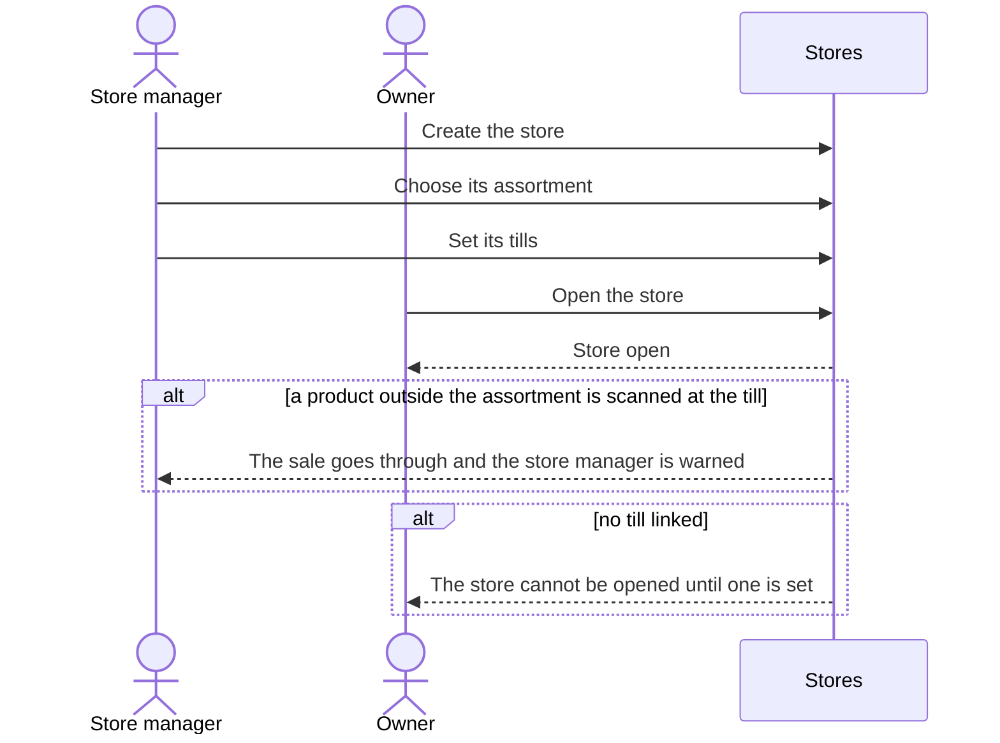

🏠 [Specs](../../../../README.md) › 🏷️ [Sectors](../../../README.md) › 🛍️ [SC02 Retail](../../README.md) ›
📝 [Use cases](../README.md) › 📝 [Use cases: FL-SC02-01 Set up the stores](README.md) ›
📝 UC-SC02-01 Set up stores and their assortments

# 📝 UC-SC02-01 Set up stores and their assortments

**Status:** ✅ specified

## Summary

The store manager sets up a store with its address, hours, surface, tills and Sunday exemptions, and chooses the
assortment it sells, so that replenishment and the tills know what belongs there.

## Personas

- [U23 Store manager](../../../../01-users/personas/u23-store-manager.md)
- [U13 Owner](../../../../01-users/personas/u13-owner.md)

## Goal

Each store open with its own assortment, hours and tills.

## Trigger

A new store opens, or a season changes the assortment.

## Frequency

A few times a year per store.

## Preconditions

- The SC02 sector pack is installed for the company,
  [UC-F14-02](../../../../02-functional/f14-plugin-store/use-cases/01-find-and-install/uc-f14-02-install-a-plugin-or-sector-pack.md),
  and its users have their roles,
  [UC-F1-06](../../../../02-functional/f01-administration/use-cases/04-edit-a-role/uc-f01-06-edit-a-role-and-its-record-rules.md).
- The store's site exists in the company,
  [UC-F1-02](../../../../02-functional/f01-administration/use-cases/02-manage-sites/uc-f01-02-add-or-change-a-site.md).

## Postconditions

- **Success:** the store is open, its tills set and its assortment active for the season.
- **Failed:** the store stays in preparation; nothing is sold there.

## Main flow

1. The store manager creates the store on [S-SC02-01 Stores](../../screens/01-set-up-the-stores/s-sc02-01-stores.md):
   name, address, surface, hours and Sunday exemptions.
2. The store manager chooses the categories and products the store sells for the season.
3. The store manager links the store's tills and printers,
   [UC-F10-15](../../../../02-functional/f10-point-of-sale/use-cases/07-set-up-and-report/uc-f10-15-set-up-a-point-of-sale-and-its-hardware.md).
4. The owner sets the store to open; its stock and sales start counting.

## Alternative flows

- 1a. A franchise store: the store belongs to the franchisee's company and shares the catalogue and prices only.
- 2a. A season change: the new assortment applies from the season's start date.

## Error flows

- 2e. A product outside the assortment is scanned at the till: the sale goes through and the store manager is warned.
- 4e. No till linked: the store cannot be opened until one is set.
- Any step: a call to a service or an outside system fails: it is retried first
  ([BR-F3-32](../../../../02-functional/f03-assistant/business-rules/br-f03-32-retry-before-an-error.md)), then the
  error message pattern ([D122](../../../../06-decisions/ux/d122-error-message-standard.md)) says what failed; what was
  typed is kept.

## Business rules

- [BR-SC02-01 Retail follows the country pack](../../business-rules/br-sc02-01-retail-follows-the-country-pack.md)

## Entities

- [E-SC02-01 Store](../../data/e-sc02-01-store.md)
- [E-SC02-02 Assortment](../../data/e-sc02-02-assortment.md)

## Permissions

The store manager and owner roles; the record rules of their role and site apply,
[UC-F1-06](../../../../02-functional/f01-administration/use-cases/04-edit-a-role/uc-f01-06-edit-a-role-and-its-record-rules.md).

## Notifications

- The store's staff are told when the store opens.

## Audit events

Every creation, change and state change of store, assortment records, with who, when and the values before and after
(T3).

## AI involvement

The AI assistant answers questions on the store, assortment records of this use case, with links, and prepares them as
drafts the user confirms. It works within the user's rights,
[BR-F3-34](../../../../02-functional/f03-assistant/business-rules/br-f03-34-every-capability-is-reachable-from-the-assistant.md),
and never deletes or does anything irreversible without the user's confirmation,
[BR-F3-07](../../../../02-functional/f03-assistant/business-rules/br-f03-07-no-deletes-no-irreversible-acts.md).

## API, MCP and A2A exposure

Through the API and webhooks (T5) and the MCP and A2A gateway (T6), with the caller's rights,
[BR-F3-34](../../../../02-functional/f03-assistant/business-rules/br-f03-34-every-capability-is-reachable-from-the-assistant.md),
reading, creating and changing the records of this use case; nothing irreversible without a person's confirmation.

## Screens

- [S-SC02-01 Stores](../../screens/01-set-up-the-stores/s-sc02-01-stores.md)

## Flowchart

See [FL-SC02-01 Set up the stores](../../flows/fl-sc02-01-set-up-the-stores.md#flowchart).

## Sequence diagram

## Acceptance criteria

1. **Given** the example shop chain's store Lyon 2, rue de la République, 420 m2, assortment Women and Home for SS27
   **when** the owner opens it **then** Lyon 2 sells Women and Home products from its tills.
2. **Given** a franchisee in Annecy **when** the store is created **then** the store belongs to the franchisee's company
   and shares the catalogue and prices only.
3. **Given** Coffee 250 g scanned in a store selling Women only **when** the cashier scans it **then** the sale goes
   through and the store manager is warned.

## Non-functional notes

[D408](../../../../06-decisions/technical/d408-performance-and-profiles.md)'s targets
([performance](../../../../05-non-functional/performance.md)): 95 % of screens within 1 second; lists paged on the
server, the first page within 1 second; reports within 5 seconds or in the background. WCAG 2.2 AA and RGAA
([D46](../../../../06-decisions/ux/d46-accessibility-standard.md)).

## Regulatory references

None specific to this use case; the sector's legal rules are listed in [SC02 regulatory](../../regulatory.md).

## Related use cases

- [UC-SC02-02 Manage size and colour grids and seasons](uc-sc02-02-manage-size-and-colour-grids-and-seasons.md)
- [UC-SC02-03 Replenish stores from the warehouse](../02-keep-stock-right/uc-sc02-03-replenish-stores-from-the-warehouse.md)

## Open questions

None.

---

⬆️ [Up](README.md) ·
➡️ [UC-SC02-02 Manage size and colour grids and seasons](uc-sc02-02-manage-size-and-colour-grids-and-seasons.md)
