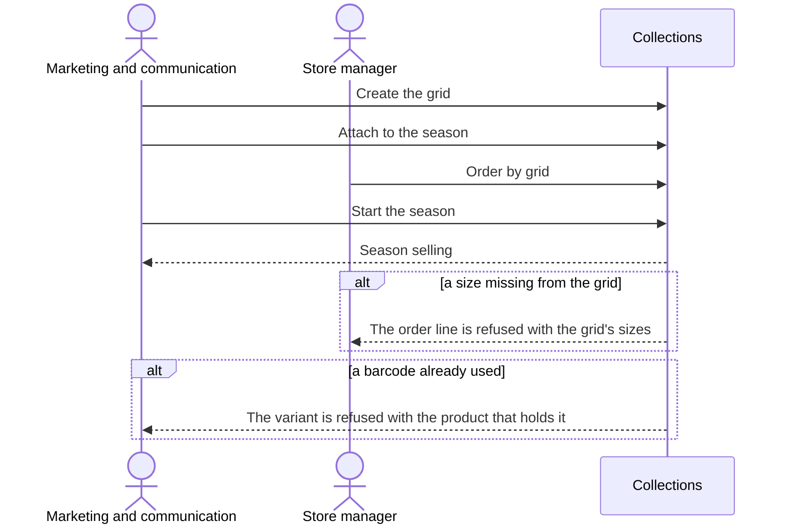

🏠 [Specs](../../../../README.md) › 🏷️ [Sectors](../../../README.md) › 🛍️ [SC02 Retail](../../README.md) ›
📝 [Use cases](../README.md) › 📝 [Use cases: FL-SC02-01 Set up the stores](README.md) ›
📝 UC-SC02-02 Manage size and colour grids and seasons

# 📝 UC-SC02-02 Manage size and colour grids and seasons

**Status:** ✅ specified

## Summary

Marketing and the store manager create products with their size and colour grid, attach them to a collection and a
season, and order them by grid.

## Personas

- [U23 Store manager](../../../../01-users/personas/u23-store-manager.md)
- [U12 Marketing and communication](../../../../01-users/personas/u12-marketing.md)

## Goal

Every variant of a product known with its code, sold and stocked by size and colour.

## Trigger

A new collection is prepared.

## Frequency

Twice a year per season, plus carry-over items.

## Preconditions

- The SC02 sector pack is installed for the company,
  [UC-F14-02](../../../../02-functional/f14-plugin-store/use-cases/01-find-and-install/uc-f14-02-install-a-plugin-or-sector-pack.md),
  and its users have their roles,
  [UC-F1-06](../../../../02-functional/f01-administration/use-cases/04-edit-a-role/uc-f01-06-edit-a-role-and-its-record-rules.md).

## Postconditions

- **Success:** the grid's variants exist with their codes and the season is selling.
- **Failed:** the products stay drafts; nothing is ordered.

## Main flow

1. Marketing creates the product's grid on
   [S-SC02-02 Collections](../../screens/01-set-up-the-stores/s-sc02-02-collections.md): sizes and colours, each variant
   with its barcode.
2. Marketing attaches the products to the collection and season with their dates.
3. The store manager orders quantities per size and colour,
   [UC-F7-02](../../../../02-functional/f07-purchasing-and-stock/use-cases/01-procure/uc-f07-02-order-from-a-supplier.md).
4. Marketing sets the season to selling on its date.

## Alternative flows

- 2a. Carry-over items: the item stays in the new season with its stock and price.

## Error flows

- 3e. A size missing from the grid: the order line is refused with the grid's sizes.
- 1e. A barcode already used: the variant is refused with the product that holds it.
- Any step: a call to a service or an outside system fails: it is retried first
  ([BR-F3-32](../../../../02-functional/f03-assistant/business-rules/br-f03-32-retry-before-an-error.md)), then the
  error message pattern ([D122](../../../../06-decisions/ux/d122-error-message-standard.md)) says what failed; what was
  typed is kept.

## Business rules

- [BR-SC02-01 Retail follows the country pack](../../business-rules/br-sc02-01-retail-follows-the-country-pack.md)

## Entities

- [E-SC02-03 Product grid](../../data/e-sc02-03-product-grid.md)
- [E-SC02-04 Season](../../data/e-sc02-04-season.md)

## Permissions

The store manager and marketing and communication roles; the record rules of their role and site apply,
[UC-F1-06](../../../../02-functional/f01-administration/use-cases/04-edit-a-role/uc-f01-06-edit-a-role-and-its-record-rules.md).

## Notifications

None beyond the in-app updates of the records concerned.

## Audit events

Every creation, change and state change of product grid, season records, with who, when and the values before and after
(T3).

## AI involvement

The AI assistant answers questions on the product grid, season records of this use case, with links, and prepares them
as drafts the user confirms. It works within the user's rights,
[BR-F3-34](../../../../02-functional/f03-assistant/business-rules/br-f03-34-every-capability-is-reachable-from-the-assistant.md),
and never deletes or does anything irreversible without the user's confirmation,
[BR-F3-07](../../../../02-functional/f03-assistant/business-rules/br-f03-07-no-deletes-no-irreversible-acts.md).

## API, MCP and A2A exposure

Through the API and webhooks (T5) and the MCP and A2A gateway (T6), with the caller's rights,
[BR-F3-34](../../../../02-functional/f03-assistant/business-rules/br-f03-34-every-capability-is-reachable-from-the-assistant.md),
reading, creating and changing the records of this use case; nothing irreversible without a person's confirmation.

## Screens

- [S-SC02-02 Collections](../../screens/01-set-up-the-stores/s-sc02-02-collections.md)

## Flowchart

See [FL-SC02-01 Set up the stores](../../flows/fl-sc02-01-set-up-the-stores.md#flowchart).

## Sequence diagram

## Acceptance criteria

1. **Given** the example shop chain's Shirt S1 with sizes S to XL in blue and white **when** the grid is saved **then**
   8 variants exist, each with its own barcode.
2. **Given** Shirt S1 kept from SS26 to SS27 **when** SS27 starts **then** the item stays in the new season with its
   stock and price.
3. **Given** Shirt S1 with sizes S to XL **when** an order asks for XXL **then** the order line is refused with the
   grid's sizes.

## Non-functional notes

[D408](../../../../06-decisions/technical/d408-performance-and-profiles.md)'s targets
([performance](../../../../05-non-functional/performance.md)): 95 % of screens within 1 second; lists paged on the
server, the first page within 1 second; reports within 5 seconds or in the background. WCAG 2.2 AA and RGAA
([D46](../../../../06-decisions/ux/d46-accessibility-standard.md)).

## Regulatory references

None specific to this use case; the sector's legal rules are listed in [SC02 regulatory](../../regulatory.md).

## Related use cases

- [UC-SC02-01 Set up stores and their assortments](uc-sc02-01-set-up-stores-and-their-assortments.md)
- [UC-SC02-05 Print shelf labels with unit prices](uc-sc02-05-print-shelf-labels-with-unit-prices.md)

## Open questions

None.

---

⬅️ [UC-SC02-01 Set up stores and their assortments](uc-sc02-01-set-up-stores-and-their-assortments.md) ·
⬆️ [Up](README.md) · ➡️ [UC-SC02-03](../02-keep-stock-right/uc-sc02-03-replenish-stores-from-the-warehouse.md)
