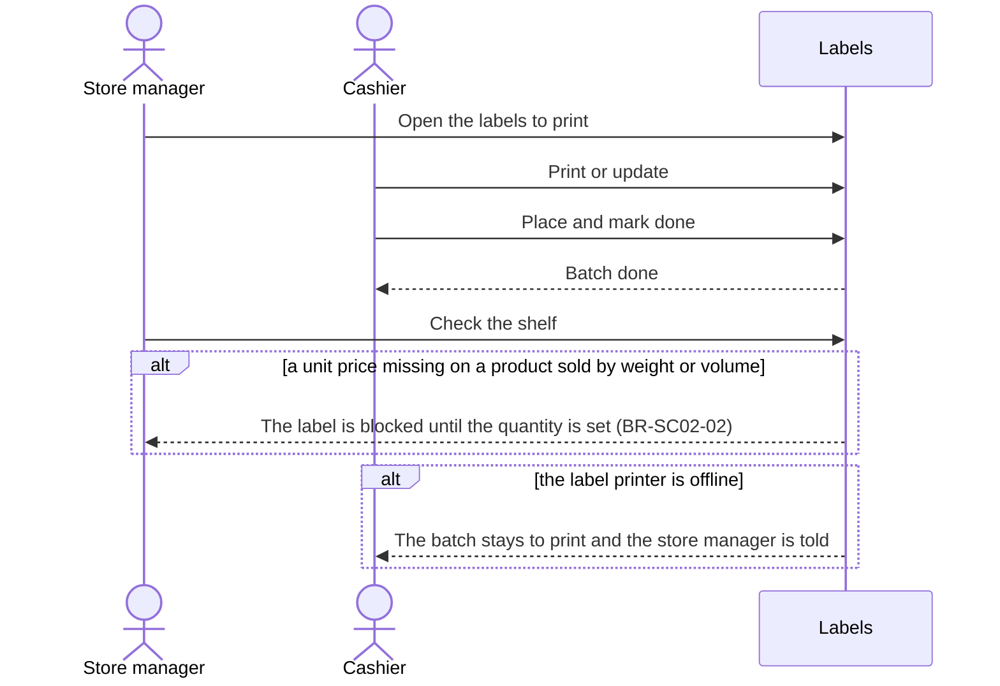

🏠 [Specs](../../../../README.md) › 🏷️ [Sectors](../../../README.md) › 🛍️ [SC02 Retail](../../README.md) ›
📝 [Use cases](../README.md) › 📝 [Use cases: FL-SC02-01 Set up the stores](README.md) ›
📝 UC-SC02-05 Print shelf labels with unit prices

# 📝 UC-SC02-05 Print shelf labels with unit prices

**Status:** ✅ specified

## Summary

When prices change, the store manager or a cashier prints the new shelf labels, or updates the electronic labels, with
the price including VAT and the unit price, before the price applies.

## Personas

- [U23 Store manager](../../../../01-users/personas/u23-store-manager.md)
- [U17 Cashier](../../../../01-users/personas/u17-cashier.md)

## Goal

Shelf prices always match the till, with their unit price.

## Trigger

A price change, a markdown or a new product.

## Frequency

Weekly in each store, more in sales periods.

## Preconditions

- The SC02 sector pack is installed for the company,
  [UC-F14-02](../../../../02-functional/f14-plugin-store/use-cases/01-find-and-install/uc-f14-02-install-a-plugin-or-sector-pack.md),
  and its users have their roles,
  [UC-F1-06](../../../../02-functional/f01-administration/use-cases/04-edit-a-role/uc-f01-06-edit-a-role-and-its-record-rules.md).

## Postconditions

- **Success:** the labels are printed or updated and marked done before the price applies.
- **Failed:** the labels stay to do and the store manager is reminded.

## Main flow

1. The store manager opens [S-SC02-05 Labels](../../screens/01-set-up-the-stores/s-sc02-05-labels.md): the products
   whose price changes in this store.
2. The cashier prints the labels, or simple-ERP updates the electronic labels through their connector (T12).
3. The cashier places them and marks the batch done
   ([BR-SC02-03](../../business-rules/br-sc02-03-labels-follow-price-changes.md)).
4. The store manager checks a sample of shelves against the till price before the new price applies.

## Alternative flows

- 1a. Labels for a sales period: the labels show the reference price and the reduction
  ([BR-SC02-05](../../business-rules/br-sc02-05-reductions-show-the-reference-price.md)).

## Error flows

- 1e. A unit price missing on a product sold by weight or volume: the label is blocked until the quantity is set
  ([BR-SC02-02](../../business-rules/br-sc02-02-every-product-priced.md)).
- 2e. The label printer is offline: the batch stays to print and the store manager is told.
- Any step: a call to a service or an outside system fails: it is retried first
  ([BR-F3-32](../../../../02-functional/f03-assistant/business-rules/br-f03-32-retry-before-an-error.md)), then the
  error message pattern ([D122](../../../../06-decisions/ux/d122-error-message-standard.md)) says what failed; what was
  typed is kept.

## Business rules

- [BR-SC02-02 Every product priced, with its unit price](../../business-rules/br-sc02-02-every-product-priced.md)
- [BR-SC02-03 Labels follow price changes](../../business-rules/br-sc02-03-labels-follow-price-changes.md)
- [BR-SC02-05 Reductions show the reference price](../../business-rules/br-sc02-05-reductions-show-the-reference-price.md)

## Entities

- [E-SC02-07 Shelf label](../../data/e-sc02-07-shelf-label.md)

## Permissions

The store manager and cashier roles; the record rules of their role and site apply,
[UC-F1-06](../../../../02-functional/f01-administration/use-cases/04-edit-a-role/uc-f01-06-edit-a-role-and-its-record-rules.md).

## Notifications

None beyond the in-app updates of the records concerned.

## Audit events

Every creation, change and state change of shelf label records, with who, when and the values before and after (T3).

## AI involvement

The AI assistant answers questions on the shelf label records of this use case, with links, and prepares them as drafts
the user confirms. It works within the user's rights,
[BR-F3-34](../../../../02-functional/f03-assistant/business-rules/br-f03-34-every-capability-is-reachable-from-the-assistant.md),
and never deletes or does anything irreversible without the user's confirmation,
[BR-F3-07](../../../../02-functional/f03-assistant/business-rules/br-f03-07-no-deletes-no-irreversible-acts.md).

## API, MCP and A2A exposure

Through the API and webhooks (T5) and the MCP and A2A gateway (T6), with the caller's rights,
[BR-F3-34](../../../../02-functional/f03-assistant/business-rules/br-f03-34-every-capability-is-reachable-from-the-assistant.md),
reading, creating and changing the records of this use case; nothing irreversible without a person's confirmation.

## Screens

- [S-SC02-05 Labels](../../screens/01-set-up-the-stores/s-sc02-05-labels.md)

## Flowchart

See [FL-SC02-01 Set up the stores](../../flows/fl-sc02-01-set-up-the-stores.md#flowchart).

## Sequence diagram

## Acceptance criteria

1. **Given** the example shop chain's Coffee 250 g at 4.20 EUR in Lyon 2 **when** its label is printed **then** it shows
   4.20 EUR and 16.80 EUR per kg.
2. **Given** Shirt S1 at 39.90 EUR marked down 30 % **when** the labels are printed **then** the labels show the
   reference price and the reduction
   ([BR-SC02-05](../../business-rules/br-sc02-05-reductions-show-the-reference-price.md)).
3. **Given** Coffee 250 g without its net quantity **when** its label is printed **then** the label is blocked until the
   quantity is set ([BR-SC02-02](../../business-rules/br-sc02-02-every-product-priced.md)).

## Non-functional notes

[D408](../../../../06-decisions/technical/d408-performance-and-profiles.md)'s targets
([performance](../../../../05-non-functional/performance.md)): 95 % of screens within 1 second; lists paged on the
server, the first page within 1 second; reports within 5 seconds or in the background. WCAG 2.2 AA and RGAA
([D46](../../../../06-decisions/ux/d46-accessibility-standard.md)).

## Regulatory references

Legal values from the France country pack:
[CR-FR-092 Price and unit-price display in shops](../../../../10-country-packs/france/consumer/cr-fr-092-unit-price-display.md),
[CR-FR-034 Consumers see prices including VAT](../../../../10-country-packs/france/consumer/cr-fr-034-prices-shown-including-vat.md),
[CR-FR-035 Reference price of a price reduction](../../../../10-country-packs/france/consumer/cr-fr-035-reference-price-for-reductions.md).

## Related use cases

- [UC-SC02-06 Run sales periods and markdowns](uc-sc02-06-run-sales-periods-and-markdowns.md)

## Open questions

None.

---

⬅️ [UC-SC02-04 Transfer stock between stores](../02-keep-stock-right/uc-sc02-04-transfer-stock-between-stores.md) ·
⬆️ [Up](README.md) · ➡️ [UC-SC02-06 Run sales periods and markdowns](uc-sc02-06-run-sales-periods-and-markdowns.md)
