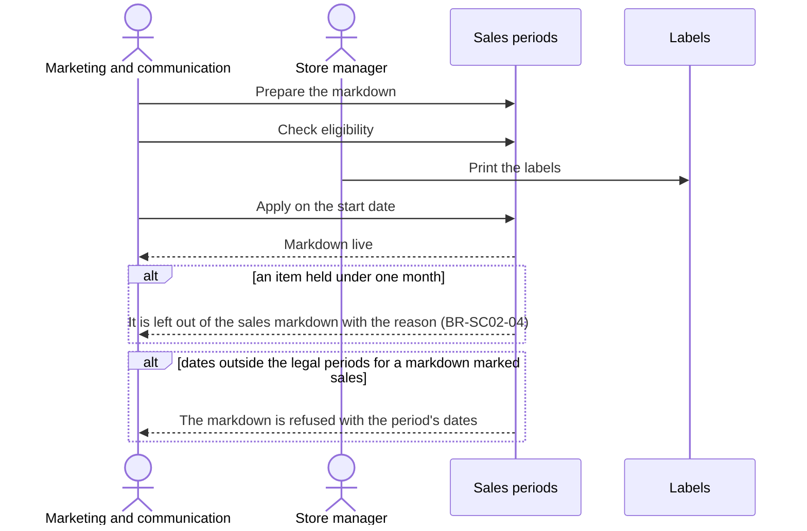

🏠 [Specs](../../../../README.md) › 🏷️ [Sectors](../../../README.md) › 🛍️ [SC02 Retail](../../README.md) ›
📝 [Use cases](../README.md) › 📝 [Use cases: FL-SC02-01 Set up the stores](README.md) ›
📝 UC-SC02-06 Run sales periods and markdowns

# 📝 UC-SC02-06 Run sales periods and markdowns

**Status:** ✅ specified

## Summary

Marketing prepares a markdown per store and channel; for the legal sales periods, simple-ERP checks each item's
eligibility and shows the reference price, then applies it on the start date.

## Personas

- [U12 Marketing and communication](../../../../01-users/personas/u12-marketing.md)
- [U23 Store manager](../../../../01-users/personas/u23-store-manager.md)

## Goal

Markdowns that respect the sales rules and reach every till and the online shop at once.

## Trigger

A sales period or a promotion is planned.

## Frequency

Twice a year for sales periods; promotions monthly.

## Preconditions

- The SC02 sector pack is installed for the company,
  [UC-F14-02](../../../../02-functional/f14-plugin-store/use-cases/01-find-and-install/uc-f14-02-install-a-plugin-or-sector-pack.md),
  and its users have their roles,
  [UC-F1-06](../../../../02-functional/f01-administration/use-cases/04-edit-a-role/uc-f01-06-edit-a-role-and-its-record-rules.md).

## Postconditions

- **Success:** the markdown applies on its dates in the chosen stores and channels.
- **Failed:** the markdown stays a draft.

## Main flow

1. Marketing creates the markdown on
   [S-SC02-06 Sales periods](../../screens/01-set-up-the-stores/s-sc02-06-sales-periods.md): kind, products, rate,
   stores and channels,
   [UC-F10-06](../../../../02-functional/f10-point-of-sale/use-cases/02-sell-at-the-counter/uc-f10-06-apply-prices-promotions-and-combos.md),
   [UC-F11-03](../../../../02-functional/f11-online-shop/use-cases/01-build-the-shop/uc-f11-03-set-online-prices-and-promotions.md).
2. For a sales period, simple-ERP keeps only items held at least one month before the start
   ([BR-SC02-04](../../business-rules/br-sc02-04-sales-only-in-the-legal-periods.md)).
3. The store manager prints the new labels ([UC-SC02-05](uc-sc02-05-print-shelf-labels-with-unit-prices.md)).
4. The markdown applies in the tills and the online shop at the start date and ends by itself.

## Alternative flows

- 1a. A private sale outside the periods: it runs without the word "sales" and without the sales period's rules.

## Error flows

- 2e. An item held under one month: it is left out of the sales markdown with the reason
  ([BR-SC02-04](../../business-rules/br-sc02-04-sales-only-in-the-legal-periods.md)).
- 4e. Dates outside the legal periods for a markdown marked sales: the markdown is refused with the period's dates.
- Any step: a call to a service or an outside system fails: it is retried first
  ([BR-F3-32](../../../../02-functional/f03-assistant/business-rules/br-f03-32-retry-before-an-error.md)), then the
  error message pattern ([D122](../../../../06-decisions/ux/d122-error-message-standard.md)) says what failed; what was
  typed is kept.

## Business rules

- [BR-SC02-04 Sales only in the legal periods](../../business-rules/br-sc02-04-sales-only-in-the-legal-periods.md)
- [BR-SC02-05 Reductions show the reference price](../../business-rules/br-sc02-05-reductions-show-the-reference-price.md)

## Entities

- [E-SC02-08 Markdown](../../data/e-sc02-08-markdown.md)

## Permissions

The marketing and communication and store manager roles; the record rules of their role and site apply,
[UC-F1-06](../../../../02-functional/f01-administration/use-cases/04-edit-a-role/uc-f01-06-edit-a-role-and-its-record-rules.md).

## Notifications

None beyond the in-app updates of the records concerned.

## Audit events

Every creation, change and state change of markdown records, with who, when and the values before and after (T3).

## AI involvement

The AI assistant answers questions on the markdown records of this use case, with links, and prepares them as drafts the
user confirms. It works within the user's rights,
[BR-F3-34](../../../../02-functional/f03-assistant/business-rules/br-f03-34-every-capability-is-reachable-from-the-assistant.md),
and never deletes or does anything irreversible without the user's confirmation,
[BR-F3-07](../../../../02-functional/f03-assistant/business-rules/br-f03-07-no-deletes-no-irreversible-acts.md).

## API, MCP and A2A exposure

Through the API and webhooks (T5) and the MCP and A2A gateway (T6), with the caller's rights,
[BR-F3-34](../../../../02-functional/f03-assistant/business-rules/br-f03-34-every-capability-is-reachable-from-the-assistant.md),
reading, creating and changing the records of this use case; nothing irreversible without a person's confirmation.

## Screens

- [S-SC02-06 Sales periods](../../screens/01-set-up-the-stores/s-sc02-06-sales-periods.md)
- [S-SC02-05 Labels](../../screens/01-set-up-the-stores/s-sc02-05-labels.md)

## Flowchart

See [FL-SC02-01 Set up the stores](../../flows/fl-sc02-01-set-up-the-stores.md#flowchart).

## Sequence diagram

## Acceptance criteria

1. **Given** the example shop chain's SS26 markdown at 30 % with a reference price of 39.90 EUR **when** it applies
   **then** the tills and the online shop sell at 27.93 EUR showing 39.90 EUR crossed out.
2. **Given** Shirt S1 blue received on 20 December for sales starting on 7 January **when** eligibility is checked
   **then** it is left out of the sales markdown with the reason
   ([BR-SC02-04](../../business-rules/br-sc02-04-sales-only-in-the-legal-periods.md)).

## Non-functional notes

[D408](../../../../06-decisions/technical/d408-performance-and-profiles.md)'s targets
([performance](../../../../05-non-functional/performance.md)): 95 % of screens within 1 second; lists paged on the
server, the first page within 1 second; reports within 5 seconds or in the background. WCAG 2.2 AA and RGAA
([D46](../../../../06-decisions/ux/d46-accessibility-standard.md)).

## Regulatory references

Legal values from the France country pack:
[CR-FR-093 Sales periods (soldes)](../../../../10-country-packs/france/consumer/cr-fr-093-sales-periods.md),
[CR-FR-035 Reference price of a price reduction](../../../../10-country-packs/france/consumer/cr-fr-035-reference-price-for-reductions.md).

## Related use cases

- [UC-SC02-05 Print shelf labels with unit prices](uc-sc02-05-print-shelf-labels-with-unit-prices.md)

## Open questions

None.

---

⬅️ [UC-SC02-05 Print shelf labels with unit prices](uc-sc02-05-print-shelf-labels-with-unit-prices.md) ·
⬆️ [Up](README.md) · ➡️ [UC-SC02-07 Count stock in store](../02-keep-stock-right/uc-sc02-07-count-stock-in-store.md)
