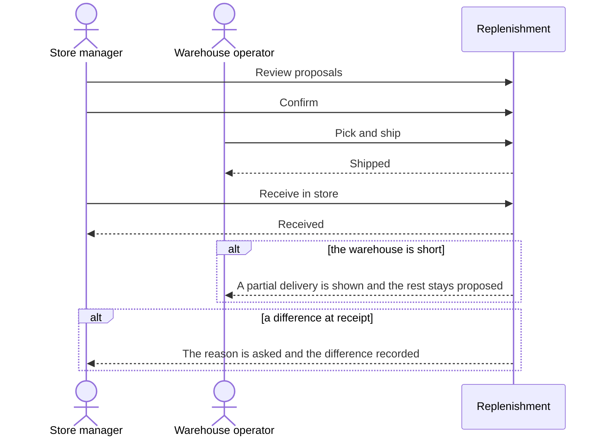

🏠 [Specs](../../../../README.md) › 🏷️ [Sectors](../../../README.md) › 🛍️ [SC02 Retail](../../README.md) ›
📝 [Use cases](../README.md) › 📝 [Use cases: FL-SC02-02 Keep stock right](README.md) ›
📝 UC-SC02-03 Replenish stores from the warehouse

# 📝 UC-SC02-03 Replenish stores from the warehouse

**Status:** ✅ specified

## Summary

The store manager reviews replenishment proposals computed from each store's minimum, maximum and sales; the warehouse
picks and delivers; the store receives.

## Personas

- [U23 Store manager](../../../../01-users/personas/u23-store-manager.md)
- [U15 Warehouse operator](../../../../01-users/personas/u15-warehouse-operator.md)

## Goal

Stores never short of what sells, with no excess.

## Trigger

The daily replenishment run.

## Frequency

Daily or weekly per store.

## Preconditions

- The SC02 sector pack is installed for the company,
  [UC-F14-02](../../../../02-functional/f14-plugin-store/use-cases/01-find-and-install/uc-f14-02-install-a-plugin-or-sector-pack.md),
  and its users have their roles,
  [UC-F1-06](../../../../02-functional/f01-administration/use-cases/04-edit-a-role/uc-f01-06-edit-a-role-and-its-record-rules.md).
- Each product has its minimum and maximum per store.

## Postconditions

- **Success:** the delivery is received in store and stock is up to the maximum.
- **Failed:** the proposal is not confirmed; the store stays below its minimum and is reminded.

## Main flow

1. The store manager reviews the proposals on
   [S-SC02-03 Replenishment](../../screens/02-keep-stock-right/s-sc02-03-replenishment.md); a transfer from a store with
   excess comes first ([BR-SC02-06](../../business-rules/br-sc02-06-replenish-from-min-max-and-sales.md)).
2. The store manager confirms or changes the quantities.
3. The warehouse operator picks and ships,
   [UC-F7-06](../../../../02-functional/f07-purchasing-and-stock/use-cases/04-pick-pack-and-ship/uc-f07-06-pick-pack-and-ship.md).
4. The store receives by scanning; stock goes up.

## Alternative flows

- 1a. Push allocation for a new collection: quantities are pushed per store by size curve without proposals.

## Error flows

- 3e. The warehouse is short: a partial delivery is shown and the rest stays proposed.
- 4e. A difference at receipt: the reason is asked and the difference recorded.
- Any step: a call to a service or an outside system fails: it is retried first
  ([BR-F3-32](../../../../02-functional/f03-assistant/business-rules/br-f03-32-retry-before-an-error.md)), then the
  error message pattern ([D122](../../../../06-decisions/ux/d122-error-message-standard.md)) says what failed; what was
  typed is kept.

## Business rules

- [BR-SC02-06 Replenish from min, max and sales](../../business-rules/br-sc02-06-replenish-from-min-max-and-sales.md)

## Entities

- [E-SC02-05 Replenishment rule](../../data/e-sc02-05-replenishment-rule.md)

## Permissions

The store manager and warehouse operator roles; the record rules of their role and site apply,
[UC-F1-06](../../../../02-functional/f01-administration/use-cases/04-edit-a-role/uc-f01-06-edit-a-role-and-its-record-rules.md).

## Notifications

None beyond the in-app updates of the records concerned.

## Audit events

Every creation, change and state change of replenishment rule records, with who, when and the values before and after
(T3).

## AI involvement

The AI assistant answers questions on the replenishment rule records of this use case, with links, and prepares them as
drafts the user confirms. It works within the user's rights,
[BR-F3-34](../../../../02-functional/f03-assistant/business-rules/br-f03-34-every-capability-is-reachable-from-the-assistant.md),
and never deletes or does anything irreversible without the user's confirmation,
[BR-F3-07](../../../../02-functional/f03-assistant/business-rules/br-f03-07-no-deletes-no-irreversible-acts.md).

## API, MCP and A2A exposure

Through the API and webhooks (T5) and the MCP and A2A gateway (T6), with the caller's rights,
[BR-F3-34](../../../../02-functional/f03-assistant/business-rules/br-f03-34-every-capability-is-reachable-from-the-assistant.md),
reading, creating and changing the records of this use case; nothing irreversible without a person's confirmation.

## Screens

- [S-SC02-03 Replenishment](../../screens/02-keep-stock-right/s-sc02-03-replenishment.md)

## Flowchart

See [FL-SC02-02 Keep stock right](../../flows/fl-sc02-02-keep-stock-right.md#flowchart).

## Sequence diagram

## Acceptance criteria

1. **Given** the example shop chain's Lyon 2 with Shirt S1 M at 1, minimum 2 and maximum 6 **when** proposals are
   computed **then** 5 Shirt S1 M are proposed.
2. **Given** 6 Shirt S1 M asked and 4 in the warehouse **when** the warehouse ships **then** a partial delivery is shown
   and the rest stays proposed.

## Non-functional notes

[D408](../../../../06-decisions/technical/d408-performance-and-profiles.md)'s targets
([performance](../../../../05-non-functional/performance.md)): 95 % of screens within 1 second; lists paged on the
server, the first page within 1 second; reports within 5 seconds or in the background. WCAG 2.2 AA and RGAA
([D46](../../../../06-decisions/ux/d46-accessibility-standard.md)).

## Regulatory references

None specific to this use case; the sector's legal rules are listed in [SC02 regulatory](../../regulatory.md).

## Related use cases

- [UC-SC02-04 Transfer stock between stores](uc-sc02-04-transfer-stock-between-stores.md)
- [UC-SC02-07 Count stock in store](uc-sc02-07-count-stock-in-store.md)

## Open questions

None.

---

⬅️ [UC-SC02-02](../01-set-up-the-stores/uc-sc02-02-manage-size-and-colour-grids-and-seasons.md) · ⬆️ [Up](README.md) ·
➡️ [UC-SC02-04 Transfer stock between stores](uc-sc02-04-transfer-stock-between-stores.md)
