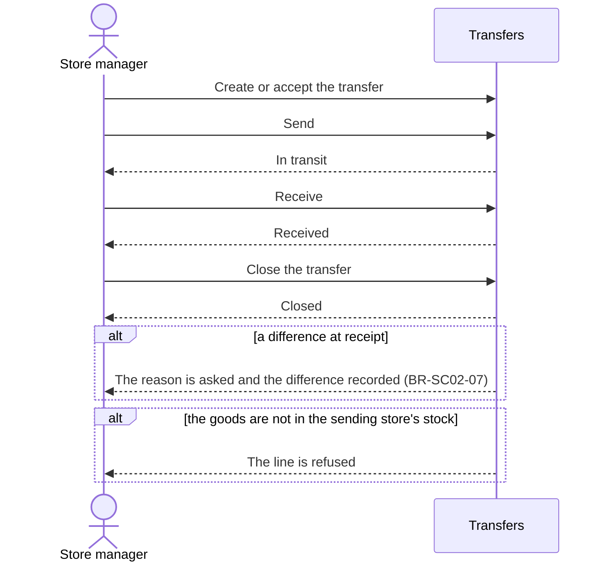

🏠 [Specs](../../../../README.md) › 🏷️ [Sectors](../../../README.md) › 🛍️ [SC02 Retail](../../README.md) ›
📝 [Use cases](../README.md) › 📝 [Use cases: FL-SC02-02 Keep stock right](README.md) ›
📝 UC-SC02-04 Transfer stock between stores

# 📝 UC-SC02-04 Transfer stock between stores

**Status:** ✅ specified

## Summary

The store manager creates or accepts a transfer proposal; the goods leave the sending store's stock, stay in transit and
enter the receiving store when scanned.

## Personas

- [U23 Store manager](../../../../01-users/personas/u23-store-manager.md)

## Goal

Stock moved where it sells, always counted somewhere.

## Trigger

A replenishment proposal, an excess, or a customer's request.

## Frequency

Several times a week across stores.

## Preconditions

- The SC02 sector pack is installed for the company,
  [UC-F14-02](../../../../02-functional/f14-plugin-store/use-cases/01-find-and-install/uc-f14-02-install-a-plugin-or-sector-pack.md),
  and its users have their roles,
  [UC-F1-06](../../../../02-functional/f01-administration/use-cases/04-edit-a-role/uc-f01-06-edit-a-role-and-its-record-rules.md).

## Postconditions

- **Success:** the transfer is received; both stores' stock is right.
- **Failed:** the transfer stays proposed or in transit.

## Main flow

1. The store manager creates a transfer on
   [S-SC02-04 Transfers](../../screens/02-keep-stock-right/s-sc02-04-transfers.md) or accepts a proposal,
   [UC-F10-26](../../../../02-functional/f10-point-of-sale/use-cases/10-clienteling-transfers-and-tax-free/uc-f10-26-look-up-and-transfer-stock-between-stores.md).
2. The sending store scans the goods; they leave its stock and go in transit
   ([BR-SC02-07](../../business-rules/br-sc02-07-transfers-in-transit.md)).
3. The receiving store scans them in.
4. The transfer is closed; both stores' stock and the transfer's value are posted,
   [UC-F7-09](../../../../02-functional/f07-purchasing-and-stock/use-cases/02-receive-and-store/uc-f07-09-value-stock-and-landed-costs.md).

## Alternative flows

- 1a. An urgent transfer for a customer: the transfer is linked to the customer's reservation and the customer is told
  when it arrives.

## Error flows

- 3e. A difference at receipt: the reason is asked and the difference recorded
  ([BR-SC02-07](../../business-rules/br-sc02-07-transfers-in-transit.md)).
- 2e. The goods are not in the sending store's stock: the line is refused.
- Any step: a call to a service or an outside system fails: it is retried first
  ([BR-F3-32](../../../../02-functional/f03-assistant/business-rules/br-f03-32-retry-before-an-error.md)), then the
  error message pattern ([D122](../../../../06-decisions/ux/d122-error-message-standard.md)) says what failed; what was
  typed is kept.

## Business rules

- [BR-SC02-07 Transfers in transit](../../business-rules/br-sc02-07-transfers-in-transit.md)
- [BR-SC02-06 Replenish from min, max and sales](../../business-rules/br-sc02-06-replenish-from-min-max-and-sales.md)

## Entities

- [E-SC02-06 Store transfer](../../data/e-sc02-06-store-transfer.md)

## Permissions

The store manager roles; the record rules of their role and site apply,
[UC-F1-06](../../../../02-functional/f01-administration/use-cases/04-edit-a-role/uc-f01-06-edit-a-role-and-its-record-rules.md).

## Notifications

None beyond the in-app updates of the records concerned.

## Audit events

Every creation, change and state change of store transfer records, with who, when and the values before and after (T3).

## AI involvement

The AI assistant answers questions on the store transfer records of this use case, with links, and prepares them as
drafts the user confirms. It works within the user's rights,
[BR-F3-34](../../../../02-functional/f03-assistant/business-rules/br-f03-34-every-capability-is-reachable-from-the-assistant.md),
and never deletes or does anything irreversible without the user's confirmation,
[BR-F3-07](../../../../02-functional/f03-assistant/business-rules/br-f03-07-no-deletes-no-irreversible-acts.md).

## API, MCP and A2A exposure

Through the API and webhooks (T5) and the MCP and A2A gateway (T6), with the caller's rights,
[BR-F3-34](../../../../02-functional/f03-assistant/business-rules/br-f03-34-every-capability-is-reachable-from-the-assistant.md),
reading, creating and changing the records of this use case; nothing irreversible without a person's confirmation.

## Screens

- [S-SC02-04 Transfers](../../screens/02-keep-stock-right/s-sc02-04-transfers.md)

## Flowchart

See [FL-SC02-02 Keep stock right](../../flows/fl-sc02-02-keep-stock-right.md#flowchart).

## Sequence diagram

## Acceptance criteria

1. **Given** the example shop chain's transfer of 3 Shirt S1 M from Lyon 2 to Lyon 1 **when** it is sent **then** Lyon
   2's stock drops by 3 and the 3 show in transit.
2. **Given** 3 Shirt S1 M sent from Lyon 2 and 2 scanned in Lyon 1 **when** Lyon 1 receives **then** the reason is asked
   and the difference recorded ([BR-SC02-07](../../business-rules/br-sc02-07-transfers-in-transit.md)).

## Non-functional notes

[D408](../../../../06-decisions/technical/d408-performance-and-profiles.md)'s targets
([performance](../../../../05-non-functional/performance.md)): 95 % of screens within 1 second; lists paged on the
server, the first page within 1 second; reports within 5 seconds or in the background. WCAG 2.2 AA and RGAA
([D46](../../../../06-decisions/ux/d46-accessibility-standard.md)).

## Regulatory references

None specific to this use case; the sector's legal rules are listed in [SC02 regulatory](../../regulatory.md).

## Related use cases

- [UC-SC02-03 Replenish stores from the warehouse](uc-sc02-03-replenish-stores-from-the-warehouse.md)

## Open questions

None.

---

⬅️ [UC-SC02-03 Replenish stores from the warehouse](uc-sc02-03-replenish-stores-from-the-warehouse.md) ·
⬆️ [Up](README.md) · ➡️ [UC-SC02-05](../01-set-up-the-stores/uc-sc02-05-print-shelf-labels-with-unit-prices.md)
