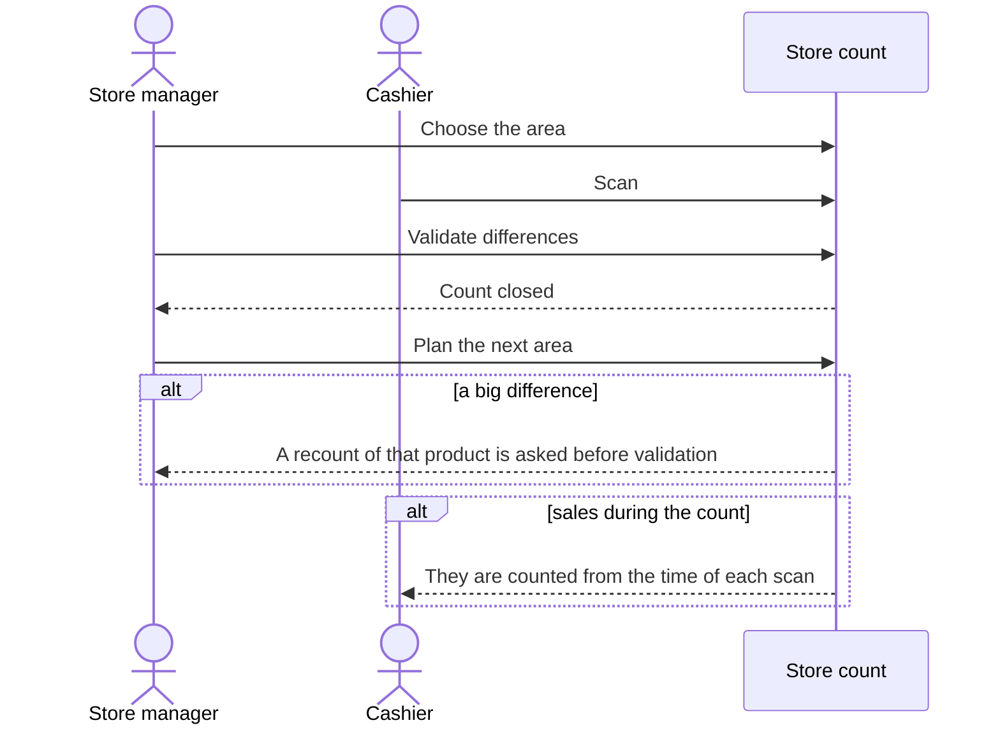

🏠 [Specs](../../../../README.md) › 🏷️ [Sectors](../../../README.md) › 🛍️ [SC02 Retail](../../README.md) ›
📝 [Use cases](../README.md) › 📝 [Use cases: FL-SC02-02 Keep stock right](README.md) ›
📝 UC-SC02-07 Count stock in store

# 📝 UC-SC02-07 Count stock in store

**Status:** ✅ specified

## Summary

The store manager runs cycle counts by area and full inventories; cashiers scan; differences are validated and posted.

## Personas

- [U23 Store manager](../../../../01-users/personas/u23-store-manager.md)
- [U17 Cashier](../../../../01-users/personas/u17-cashier.md)

## Goal

Store stock that matches the shelves.

## Trigger

The count calendar, or a suspected gap.

## Frequency

Weekly cycle counts; one full inventory a year.

## Preconditions

- The SC02 sector pack is installed for the company,
  [UC-F14-02](../../../../02-functional/f14-plugin-store/use-cases/01-find-and-install/uc-f14-02-install-a-plugin-or-sector-pack.md),
  and its users have their roles,
  [UC-F1-06](../../../../02-functional/f01-administration/use-cases/04-edit-a-role/uc-f01-06-edit-a-role-and-its-record-rules.md).

## Postconditions

- **Success:** the counted quantities replace the book stock and the differences are posted.
- **Failed:** the count stays open; book stock is unchanged.

## Main flow

1. The store manager opens a count on
   [S-SC02-07 Store count](../../screens/02-keep-stock-right/s-sc02-07-store-count.md) for an area,
   [UC-F7-07](../../../../02-functional/f07-purchasing-and-stock/use-cases/05-count-trace-and-analyse/uc-f07-07-count-stock.md).
2. Cashiers scan the shelves with the phone.
3. The store manager validates the differences; they are posted to stock and accounting.
4. The store manager sets the next area of the cycle; the count calendar moves on.

## Alternative flows

- 2a. A blind count: the expected quantities are hidden from the counters.

## Error flows

- 3e. A big difference: a recount of that product is asked before validation (over 10 % or over 100 EUR).
- 2e. Sales during the count: they are counted from the time of each scan.
- Any step: a call to a service or an outside system fails: it is retried first
  ([BR-F3-32](../../../../02-functional/f03-assistant/business-rules/br-f03-32-retry-before-an-error.md)), then the
  error message pattern ([D122](../../../../06-decisions/ux/d122-error-message-standard.md)) says what failed; what was
  typed is kept.

## Business rules

- [BR-SC02-07 Transfers in transit](../../business-rules/br-sc02-07-transfers-in-transit.md)

## Entities

- [E-SC02-01 Store](../../data/e-sc02-01-store.md)

## Permissions

The store manager and cashier roles; the record rules of their role and site apply,
[UC-F1-06](../../../../02-functional/f01-administration/use-cases/04-edit-a-role/uc-f01-06-edit-a-role-and-its-record-rules.md).

## Notifications

None beyond the in-app updates of the records concerned.

## Audit events

Every creation, change and state change of store records, with who, when and the values before and after (T3).

## AI involvement

The AI assistant answers questions on the store records of this use case, with links, and prepares them as drafts the
user confirms. It works within the user's rights,
[BR-F3-34](../../../../02-functional/f03-assistant/business-rules/br-f03-34-every-capability-is-reachable-from-the-assistant.md),
and never deletes or does anything irreversible without the user's confirmation,
[BR-F3-07](../../../../02-functional/f03-assistant/business-rules/br-f03-07-no-deletes-no-irreversible-acts.md).

## API, MCP and A2A exposure

Through the API and webhooks (T5) and the MCP and A2A gateway (T6), with the caller's rights,
[BR-F3-34](../../../../02-functional/f03-assistant/business-rules/br-f03-34-every-capability-is-reachable-from-the-assistant.md),
reading, creating and changing the records of this use case; nothing irreversible without a person's confirmation.

## Screens

- [S-SC02-07 Store count](../../screens/02-keep-stock-right/s-sc02-07-store-count.md)

## Flowchart

See [FL-SC02-02 Keep stock right](../../flows/fl-sc02-02-keep-stock-right.md#flowchart).

## Sequence diagram

## Acceptance criteria

1. **Given** the example shop chain's area Women in Lyon 2 counted with 1 difference of 1 unit **when** the store
   manager validates **then** stock drops by 1 and the loss is posted.
2. **Given** 6 Shirt S1 M expected and 2 counted **when** the store manager validates **then** a recount of that product
   is asked before validation (over 10 % or over 100 EUR).

## Non-functional notes

[D408](../../../../06-decisions/technical/d408-performance-and-profiles.md)'s targets
([performance](../../../../05-non-functional/performance.md)): 95 % of screens within 1 second; lists paged on the
server, the first page within 1 second; reports within 5 seconds or in the background. WCAG 2.2 AA and RGAA
([D46](../../../../06-decisions/ux/d46-accessibility-standard.md)).

## Regulatory references

None specific to this use case; the sector's legal rules are listed in [SC02 regulatory](../../regulatory.md).

## Related use cases

- [UC-SC02-03 Replenish stores from the warehouse](uc-sc02-03-replenish-stores-from-the-warehouse.md)

## Open questions

None open.

---

⬅️ [UC-SC02-06 Run sales periods and markdowns](../01-set-up-the-stores/uc-sc02-06-run-sales-periods-and-markdowns.md) ·
⬆️ [Up](README.md) ·
➡️ [UC-SC02-08 Sell across channels](../03-sell-and-return-across-channels/uc-sc02-08-sell-across-channels.md)
