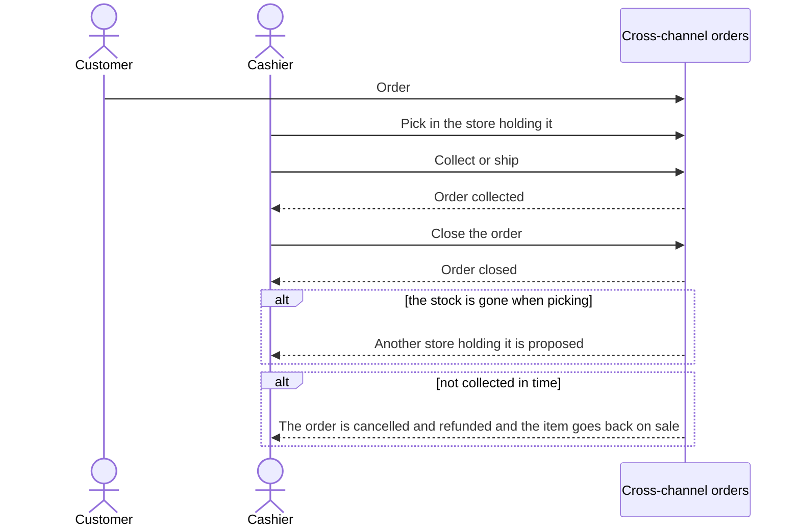

🏠 [Specs](../../../../README.md) › 🏷️ [Sectors](../../../README.md) › 🛍️ [SC02 Retail](../../README.md) ›
📝 [Use cases](../README.md) › 📝 [Use cases: FL-SC02-03 Sell and return across channels](README.md) ›
📝 UC-SC02-08 Sell across channels

# 📝 UC-SC02-08 Sell across channels

**Status:** ✅ specified

## Summary

Customers order online for click & collect or delivery, or the cashier orders at the till what the store does not hold;
the store holding it picks, and the order is collected or shipped.

## Personas

- [U17 Cashier](../../../../01-users/personas/u17-cashier.md)
- [U09 Customer](../../../../01-users/personas/u09-customer.md)

## Goal

No sale lost because the product is in another store.

## Trigger

An online order, or a customer at the till asking for a missing size.

## Frequency

Daily.

## Preconditions

- The SC02 sector pack is installed for the company,
  [UC-F14-02](../../../../02-functional/f14-plugin-store/use-cases/01-find-and-install/uc-f14-02-install-a-plugin-or-sector-pack.md),
  and its users have their roles,
  [UC-F1-06](../../../../02-functional/f01-administration/use-cases/04-edit-a-role/uc-f01-06-edit-a-role-and-its-record-rules.md).

## Postconditions

- **Success:** the order is picked in the store holding it and collected or shipped.
- **Failed:** the order is cancelled and refunded.

## Main flow

1. The customer orders online,
   [UC-F11-07](../../../../02-functional/f11-online-shop/use-cases/02-shop-and-check-out/uc-f11-07-choose-delivery-or-click-collect.md),
   or the cashier orders at the till on
   [S-SC02-08 Cross-channel orders](../../screens/03-sell-and-return-across-channels/s-sc02-08-cross-channel-orders.md)
   from all stores' stock ([BR-SC02-08](../../business-rules/br-sc02-08-one-stock-for-all-channels.md)).
2. The store holding it is told and picks the order,
   [UC-F11-28](../../../../02-functional/f11-online-shop/use-cases/10-fulfil-from-stores-and-report/uc-f11-28-fulfil-online-orders-from-a-store.md).
3. The customer collects with the order code, or the order is shipped.
4. The order is invoiced and the stock of the store that picked it goes down,
   [UC-F11-08](../../../../02-functional/f11-online-shop/use-cases/02-shop-and-check-out/uc-f11-08-confirm-the-order-and-invoice.md).

## Alternative flows

- 1a. A reservation in store: the item is held for the customer for a day and released after.

## Error flows

- 2e. The stock is gone when picking: another store holding it is proposed.
- 3e. Not collected in time: the order is cancelled and refunded and the item goes back on sale.
- Any step: a call to a service or an outside system fails: it is retried first
  ([BR-F3-32](../../../../02-functional/f03-assistant/business-rules/br-f03-32-retry-before-an-error.md)), then the
  error message pattern ([D122](../../../../06-decisions/ux/d122-error-message-standard.md)) says what failed; what was
  typed is kept.

## Business rules

- [BR-SC02-08 One stock for all channels](../../business-rules/br-sc02-08-one-stock-for-all-channels.md)
- [BR-SC02-13 Gift cards honoured until they expire](../../business-rules/br-sc02-13-gift-cards-honoured.md)

## Entities

- [E-SC02-01 Store](../../data/e-sc02-01-store.md)

## Permissions

The cashier and customer roles; the record rules of their role and site apply,
[UC-F1-06](../../../../02-functional/f01-administration/use-cases/04-edit-a-role/uc-f01-06-edit-a-role-and-its-record-rules.md).

## Notifications

- The customer gets a message when the order is ready.

## Audit events

Every creation, change and state change of store records, with who, when and the values before and after (T3).

## AI involvement

The AI assistant answers questions on the store records of this use case, with links, and prepares them as drafts the
user confirms. It works within the user's rights,
[BR-F3-34](../../../../02-functional/f03-assistant/business-rules/br-f03-34-every-capability-is-reachable-from-the-assistant.md),
and never deletes or does anything irreversible without the user's confirmation,
[BR-F3-07](../../../../02-functional/f03-assistant/business-rules/br-f03-07-no-deletes-no-irreversible-acts.md).

## API, MCP and A2A exposure

Through the API and webhooks (T5) and the MCP and A2A gateway (T6), with the caller's rights,
[BR-F3-34](../../../../02-functional/f03-assistant/business-rules/br-f03-34-every-capability-is-reachable-from-the-assistant.md),
reading, creating and changing the records of this use case; nothing irreversible without a person's confirmation.

## Screens

- [S-SC02-08 Cross-channel orders](../../screens/03-sell-and-return-across-channels/s-sc02-08-cross-channel-orders.md)

## Flowchart

See [FL-SC02-03 Sell and return across channels](../../flows/fl-sc02-03-sell-and-return-across-channels.md#flowchart).

## Sequence diagram

## Acceptance criteria

1. **Given** the example shop chain's Lyon 2 with no Shirt S1 M and Lyon 1 with 3 **when** the cashier orders one for a
   customer **then** Lyon 1 is told to pick it and ship it to the customer.
2. **Given** Shirt S1 M ordered in Lyon 2 with the last one sold at the till **when** Lyon 2 picks **then** another
   store holding it is proposed.

## Non-functional notes

[D408](../../../../06-decisions/technical/d408-performance-and-profiles.md)'s targets
([performance](../../../../05-non-functional/performance.md)): 95 % of screens within 1 second; lists paged on the
server, the first page within 1 second; reports within 5 seconds or in the background. WCAG 2.2 AA and RGAA
([D46](../../../../06-decisions/ux/d46-accessibility-standard.md)).

## Regulatory references

None specific to this use case; the sector's legal rules are listed in [SC02 regulatory](../../regulatory.md).

## Related use cases

- [UC-SC02-09 Return across channels](uc-sc02-09-return-across-channels.md)

## Open questions

None.

---

⬅️ [UC-SC02-07 Count stock in store](../02-keep-stock-right/uc-sc02-07-count-stock-in-store.md) · ⬆️ [Up](README.md) ·
➡️ [UC-SC02-09 Return across channels](uc-sc02-09-return-across-channels.md)
