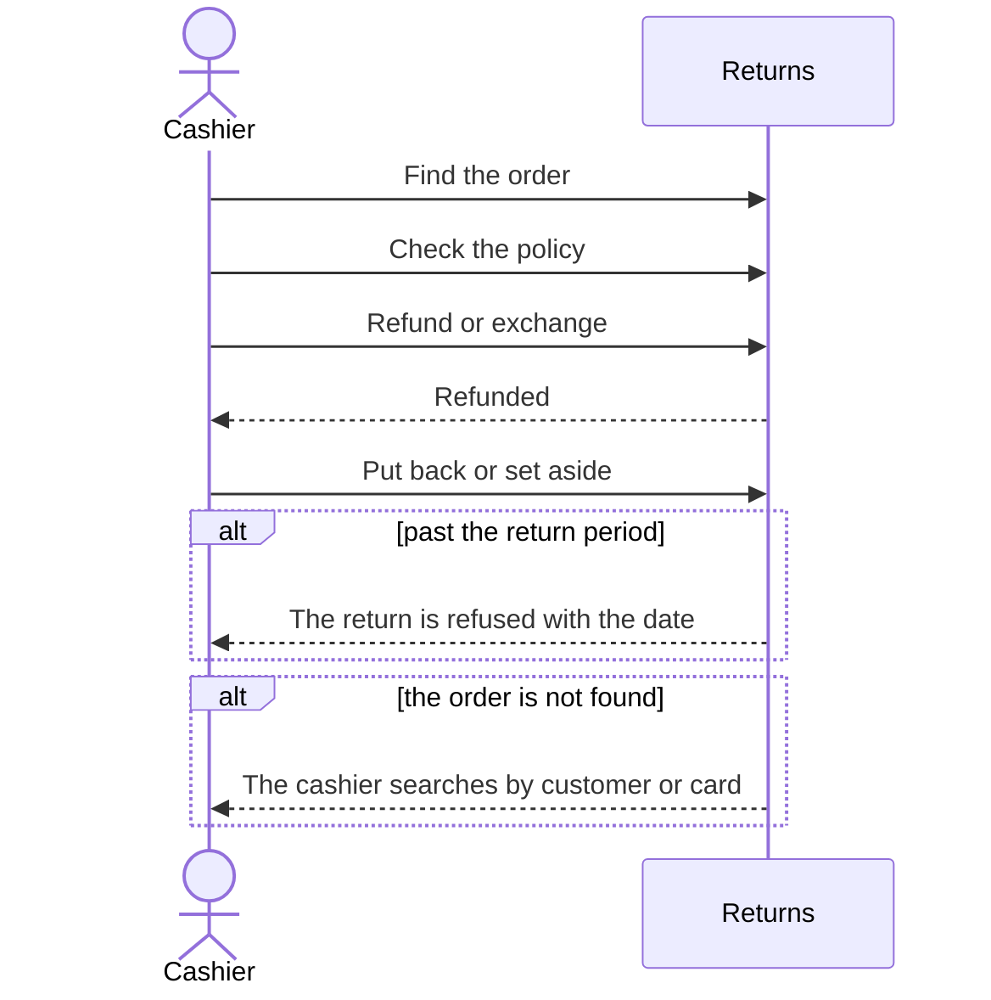

🏠 [Specs](../../../../README.md) › 🏷️ [Sectors](../../../README.md) › 🛍️ [SC02 Retail](../../README.md) ›
📝 [Use cases](../README.md) › 📝 [Use cases: FL-SC02-03 Sell and return across channels](README.md) ›
📝 UC-SC02-09 Return across channels

# 📝 UC-SC02-09 Return across channels

**Status:** ✅ specified

## Summary

The cashier finds an order from any channel, checks the return policy and the withdrawal right, and refunds or exchanges
in any store.

## Personas

- [U17 Cashier](../../../../01-users/personas/u17-cashier.md)
- [U09 Customer](../../../../01-users/personas/u09-customer.md)

## Goal

Customers return anywhere; stock and refunds are right.

## Trigger

A customer brings back a product.

## Frequency

Daily in each store.

## Preconditions

- The SC02 sector pack is installed for the company,
  [UC-F14-02](../../../../02-functional/f14-plugin-store/use-cases/01-find-and-install/uc-f14-02-install-a-plugin-or-sector-pack.md),
  and its users have their roles,
  [UC-F1-06](../../../../02-functional/f01-administration/use-cases/04-edit-a-role/uc-f01-06-edit-a-role-and-its-record-rules.md).

## Postconditions

- **Success:** the refund or exchange is done and the product is back in stock or set aside.
- **Failed:** the return is refused with the reason and nothing changes.

## Main flow

1. The cashier finds the order on
   [S-SC02-09 Returns](../../screens/03-sell-and-return-across-channels/s-sc02-09-returns.md) by receipt, order number
   or customer.
2. Simple-ERP shows the return period and the online withdrawal right
   ([BR-SC02-09](../../business-rules/br-sc02-09-return-anywhere.md)).
3. The cashier refunds or exchanges,
   [UC-F10-04](../../../../02-functional/f10-point-of-sale/use-cases/03-after-sales/uc-f10-04-refund-or-exchange.md);
   the receipt is given on request ([BR-SC02-12](../../business-rules/br-sc02-12-receipts-on-request.md)).
4. The cashier puts the product back on sale or sets it aside as damaged,
   [UC-F7-10](../../../../02-functional/f07-purchasing-and-stock/use-cases/04-pick-pack-and-ship/uc-f07-10-handle-returns-and-scrap.md).

## Alternative flows

- 3a. A return sent to the warehouse: the product goes to the warehouse's returns area.

## Error flows

- 2e. Past the return period: the return is refused with the date.
- 1e. The order is not found: the cashier searches by customer or card.
- Any step: a call to a service or an outside system fails: it is retried first
  ([BR-F3-32](../../../../02-functional/f03-assistant/business-rules/br-f03-32-retry-before-an-error.md)), then the
  error message pattern ([D122](../../../../06-decisions/ux/d122-error-message-standard.md)) says what failed; what was
  typed is kept.

## Business rules

- [BR-SC02-09 Return anywhere](../../business-rules/br-sc02-09-return-anywhere.md)
- [BR-SC02-12 Receipts on request](../../business-rules/br-sc02-12-receipts-on-request.md)

## Entities

- [E-SC02-01 Store](../../data/e-sc02-01-store.md)

## Permissions

The cashier and customer roles; the record rules of their role and site apply,
[UC-F1-06](../../../../02-functional/f01-administration/use-cases/04-edit-a-role/uc-f01-06-edit-a-role-and-its-record-rules.md).

## Notifications

None beyond the in-app updates of the records concerned.

## Audit events

Every creation, change and state change of store records, with who, when and the values before and after (T3).

## AI involvement

The AI assistant answers questions on the store records of this use case, with links, and prepares them as drafts the
user confirms. It works within the user's rights,
[BR-F3-34](../../../../02-functional/f03-assistant/business-rules/br-f03-34-every-capability-is-reachable-from-the-assistant.md),
and never deletes or does anything irreversible without the user's confirmation,
[BR-F3-07](../../../../02-functional/f03-assistant/business-rules/br-f03-07-no-deletes-no-irreversible-acts.md).

## API, MCP and A2A exposure

Through the API and webhooks (T5) and the MCP and A2A gateway (T6), with the caller's rights,
[BR-F3-34](../../../../02-functional/f03-assistant/business-rules/br-f03-34-every-capability-is-reachable-from-the-assistant.md),
reading, creating and changing the records of this use case; nothing irreversible without a person's confirmation.

## Screens

- [S-SC02-09 Returns](../../screens/03-sell-and-return-across-channels/s-sc02-09-returns.md)

## Flowchart

See [FL-SC02-03 Sell and return across channels](../../flows/fl-sc02-03-sell-and-return-across-channels.md#flowchart).

## Sequence diagram

## Acceptance criteria

1. **Given** the example shop chain's online order of 2 November delivered on 4 November **when** it is returned in Lyon
   2 on 15 November **then** it is refunded within the 14-day withdrawal right.
2. **Given** an order from 2 October with a 30-day policy **when** it is returned on 10 November **then** the return is
   refused with the date.

## Non-functional notes

[D408](../../../../06-decisions/technical/d408-performance-and-profiles.md)'s targets
([performance](../../../../05-non-functional/performance.md)): 95 % of screens within 1 second; lists paged on the
server, the first page within 1 second; reports within 5 seconds or in the background. WCAG 2.2 AA and RGAA
([D46](../../../../06-decisions/ux/d46-accessibility-standard.md)).

## Regulatory references

Legal values from the France country pack:
[CR-FR-036 Consumer withdrawal right](../../../../10-country-packs/france/consumer/cr-fr-036-withdrawal-right.md),
[CR-FR-031 Paper receipts on request only](../../../../10-country-packs/france/point-of-sale/cr-fr-031-paper-receipt-on-request.md).

## Related use cases

- [UC-SC02-08 Sell across channels](uc-sc02-08-sell-across-channels.md)

## Open questions

None.

---

⬅️ [UC-SC02-08 Sell across channels](uc-sc02-08-sell-across-channels.md) · ⬆️ [Up](README.md) ·
➡️ [UC-SC02-10 Know the customer](../04-customers-and-staff/uc-sc02-10-know-the-customer.md)
