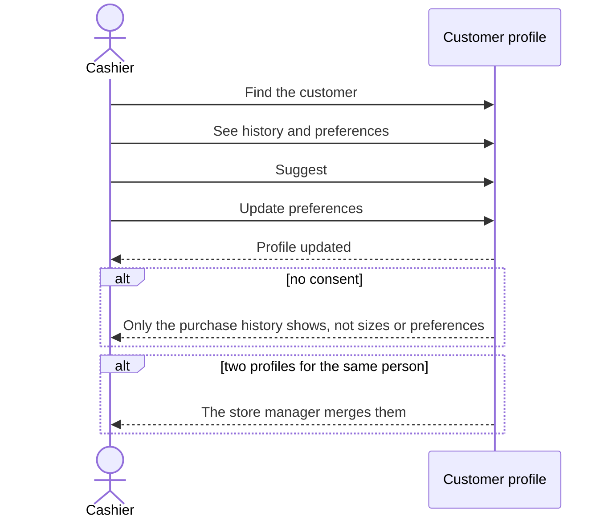

🏠 [Specs](../../../../README.md) › 🏷️ [Sectors](../../../README.md) › 🛍️ [SC02 Retail](../../README.md) ›
📝 [Use cases](../README.md) › 📝 [Use cases: FL-SC02-04 Customers and staff](README.md) ›
📝 UC-SC02-10 Know the customer

# 📝 UC-SC02-10 Know the customer

**Status:** ✅ specified

## Summary

The cashier or store manager finds a customer and sees their purchases, sizes, preferences and consents to suggest
products, only with the customer's consent.

## Personas

- [U17 Cashier](../../../../01-users/personas/u17-cashier.md)
- [U23 Store manager](../../../../01-users/personas/u23-store-manager.md)

## Goal

Personal advice that respects consent.

## Trigger

A customer at the till or in the store.

## Frequency

Many times a day.

## Preconditions

- The SC02 sector pack is installed for the company,
  [UC-F14-02](../../../../02-functional/f14-plugin-store/use-cases/01-find-and-install/uc-f14-02-install-a-plugin-or-sector-pack.md),
  and its users have their roles,
  [UC-F1-06](../../../../02-functional/f01-administration/use-cases/04-edit-a-role/uc-f01-06-edit-a-role-and-its-record-rules.md).

## Postconditions

- **Success:** the cashier sees the profile and suggests; preferences are updated with consent.
- **Failed:** only the purchase history shows.

## Main flow

1. The cashier finds the customer on
   [S-SC02-10 Customer profile](../../screens/04-customers-and-staff/s-sc02-10-customer-profile.md),
   [UC-F10-25](../../../../02-functional/f10-point-of-sale/use-cases/10-clienteling-transfers-and-tax-free/uc-f10-25-serve-a-customer-with-their-profile.md).
2. The cashier sees the purchases, sizes and preferences kept with consent
   ([BR-SC02-14](../../business-rules/br-sc02-14-clienteling-with-consent.md)).
3. The cashier suggests products in the customer's size and in stock.
4. With the customer's consent, the cashier updates sizes and preferences after the sale.

## Alternative flows

- 3a. Book an appointment: a styling appointment is booked,
  [UC-F4-18](../../../../02-functional/f04-meetings/use-cases/10-benchmark-additions/uc-f04-18-let-customers-book-appointments.md).

## Error flows

- 2e. No consent: only the purchase history shows, not sizes or preferences.
- 1e. Two profiles for the same person: the store manager merges them.
- Any step: a call to a service or an outside system fails: it is retried first
  ([BR-F3-32](../../../../02-functional/f03-assistant/business-rules/br-f03-32-retry-before-an-error.md)), then the
  error message pattern ([D122](../../../../06-decisions/ux/d122-error-message-standard.md)) says what failed; what was
  typed is kept.

## Business rules

- [BR-SC02-14 Clienteling with consent](../../business-rules/br-sc02-14-clienteling-with-consent.md)

## Entities

- [E-SC02-11 Customer profile](../../data/e-sc02-11-customer-profile.md)

## Permissions

The cashier and store manager roles; the record rules of their role and site apply,
[UC-F1-06](../../../../02-functional/f01-administration/use-cases/04-edit-a-role/uc-f01-06-edit-a-role-and-its-record-rules.md).

## Notifications

None beyond the in-app updates of the records concerned.

## Audit events

Every creation, change and state change of customer profile records, with who, when and the values before and after
(T3).

## AI involvement

The AI assistant answers questions on the customer profile records of this use case, with links, and prepares them as
drafts the user confirms. It works within the user's rights,
[BR-F3-34](../../../../02-functional/f03-assistant/business-rules/br-f03-34-every-capability-is-reachable-from-the-assistant.md),
and never deletes or does anything irreversible without the user's confirmation,
[BR-F3-07](../../../../02-functional/f03-assistant/business-rules/br-f03-07-no-deletes-no-irreversible-acts.md).

## API, MCP and A2A exposure

Through the API and webhooks (T5) and the MCP and A2A gateway (T6), with the caller's rights,
[BR-F3-34](../../../../02-functional/f03-assistant/business-rules/br-f03-34-every-capability-is-reachable-from-the-assistant.md),
reading, creating and changing the records of this use case; nothing irreversible without a person's confirmation.

## Screens

- [S-SC02-10 Customer profile](../../screens/04-customers-and-staff/s-sc02-10-customer-profile.md)

## Flowchart

See [FL-SC02-04 Customers and staff](../../flows/fl-sc02-04-customers-and-staff.md#flowchart).

## Sequence diagram

## Acceptance criteria

1. **Given** the example shop chain's customer J. Martin, size M, likes blue, newsletter consent **when** the cashier
   opens the profile **then** it shows size M, blue and the in-stock blue items in M.
2. **Given** J. Martin without consent **when** the cashier opens his profile **then** only the purchase history shows,
   not sizes or preferences.

## Non-functional notes

[D408](../../../../06-decisions/technical/d408-performance-and-profiles.md)'s targets
([performance](../../../../05-non-functional/performance.md)): 95 % of screens within 1 second; lists paged on the
server, the first page within 1 second; reports within 5 seconds or in the background. WCAG 2.2 AA and RGAA
([D46](../../../../06-decisions/ux/d46-accessibility-standard.md)).

## Regulatory references

Legal values from the France country pack:
[CR-FR-063 Consent for email and SMS marketing](../../../../10-country-packs/france/consumer/cr-fr-063-electronic-marketing-consent.md).

## Related use cases

- [UC-SC02-11 Set store targets and follow sales per staff](uc-sc02-11-set-store-targets-and-follow-sales-per-staff.md)

## Open questions

None.

---

⬅️ [UC-SC02-09 Return across channels](../03-sell-and-return-across-channels/uc-sc02-09-return-across-channels.md) ·
⬆️ [Up](README.md) · ➡️ [UC-SC02-11](uc-sc02-11-set-store-targets-and-follow-sales-per-staff.md)
