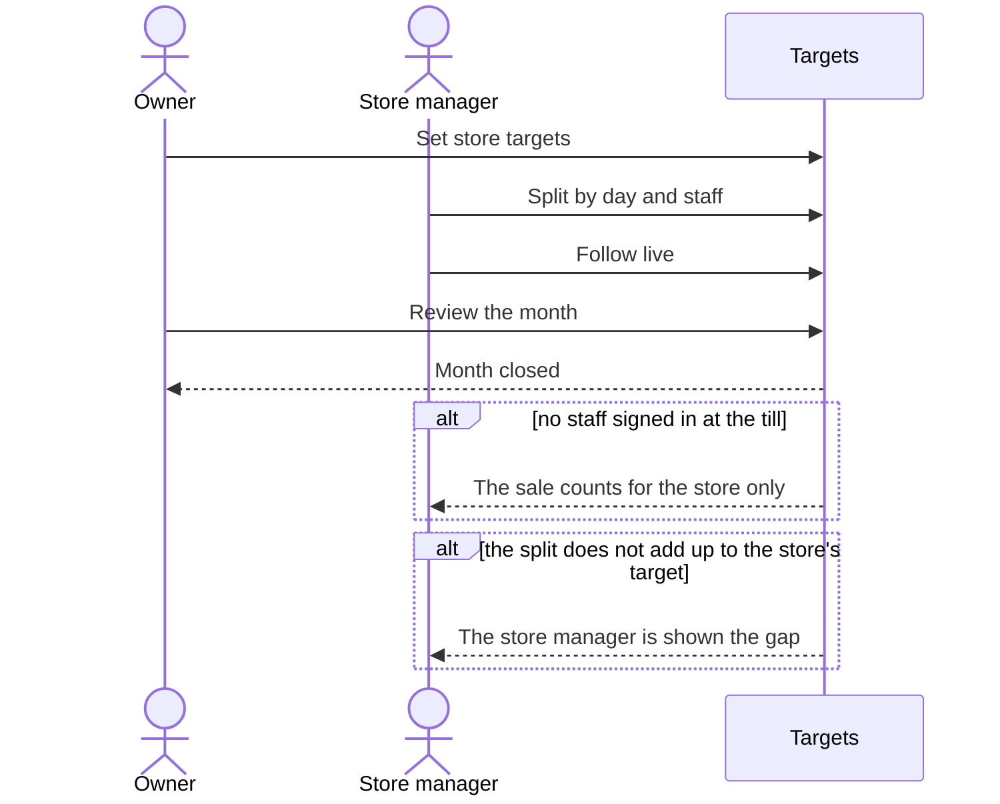

🏠 [Specs](../../../../README.md) › 🏷️ [Sectors](../../../README.md) › 🛍️ [SC02 Retail](../../README.md) ›
📝 [Use cases](../README.md) › 📝 [Use cases: FL-SC02-04 Customers and staff](README.md) ›
📝 UC-SC02-11 Set store targets and follow sales per staff

# 📝 UC-SC02-11 Set store targets and follow sales per staff

**Status:** ✅ specified

## Summary

The owner sets targets per store and month through the shared targets and commissions capability; the store manager
splits them by day and staff member and follows sales live.

## Personas

- [U23 Store manager](../../../../01-users/personas/u23-store-manager.md)
- [U13 Owner](../../../../01-users/personas/u13-owner.md)

## Goal

Every store and staff member knows their target and where they stand.

## Trigger

The start of a month.

## Frequency

Monthly; followed daily.

## Preconditions

- The SC02 sector pack is installed for the company,
  [UC-F14-02](../../../../02-functional/f14-plugin-store/use-cases/01-find-and-install/uc-f14-02-install-a-plugin-or-sector-pack.md),
  and its users have their roles,
  [UC-F1-06](../../../../02-functional/f01-administration/use-cases/04-edit-a-role/uc-f01-06-edit-a-role-and-its-record-rules.md).

## Postconditions

- **Success:** targets are set and followed; commissions on paid sales go to payroll.
- **Failed:** no target; sales are still recorded.

## Main flow

1. The owner sets each store's monthly target on
   [S-SC02-11 Targets](../../screens/04-customers-and-staff/s-sc02-11-targets.md),
   [UC-F6-25](../../../../02-functional/f06-customers-and-sales/use-cases/09-sell-on-the-road-and-steer-sales/uc-f06-25-set-sales-targets-and-pay-commissions.md).
2. The store manager splits it by day and staff member
   ([BR-SC02-15](../../business-rules/br-sc02-15-targets-per-store-and-staff.md)).
3. Each sale counts for the staff member signed in at the till.
4. The owner reviews the month; commissions follow the commission plan,
   [BR-F6-18](../../../../02-functional/f06-customers-and-sales/business-rules/br-f06-18-commissions-follow-paid-invoices.md).

## Alternative flows

- 2a. Team targets: the target is shared by the store's team.

## Error flows

- 3e. No staff signed in at the till: the sale counts for the store only.
- 2e. The split does not add up to the store's target: the store manager is shown the gap.
- Any step: a call to a service or an outside system fails: it is retried first
  ([BR-F3-32](../../../../02-functional/f03-assistant/business-rules/br-f03-32-retry-before-an-error.md)), then the
  error message pattern ([D122](../../../../06-decisions/ux/d122-error-message-standard.md)) says what failed; what was
  typed is kept.

## Business rules

- [BR-SC02-15 Targets per store and staff](../../business-rules/br-sc02-15-targets-per-store-and-staff.md)
- [BR-F6-18 Commissions follow paid invoices](../../../../02-functional/f06-customers-and-sales/business-rules/br-f06-18-commissions-follow-paid-invoices.md)

## Entities

- [E-SC02-09 Store target](../../data/e-sc02-09-store-target.md)

## Permissions

The store manager and owner roles; the record rules of their role and site apply,
[UC-F1-06](../../../../02-functional/f01-administration/use-cases/04-edit-a-role/uc-f01-06-edit-a-role-and-its-record-rules.md).

## Notifications

None beyond the in-app updates of the records concerned.

## Audit events

Every creation, change and state change of store target records, with who, when and the values before and after (T3).

## AI involvement

The AI assistant answers questions on the store target records of this use case, with links, and prepares them as drafts
the user confirms. It works within the user's rights,
[BR-F3-34](../../../../02-functional/f03-assistant/business-rules/br-f03-34-every-capability-is-reachable-from-the-assistant.md),
and never deletes or does anything irreversible without the user's confirmation,
[BR-F3-07](../../../../02-functional/f03-assistant/business-rules/br-f03-07-no-deletes-no-irreversible-acts.md).

## API, MCP and A2A exposure

Through the API and webhooks (T5) and the MCP and A2A gateway (T6), with the caller's rights,
[BR-F3-34](../../../../02-functional/f03-assistant/business-rules/br-f03-34-every-capability-is-reachable-from-the-assistant.md),
reading, creating and changing the records of this use case; nothing irreversible without a person's confirmation.

## Screens

- [S-SC02-11 Targets](../../screens/04-customers-and-staff/s-sc02-11-targets.md)

## Flowchart

See [FL-SC02-04 Customers and staff](../../flows/fl-sc02-04-customers-and-staff.md#flowchart).

## Sequence diagram

## Acceptance criteria

1. **Given** the example shop chain's Lyon 2 target of 42,000 EUR for November, L. B. at 8,000 EUR **when** L. B. sells
   2,000 EUR signed in **then** L. B. shows 25 % of her target.
2. **Given** a sale of 120 EUR made with no one signed in **when** the sale is recorded **then** the sale counts for the
   store only.

## Non-functional notes

[D408](../../../../06-decisions/technical/d408-performance-and-profiles.md)'s targets
([performance](../../../../05-non-functional/performance.md)): 95 % of screens within 1 second; lists paged on the
server, the first page within 1 second; reports within 5 seconds or in the background. WCAG 2.2 AA and RGAA
([D46](../../../../06-decisions/ux/d46-accessibility-standard.md)).

## Regulatory references

None specific to this use case; the sector's legal rules are listed in [SC02 regulatory](../../regulatory.md).

## Related use cases

- [UC-SC02-14 Follow store performance](../05-unsold-goods-and-performance/uc-sc02-14-follow-store-performance.md)

## Open questions

None.

---

⬅️ [UC-SC02-10 Know the customer](uc-sc02-10-know-the-customer.md) · ⬆️ [Up](README.md) ·
➡️ [UC-SC02-12 Plan staff schedules and Sunday openings](uc-sc02-12-plan-staff-schedules-and-sunday-openings.md)
