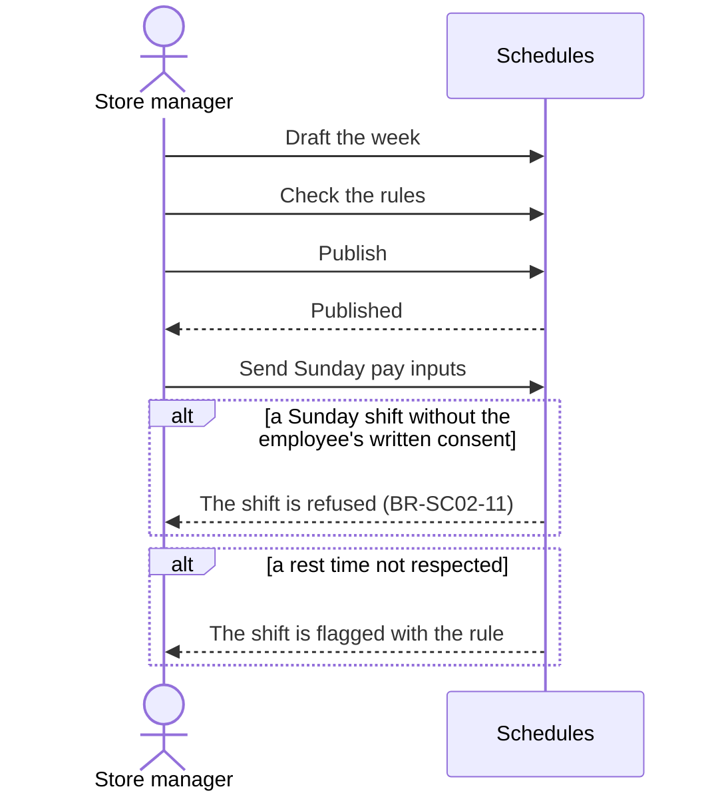

🏠 [Specs](../../../../README.md) › 🏷️ [Sectors](../../../README.md) › 🛍️ [SC02 Retail](../../README.md) ›
📝 [Use cases](../README.md) › 📝 [Use cases: FL-SC02-04 Customers and staff](README.md) ›
📝 UC-SC02-12 Plan staff schedules and Sunday openings

# 📝 UC-SC02-12 Plan staff schedules and Sunday openings

**Status:** ✅ specified

## Summary

The store manager drafts the week's schedule, simple-ERP checks working-time rules, Sunday exemptions and consents, and
the store manager publishes it.

## Personas

- [U23 Store manager](../../../../01-users/personas/u23-store-manager.md)

## Goal

A legal schedule that covers the opening hours.

## Trigger

The weekly planning.

## Frequency

Weekly per store.

## Preconditions

- The SC02 sector pack is installed for the company,
  [UC-F14-02](../../../../02-functional/f14-plugin-store/use-cases/01-find-and-install/uc-f14-02-install-a-plugin-or-sector-pack.md),
  and its users have their roles,
  [UC-F1-06](../../../../02-functional/f01-administration/use-cases/04-edit-a-role/uc-f01-06-edit-a-role-and-its-record-rules.md).

## Postconditions

- **Success:** the schedule is published and staff see their shifts.
- **Failed:** the schedule stays a draft.

## Main flow

1. The store manager drafts the week on
   [S-SC02-12 Schedules](../../screens/04-customers-and-staff/s-sc02-12-schedules.md),
   [UC-F9-15](../../../../02-functional/f09-hr-and-projects/use-cases/06-plan-and-deliver-work/uc-f09-15-plan-shifts.md).
2. Simple-ERP checks rest times, the Sunday exemption and each employee's consent
   ([BR-SC02-11](../../business-rules/br-sc02-11-sunday-work-needs-the-exemption.md)).
3. The store manager publishes; staff see their shifts.
4. At month end, Sunday and holiday hours go to payroll with their extra pay,
   [UC-F13-03](../../../../02-functional/f13-payroll/use-cases/02-monthly-pay-run/uc-f13-03-collect-pay-inputs-from-f9.md).

## Alternative flows

- 3a. A shift swap: two staff swap; the store manager approves.

## Error flows

- 2e. A Sunday shift without the employee's written consent: the shift is refused
  ([BR-SC02-11](../../business-rules/br-sc02-11-sunday-work-needs-the-exemption.md)).
- 2f. A rest time not respected: the shift is flagged with the rule.
- Any step: a call to a service or an outside system fails: it is retried first
  ([BR-F3-32](../../../../02-functional/f03-assistant/business-rules/br-f03-32-retry-before-an-error.md)), then the
  error message pattern ([D122](../../../../06-decisions/ux/d122-error-message-standard.md)) says what failed; what was
  typed is kept.

## Business rules

- [BR-SC02-11 Sunday work needs its exemption](../../business-rules/br-sc02-11-sunday-work-needs-the-exemption.md)
- [BR-F9-09 Shifts respect people and rules](../../../../02-functional/f09-hr-and-projects/business-rules/br-f09-09-shifts-respect-people-and-rules.md)

## Entities

- [E-SC02-01 Store](../../data/e-sc02-01-store.md)

## Permissions

The store manager roles; the record rules of their role and site apply,
[UC-F1-06](../../../../02-functional/f01-administration/use-cases/04-edit-a-role/uc-f01-06-edit-a-role-and-its-record-rules.md).

## Notifications

- Staff get their shifts and any change.

## Audit events

Every creation, change and state change of store records, with who, when and the values before and after (T3).

## AI involvement

The AI assistant answers questions on the store records of this use case, with links, and prepares them as drafts the
user confirms. It works within the user's rights,
[BR-F3-34](../../../../02-functional/f03-assistant/business-rules/br-f03-34-every-capability-is-reachable-from-the-assistant.md),
and never deletes or does anything irreversible without the user's confirmation,
[BR-F3-07](../../../../02-functional/f03-assistant/business-rules/br-f03-07-no-deletes-no-irreversible-acts.md).

## API, MCP and A2A exposure

Through the API and webhooks (T5) and the MCP and A2A gateway (T6), with the caller's rights,
[BR-F3-34](../../../../02-functional/f03-assistant/business-rules/br-f03-34-every-capability-is-reachable-from-the-assistant.md),
reading, creating and changing the records of this use case; nothing irreversible without a person's confirmation.

## Screens

- [S-SC02-12 Schedules](../../screens/04-customers-and-staff/s-sc02-12-schedules.md)

## Flowchart

See [FL-SC02-04 Customers and staff](../../flows/fl-sc02-04-customers-and-staff.md#flowchart).

## Sequence diagram

## Acceptance criteria

1. **Given** the example shop chain's Lyon 2 open on the mayor's Sundays **when** a consenting employee is planned on
   one **then** the shift is accepted with its extra pay.
2. **Given** L. B. without consent planned on Sunday 14 December **when** the week is checked **then** the shift is
   refused ([BR-SC02-11](../../business-rules/br-sc02-11-sunday-work-needs-the-exemption.md)).

## Non-functional notes

[D408](../../../../06-decisions/technical/d408-performance-and-profiles.md)'s targets
([performance](../../../../05-non-functional/performance.md)): 95 % of screens within 1 second; lists paged on the
server, the first page within 1 second; reports within 5 seconds or in the background. WCAG 2.2 AA and RGAA
([D46](../../../../06-decisions/ux/d46-accessibility-standard.md)).

## Regulatory references

Legal values from the France country pack:
[CR-FR-096 Sunday and public-holiday opening of shops](../../../../10-country-packs/france/labour/cr-fr-096-sunday-and-holiday-opening.md),
[CR-FR-042 Working time and rest](../../../../10-country-packs/france/labour/cr-fr-042-working-time-and-rest.md).

## Related use cases

- [UC-SC02-11 Set store targets and follow sales per staff](uc-sc02-11-set-store-targets-and-follow-sales-per-staff.md)

## Open questions

None.

---

⬅️ [UC-SC02-11](uc-sc02-11-set-store-targets-and-follow-sales-per-staff.md) · ⬆️ [Up](README.md) ·
➡️ [UC-SC02-13 Handle unsold goods](../05-unsold-goods-and-performance/uc-sc02-13-handle-unsold-goods.md)
