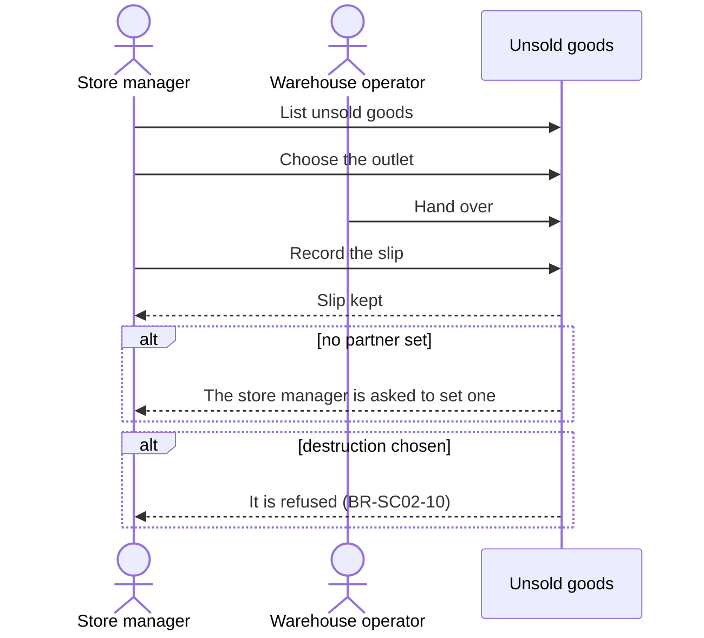

🏠 [Specs](../../../../README.md) › 🏷️ [Sectors](../../../README.md) › 🛍️ [SC02 Retail](../../README.md) ›
📝 [Use cases](../README.md) › 📝 [Use cases: FL-SC02-05 Unsold goods and performance](README.md) ›
📝 UC-SC02-13 Handle unsold goods

# 📝 UC-SC02-13 Handle unsold goods

**Status:** ✅ specified

## Summary

The store manager lists unsold goods, chooses donation, reuse or recycling, and records the partner's slip; nothing is
destroyed.

## Personas

- [U23 Store manager](../../../../01-users/personas/u23-store-manager.md)
- [U15 Warehouse operator](../../../../01-users/personas/u15-warehouse-operator.md)

## Goal

Unsold goods handled within the law, each donation proved.

## Trigger

The end of a season, or food nearing its date.

## Frequency

Monthly, and at each season end.

## Preconditions

- The SC02 sector pack is installed for the company,
  [UC-F14-02](../../../../02-functional/f14-plugin-store/use-cases/01-find-and-install/uc-f14-02-install-a-plugin-or-sector-pack.md),
  and its users have their roles,
  [UC-F1-06](../../../../02-functional/f01-administration/use-cases/04-edit-a-role/uc-f01-06-edit-a-role-and-its-record-rules.md).

## Postconditions

- **Success:** each line is donated, reused or recycled with its slip.
- **Failed:** the goods stay in stock, marked unsold.

## Main flow

1. The store manager lists unsold goods on
   [S-SC02-13 Unsold goods](../../screens/05-unsold-goods-and-performance/s-sc02-13-unsold-goods.md).
2. The store manager chooses donation, reuse or recycling and the partner
   ([BR-SC02-10](../../business-rules/br-sc02-10-unsold-goods-never-destroyed.md)).
3. The warehouse operator hands over the goods; stock goes down,
   [UC-F7-10](../../../../02-functional/f07-purchasing-and-stock/use-cases/04-pick-pack-and-ship/uc-f07-10-handle-returns-and-scrap.md).
4. The store manager records the partner's slip.

## Alternative flows

- 1a. Food near its date: it is offered to a food-aid partner first.

## Error flows

- 2e. No partner set: the store manager is asked to set one.
- 2f. Destruction chosen: it is refused ([BR-SC02-10](../../business-rules/br-sc02-10-unsold-goods-never-destroyed.md)).
- Any step: a call to a service or an outside system fails: it is retried first
  ([BR-F3-32](../../../../02-functional/f03-assistant/business-rules/br-f03-32-retry-before-an-error.md)), then the
  error message pattern ([D122](../../../../06-decisions/ux/d122-error-message-standard.md)) says what failed; what was
  typed is kept.

## Business rules

- [BR-SC02-10 Unsold goods never destroyed](../../business-rules/br-sc02-10-unsold-goods-never-destroyed.md)

## Entities

- [E-SC02-10 Unsold goods donation](../../data/e-sc02-10-unsold-goods-donation.md)

## Permissions

The store manager and warehouse operator roles; the record rules of their role and site apply,
[UC-F1-06](../../../../02-functional/f01-administration/use-cases/04-edit-a-role/uc-f01-06-edit-a-role-and-its-record-rules.md).

## Notifications

None beyond the in-app updates of the records concerned.

## Audit events

Every creation, change and state change of unsold goods donation records, with who, when and the values before and after
(T3).

## AI involvement

The AI assistant answers questions on the unsold goods donation records of this use case, with links, and prepares them
as drafts the user confirms. It works within the user's rights,
[BR-F3-34](../../../../02-functional/f03-assistant/business-rules/br-f03-34-every-capability-is-reachable-from-the-assistant.md),
and never deletes or does anything irreversible without the user's confirmation,
[BR-F3-07](../../../../02-functional/f03-assistant/business-rules/br-f03-07-no-deletes-no-irreversible-acts.md).

## API, MCP and A2A exposure

Through the API and webhooks (T5) and the MCP and A2A gateway (T6), with the caller's rights,
[BR-F3-34](../../../../02-functional/f03-assistant/business-rules/br-f03-34-every-capability-is-reachable-from-the-assistant.md),
reading, creating and changing the records of this use case; nothing irreversible without a person's confirmation.

## Screens

- [S-SC02-13 Unsold goods](../../screens/05-unsold-goods-and-performance/s-sc02-13-unsold-goods.md)

## Flowchart

See [FL-SC02-05 Unsold goods and performance](../../flows/fl-sc02-05-unsold-goods-and-performance.md#flowchart).

## Sequence diagram

## Acceptance criteria

1. **Given** the example shop chain's Lyon 2 with 24 unsold shampoos and partner Restos **when** they are donated
   **then** the stock drops by 24 and slip-118.pdf is kept on the donation.
2. **Given** 24 shampoos to donate and no partner **when** a donation is chosen **then** the store manager is asked to
   set one.

## Non-functional notes

[D408](../../../../06-decisions/technical/d408-performance-and-profiles.md)'s targets
([performance](../../../../05-non-functional/performance.md)): 95 % of screens within 1 second; lists paged on the
server, the first page within 1 second; reports within 5 seconds or in the background. WCAG 2.2 AA and RGAA
([D46](../../../../06-decisions/ux/d46-accessibility-standard.md)).

## Regulatory references

Legal values from the France country pack:
[CR-FR-094 Unsold non-food goods](../../../../10-country-packs/france/environment/cr-fr-094-unsold-non-food-goods.md),
[CR-FR-095 Donation of unsold food](../../../../10-country-packs/france/environment/cr-fr-095-unsold-food-donation.md).

## Related use cases

- [UC-SC02-14 Follow store performance](uc-sc02-14-follow-store-performance.md)

## Open questions

None.

---

⬅️ [UC-SC02-12](../04-customers-and-staff/uc-sc02-12-plan-staff-schedules-and-sunday-openings.md) · ⬆️ [Up](README.md) ·
➡️ [UC-SC02-14 Follow store performance](uc-sc02-14-follow-store-performance.md)
