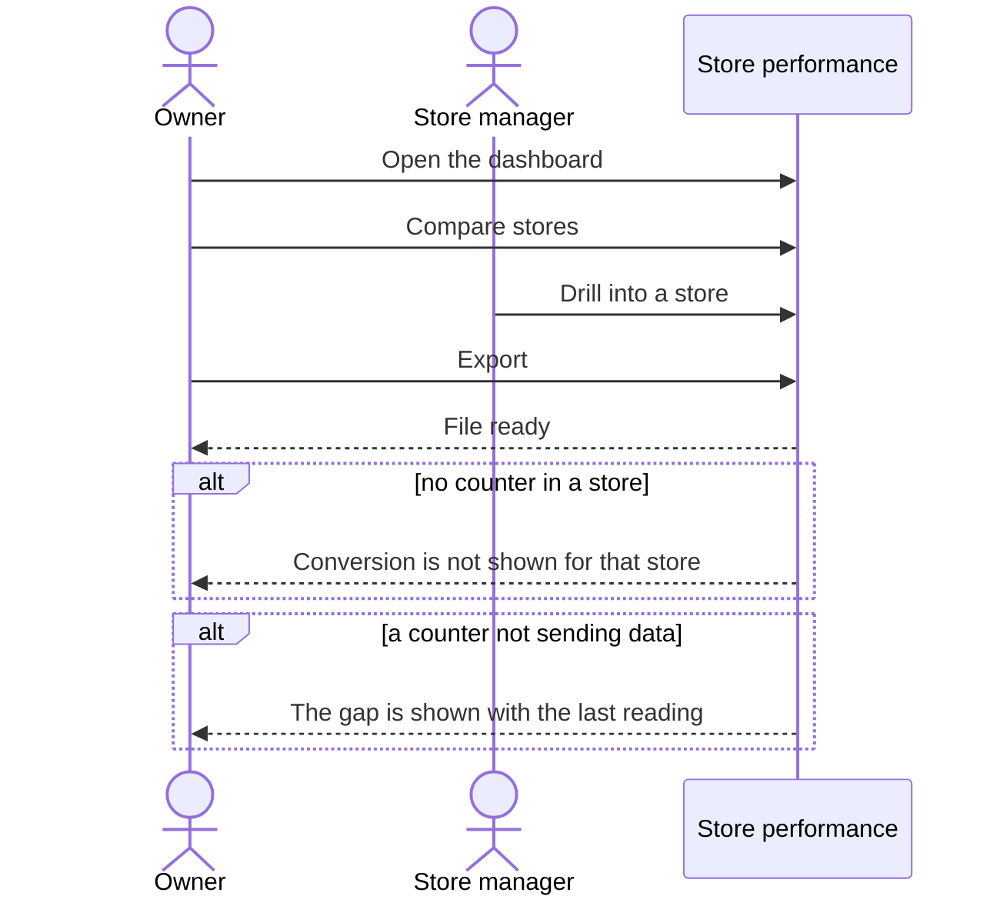

🏠 [Specs](../../../../README.md) › 🏷️ [Sectors](../../../README.md) › 🛍️ [SC02 Retail](../../README.md) ›
📝 [Use cases](../README.md) › 📝 [Use cases: FL-SC02-05 Unsold goods and performance](README.md) ›
📝 UC-SC02-14 Follow store performance

# 📝 UC-SC02-14 Follow store performance

**Status:** ✅ specified

## Summary

The owner and store managers follow sales per square metre, footfall, conversion, basket and stock cover, and compare
stores.

## Personas

- [U13 Owner](../../../../01-users/personas/u13-owner.md)
- [U23 Store manager](../../../../01-users/personas/u23-store-manager.md)

## Goal

Know which stores perform, and why.

## Trigger

Daily look, monthly review.

## Frequency

Daily for store managers; monthly for the owner.

## Preconditions

- The SC02 sector pack is installed for the company,
  [UC-F14-02](../../../../02-functional/f14-plugin-store/use-cases/01-find-and-install/uc-f14-02-install-a-plugin-or-sector-pack.md),
  and its users have their roles,
  [UC-F1-06](../../../../02-functional/f01-administration/use-cases/04-edit-a-role/uc-f01-06-edit-a-role-and-its-record-rules.md).

## Postconditions

- **Success:** the figures are read and compared; an export is made if needed.
- **Failed:** the figures that cannot be computed are shown as missing with the reason.

## Main flow

1. The owner opens
   [S-SC02-14 Store performance](../../screens/05-unsold-goods-and-performance/s-sc02-14-store-performance.md),
   [UC-F10-28](../../../../02-functional/f10-point-of-sale/use-cases/11-store-reports/uc-f10-28-read-hourly-sales-staff-performance-and-basket-analysis.md).
2. The owner compares stores by sales per m2, conversion and basket.
3. The store manager opens their store by hour and staff.
4. The owner exports the comparison.

## Alternative flows

- 1a. Footfall from counters: the counters' hourly visits come through their connector (T12).

## Error flows

- 2e. No counter in a store: conversion is not shown for that store.
- 1e. A counter not sending data: the gap is shown with the last reading.
- Any step: a call to a service or an outside system fails: it is retried first
  ([BR-F3-32](../../../../02-functional/f03-assistant/business-rules/br-f03-32-retry-before-an-error.md)), then the
  error message pattern ([D122](../../../../06-decisions/ux/d122-error-message-standard.md)) says what failed; what was
  typed is kept.

## Business rules

- [BR-SC02-15 Targets per store and staff](../../business-rules/br-sc02-15-targets-per-store-and-staff.md)

## Entities

- [E-SC02-12 Footfall count](../../data/e-sc02-12-footfall-count.md)
- [E-SC02-01 Store](../../data/e-sc02-01-store.md)

## Permissions

The owner and store manager roles; the record rules of their role and site apply,
[UC-F1-06](../../../../02-functional/f01-administration/use-cases/04-edit-a-role/uc-f01-06-edit-a-role-and-its-record-rules.md).

## Notifications

None beyond the in-app updates of the records concerned.

## Audit events

Every creation, change and state change of footfall count, store records, with who, when and the values before and after
(T3).

## AI involvement

The AI assistant answers questions on the footfall count, store records of this use case, with links, and prepares them
as drafts the user confirms. It works within the user's rights,
[BR-F3-34](../../../../02-functional/f03-assistant/business-rules/br-f03-34-every-capability-is-reachable-from-the-assistant.md),
and never deletes or does anything irreversible without the user's confirmation,
[BR-F3-07](../../../../02-functional/f03-assistant/business-rules/br-f03-07-no-deletes-no-irreversible-acts.md).

## API, MCP and A2A exposure

Through the API and webhooks (T5) and the MCP and A2A gateway (T6), with the caller's rights,
[BR-F3-34](../../../../02-functional/f03-assistant/business-rules/br-f03-34-every-capability-is-reachable-from-the-assistant.md),
reading, creating and changing the records of this use case; nothing irreversible without a person's confirmation.

## Screens

- [S-SC02-14 Store performance](../../screens/05-unsold-goods-and-performance/s-sc02-14-store-performance.md)

## Flowchart

See [FL-SC02-05 Unsold goods and performance](../../flows/fl-sc02-05-unsold-goods-and-performance.md#flowchart).

## Sequence diagram

## Acceptance criteria

1. **Given** the example shop chain's Lyon 2 with 84 visitors at 11:00 and 21 sales **when** the hour is shown **then**
   conversion is 25 %.
2. **Given** Lyon 1 without a footfall counter **when** stores are compared **then** conversion is not shown for that
   store.

## Non-functional notes

[D408](../../../../06-decisions/technical/d408-performance-and-profiles.md)'s targets
([performance](../../../../05-non-functional/performance.md)): 95 % of screens within 1 second; lists paged on the
server, the first page within 1 second; reports within 5 seconds or in the background. WCAG 2.2 AA and RGAA
([D46](../../../../06-decisions/ux/d46-accessibility-standard.md)).

## Regulatory references

None specific to this use case; the sector's legal rules are listed in [SC02 regulatory](../../regulatory.md).

## Related use cases

- [UC-SC02-11 Set store targets and follow sales per staff](../04-customers-and-staff/uc-sc02-11-set-store-targets-and-follow-sales-per-staff.md)

## Open questions

None.

---

⬅️ [UC-SC02-13 Handle unsold goods](uc-sc02-13-handle-unsold-goods.md) · ⬆️ [Up](README.md) ·
➡️ [UC-SC02-15 Ask the AI assistant about a store](uc-sc02-15-ask-the-assistant-about-a-store.md)
