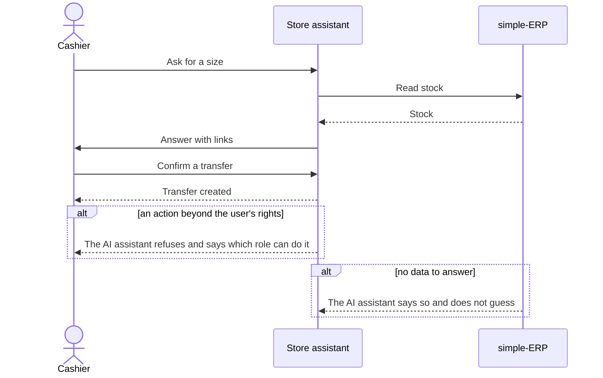

🏠 [Specs](../../../../README.md) › 🏷️ [Sectors](../../../README.md) › 🛍️ [SC02 Retail](../../README.md) ›
📝 [Use cases](../README.md) › 📝 [Use cases: FL-SC02-05 Unsold goods and performance](README.md) ›
📝 UC-SC02-15 Ask the AI assistant about a store

# 📝 UC-SC02-15 Ask the AI assistant about a store

**Status:** ✅ specified

## Summary

The store manager or a cashier asks the AI assistant about today's sales, a product in other stores or a transfer to
propose, within their role's rights.

## Personas

- [U23 Store manager](../../../../01-users/personas/u23-store-manager.md)
- [U17 Cashier](../../../../01-users/personas/u17-cashier.md)

## Goal

Answers and prepared actions without hunting through screens.

## Trigger

A question to the AI assistant.

## Frequency

Several times a day.

## Preconditions

- The SC02 sector pack is installed for the company,
  [UC-F14-02](../../../../02-functional/f14-plugin-store/use-cases/01-find-and-install/uc-f14-02-install-a-plugin-or-sector-pack.md),
  and its users have their roles,
  [UC-F1-06](../../../../02-functional/f01-administration/use-cases/04-edit-a-role/uc-f01-06-edit-a-role-and-its-record-rules.md).

## Postconditions

- **Success:** the answer cites the records, or the prepared action is confirmed and done.
- **Failed:** the AI assistant says it cannot answer or act, and why.

## Main flow

1. The cashier asks on
   [S-SC02-15 Store assistant](../../screens/05-unsold-goods-and-performance/s-sc02-15-store-assistant.md): "Shirt S1 M
   in another store?",
   [UC-F10-20](../../../../02-functional/f10-point-of-sale/use-cases/07-set-up-and-report/uc-f10-20-ask-the-assistant-at-the-till.md).
2. The AI assistant reads the stores' stock within the user's rights.
3. The AI assistant answers: 3 in Lyon 1.
4. The cashier asks for a transfer; the AI assistant prepares it and creates it once confirmed,
   [UC-F3-03](../../../../02-functional/f03-assistant/use-cases/03-act-through-the-assistant/uc-f03-03-have-the-assistant-create-or-change-records.md).

## Alternative flows

- 1a. The store manager asks for today's sales: the AI assistant answers with the figure and its link,
  [UC-F3-16](../../../../02-functional/f03-assistant/use-cases/11-trust-the-answers/uc-f03-16-see-the-query-behind-a-figure.md).

## Error flows

- 4e. An action beyond the user's rights: the AI assistant refuses and says which role can do it.
- 2e. No data to answer: the AI assistant says so and does not guess.
- Any step: a call to a service or an outside system fails: it is retried first
  ([BR-F3-32](../../../../02-functional/f03-assistant/business-rules/br-f03-32-retry-before-an-error.md)), then the
  error message pattern ([D122](../../../../06-decisions/ux/d122-error-message-standard.md)) says what failed; what was
  typed is kept.

## Business rules

- [BR-SC02-01 Retail follows the country pack](../../business-rules/br-sc02-01-retail-follows-the-country-pack.md)
- [BR-F3-34 All capabilities via the AI assistant](../../../../02-functional/f03-assistant/business-rules/br-f03-34-every-capability-is-reachable-from-the-assistant.md)
- [BR-F3-07 No deletes, no irreversible acts](../../../../02-functional/f03-assistant/business-rules/br-f03-07-no-deletes-no-irreversible-acts.md)

## Entities

- [E-SC02-01 Store](../../data/e-sc02-01-store.md)
- [E-SC02-06 Store transfer](../../data/e-sc02-06-store-transfer.md)

## Permissions

The store manager and cashier roles; the record rules of their role and site apply,
[UC-F1-06](../../../../02-functional/f01-administration/use-cases/04-edit-a-role/uc-f01-06-edit-a-role-and-its-record-rules.md).

## Notifications

None beyond the in-app updates of the records concerned.

## Audit events

Every creation, change and state change of store, store transfer records, with who, when and the values before and after
(T3).

## AI involvement

The AI assistant answers from the stores' records with links and prepares transfers, labels and orders as drafts. It
works within the user's rights,
[BR-F3-34](../../../../02-functional/f03-assistant/business-rules/br-f03-34-every-capability-is-reachable-from-the-assistant.md),
and never deletes or does anything irreversible without the user's confirmation,
[BR-F3-07](../../../../02-functional/f03-assistant/business-rules/br-f03-07-no-deletes-no-irreversible-acts.md).

## API, MCP and A2A exposure

Through the API and webhooks (T5) and the MCP and A2A gateway (T6), with the caller's rights,
[BR-F3-34](../../../../02-functional/f03-assistant/business-rules/br-f03-34-every-capability-is-reachable-from-the-assistant.md),
reading, creating and changing the records of this use case; nothing irreversible without a person's confirmation.

## Screens

- [S-SC02-15 Store assistant](../../screens/05-unsold-goods-and-performance/s-sc02-15-store-assistant.md)

## Flowchart

See [FL-SC02-05 Unsold goods and performance](../../flows/fl-sc02-05-unsold-goods-and-performance.md#flowchart).

## Sequence diagram

## Acceptance criteria

1. **Given** the example shop chain's Lyon 1 with 3 Shirt S1 M **when** a cashier in Lyon 2 asks for one **then** the
   AI assistant answers 3 in Lyon 1 and offers a transfer.
2. **Given** a cashier asking to change a price **when** she asks the AI assistant **then** the AI assistant refuses and
   says which role can do it.

## Non-functional notes

[D408](../../../../06-decisions/technical/d408-performance-and-profiles.md)'s targets
([performance](../../../../05-non-functional/performance.md)): 95 % of screens within 1 second; lists paged on the
server, the first page within 1 second; reports within 5 seconds or in the background. WCAG 2.2 AA and RGAA
([D46](../../../../06-decisions/ux/d46-accessibility-standard.md)).

## Regulatory references

None specific to this use case; the sector's legal rules are listed in [SC02 regulatory](../../regulatory.md).

## Related use cases

- [UC-SC02-04 Transfer stock between stores](../02-keep-stock-right/uc-sc02-04-transfer-stock-between-stores.md)

## Open questions

None.

---

⬅️ [UC-SC02-14 Follow store performance](uc-sc02-14-follow-store-performance.md) · ⬆️ [Up](README.md) ·
➡️ [UC-SC02-16](../06-books-furniture-second-hand-franchise/uc-sc02-16-sell-books-under-the-fixed-price-law.md)
