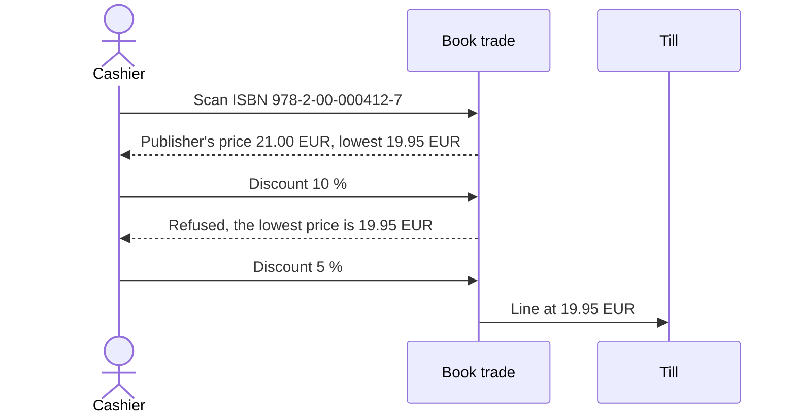

🏠 [Specs](../../../../README.md) › 🏷️ [Sectors](../../../README.md) › 🛍️ [SC02 Retail](../../README.md) ›
📝 [Use cases](../README.md) › 📝 [Use cases: FL-SC02-06 Books, furniture, second-hand and franchise](README.md) ›
📝 UC-SC02-16 Sell books under the fixed price law

# 📝 UC-SC02-16 Sell books under the fixed price law

**Status:** ✅ specified

## Summary

A bookshop sells books at the publisher's price, the only price the law lets a retailer charge, with a discount of at
most 5 %. The cashier scans the ISBN, sees the publisher's price and the lowest price allowed, and the till refuses any
discount, promotion or loyalty reward that would go below it.

## Personas

- [U17 Cashier](../../../../01-users/personas/u17-cashier.md)
- [U23 Store manager](../../../../01-users/personas/u23-store-manager.md)

## Goal

Every book is sold at the fixed price or within the allowed discount, in the shop and online, so the shop never breaks
the fixed book price.

## Trigger

A cashier scans a book, a title is added to the catalogue, or a publisher changes a price.

## Frequency

Every book sale; a price change a few times a year per publisher.

## Preconditions

- The book titles are loaded with their ISBN, publisher and publisher's price
  ([E-SC02-13 Book title](../../data/e-sc02-13-book-title.md)).
- The till uses the price list of the shop
  [UC-F10-06](../../../../02-functional/f10-point-of-sale/use-cases/02-sell-at-the-counter/uc-f10-06-apply-prices-promotions-and-combos.md).

## Postconditions

- **Succeeded:** the book is sold at a price not below the publisher's price less the allowed discount, and the sale
  line shows the price and the discount.
- **Failed:** the sale line is refused with the lowest allowed price; nothing is recorded below it.

## Main flow

1. The cashier scans a book at the tablet till; the book trade screen
   ([S-SC02-16](../../screens/06-books-furniture-second-hand-franchise/s-sc02-16-book-trade.md)) shows the title, the
   publisher's price and the lowest allowed price.
2. The cashier gives a discount, or the customer's loyalty reward is applied; the till computes the resulting price.
3. The till checks the price against the cap
   ([BR-SC02-16](../../business-rules/br-sc02-16-book-discounts-never-exceed-5-of-the-publishers-price.md)): the
   discount, a promotion and a reward count together.
4. The sale is recorded at the checked price
   [UC-F10-02](../../../../02-functional/f10-point-of-sale/use-cases/02-sell-at-the-counter/uc-f10-02-sell-at-the-counter.md).
5. The store manager updates the publisher's price of a title when a publisher announces a change; the new price applies
   to the next sale and the shelf labels are reprinted
   ([UC-SC02-05](../01-set-up-the-stores/uc-sc02-05-print-shelf-labels-with-unit-prices.md)).
6. The store manager reads the discounts given per title and per cashier.

## Alternative flows

- 2a. A school or a library buys: a different cap may apply to that customer type, kept as data of the country pack and
  shown on the screen.
- 2b. An old stock book carries a lower publisher's price on its cover: the title records the price that applies and the
  date it applies from.
- 5a. A title is out of print: it is marked Withdrawn and sold only from the stock that remains.

## Error flows

- 3e. The discount, promotion and reward together go below the lowest allowed price: the till refuses the line and shows
  the price it would accept.
- 1e. The ISBN is unknown: the cashier adds the title with its publisher's price before selling it.
- 5e. A price change sets a price below the old cost: a warning is shown, the change is not blocked.
- Any step: a service does not answer; the call is retried first
  ([BR-F3-32](../../../../02-functional/f03-assistant/business-rules/br-f03-32-retry-before-an-error.md)), then the
  message follows the error pattern ([D122](../../../../06-decisions/ux/d122-error-message-standard.md)) and what the
  user typed stays on the screen.

## Business rules

- [BR-SC02-16](../../business-rules/br-sc02-16-book-discounts-never-exceed-5-of-the-publishers-price.md)
- [BR-SC02-02](../../business-rules/br-sc02-02-every-product-priced.md)
- [BR-SC02-05](../../business-rules/br-sc02-05-reductions-show-the-reference-price.md)

## Entities

- [E-SC02-13 Book title](../../data/e-sc02-13-book-title.md): created, changed
- [E-F10-08](../../../../02-functional/f10-point-of-sale/data/e-f10-08-price-promotion.md): read, promotions that are
  cut to the cap
- [E-F7-06 Item](../../../../02-functional/f07-purchasing-and-stock/data/e-f07-06-item.md): read, the item behind the
  title

## Permissions

Cashier sells within the cap; store manager creates titles, changes prices and reads discounts. The owner
reads every title and its price history.

## Notifications

Store manager, in the app: a discount was refused three times for one title in a day.

## Audit events

Each title created or repriced; each discount refused, with the cashier, the title and the price asked; who and when.

## AI involvement

No AI step of its own. The AI assistant may open the screen and prefill it from the user's words; the user checks and
confirms
[BR-F3-07](../../../../02-functional/f03-assistant/business-rules/br-f03-07-no-deletes-no-irreversible-acts.md).

## API, MCP and A2A exposure

T5 operations of the capability for the personas above: create, read, update and list. The MCP tool of the
capability may read and propose, never confirm alone. No A2A skill.

## Screens

- [S-SC02-16](../../screens/06-books-furniture-second-hand-franchise/s-sc02-16-book-trade.md)

## Flowchart

See
[FL-SC02-06 Books, furniture, second-hand and franchise](../../flows/fl-sc02-06-books-furniture-second-hand-franchise.md#flowchart).

## Sequence diagram

## Acceptance criteria

1. **Given** a book at a publisher's price of 21.00 EUR **when** the cashier gives a 5 % discount **then** the line is
   19.95 EUR.
2. **Given** the same book **when** the cashier gives 10 % **then** the line is refused and the lowest price 19.95 EUR
   is shown.
3. **Given** a 5 % discount and a loyalty reward of 2.00 EUR on the same book **when** the sale is totalled **then** the
   reward is cut so that the total discount stays at 1.05 EUR.
4. **Given** a publisher's new price of 22.00 EUR **when** the store manager saves it **then** the next sale uses 22.00
   EUR and the label is queued for printing.

## Non-functional notes

The screen answers within 2 seconds for 10,000 records; every change is audited.

## Regulatory references

New books are sold at the price the publisher or importer sets; a retailer may give a discount of at most 5 %
of that price, and the cap holds for every sales channel. Other buyers (schools, libraries) can have a different cap,
kept as data. The France-pack rule is listed below. Related:
[CR-FR-092](../../../../10-country-packs/france/consumer/cr-fr-092-unit-price-display.md),
[CR-FR-093](../../../../10-country-packs/france/consumer/cr-fr-093-sales-periods.md).

- France-pack rule:
  [CR-FR-227 Fixed book price (5 % cap)](../../../../10-country-packs/france/trade/cr-fr-227-fixed-book-price.md)

## Related use cases

- [UC-SC02-17 Sell made-to-order furniture](uc-sc02-17-sell-made-to-order-furniture.md)
- [UC-SC02-05](../01-set-up-the-stores/uc-sc02-05-print-shelf-labels-with-unit-prices.md)
- [UC-F10-06](../../../../02-functional/f10-point-of-sale/use-cases/02-sell-at-the-counter/uc-f10-06-apply-prices-promotions-and-combos.md)

## Open questions

None.

---

⬅️ [UC-SC02-15](../05-unsold-goods-and-performance/uc-sc02-15-ask-the-assistant-about-a-store.md) · ⬆️ [Up](README.md) ·
➡️ [UC-SC02-17 Sell made-to-order furniture](uc-sc02-17-sell-made-to-order-furniture.md)
