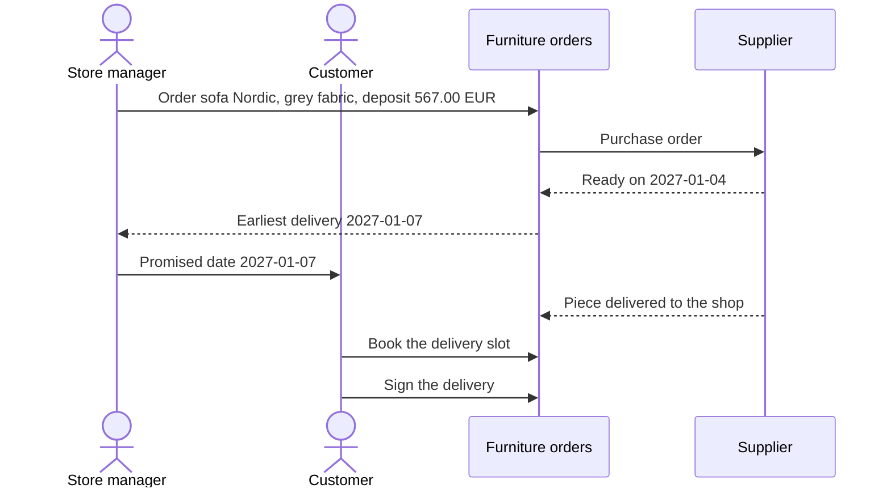

🏠 [Specs](../../../../README.md) › 🏷️ [Sectors](../../../README.md) › 🛍️ [SC02 Retail](../../README.md) ›
📝 [Use cases](../README.md) › 📝 [Use cases: FL-SC02-06 Books, furniture, second-hand and franchise](README.md) ›
📝 UC-SC02-17 Sell made-to-order furniture

# 📝 UC-SC02-17 Sell made-to-order furniture

**Status:** ✅ specified

## Summary

A furniture shop sells pieces made to order (a sofa in a chosen fabric, a table cut to size). The store manager takes
the order with a deposit, orders the piece from the supplier and promises the customer a delivery date only from the
date the supplier has confirmed. The customer follows the order on the phone and books the delivery and assembly slot.

## Personas

- [U23 Store manager](../../../../01-users/personas/u23-store-manager.md)
- [U09 Customer](../../../../01-users/personas/u09-customer.md)

## Goal

A made-to-order piece is sold with an honest date, kept informed and delivered and assembled as promised.

## Trigger

A customer chooses a piece and its options, the supplier confirms or changes its lead time, or the piece arrives.

## Frequency

A few orders a day in a furniture shop; one update per order each time the supplier moves.

## Preconditions

- The customer and the quote exist
  ([E-F6-01](../../../../02-functional/f06-customers-and-sales/data/e-f06-01-customer-record.md),
  [E-F6-03 Quote](../../../../02-functional/f06-customers-and-sales/data/e-f06-03-quote.md)).
- The supplier is a supplier record with its lead times
  ([E-F7-01](../../../../02-functional/f07-purchasing-and-stock/data/e-f07-01-supplier-record.md)).

## Postconditions

- **Succeeded:** the order is saved ([E-SC02-14 Furniture order](../../data/e-sc02-14-furniture-order.md)) with its
  options, deposit, confirmed date and delivery slot; the customer sees its state.
- **Failed:** no date is promised and the order stays Ordered until the supplier answers.

## Main flow

1. The store manager opens the furniture orders screen
   ([S-SC02-17](../../screens/06-books-furniture-second-hand-franchise/s-sc02-17-furniture-orders.md)) and creates an
   order from the customer's quote with the options (model, fabric, dimensions).
2. The customer pays the deposit and the order is placed with the supplier
   [UC-F7-02](../../../../02-functional/f07-purchasing-and-stock/use-cases/01-procure/uc-f07-02-order-from-a-supplier.md).
3. The supplier confirms its lead time; simple-ERP computes the earliest delivery date and the store manager promises
   that date or later ([BR-SC02-17](../../business-rules/br-sc02-17-dates-follow-the-suppliers-confirmed-lead-time.md)).
4. The customer sees the order's state and date on the phone and chooses a delivery and assembly slot once the piece is
   ready.
5. The piece is received and checked
   [UC-F7-03](../../../../02-functional/f07-purchasing-and-stock/use-cases/02-receive-and-store/uc-f07-03-receive-goods.md);
   the slot is confirmed and the delivery is made.
6. The customer signs the delivery on the phone; the balance is invoiced
   [UC-F6-06](../../../../02-functional/f06-customers-and-sales/use-cases/03-invoice-and-get-paid/uc-f06-06-invoice-deposits-progress-and-final.md)
   and the order is Delivered.

## Alternative flows

- 3a. The supplier moves its date: the customer is told the same day with the new date and may keep the order or ask to
  cancel.
- 5a. The piece arrives damaged: a claim goes to the supplier and the delivery date is pushed with the customer told.
- 2a. The customer pays the deposit in two parts: both are recorded and the order is placed after the first.

## Error flows

- 3e. The store manager promises a date before the supplier's confirmed date plus transport: the date is refused and the
  earliest one is shown.
- 4e. No slot is free before the promised date: the manager is warned and offers the nearest ones.
- 6e. The customer refuses the delivery for a defect: the refusal and its photos are recorded and a claim starts
  [UC-F6-31](../../../../02-functional/f06-customers-and-sales/use-cases/10-partners-contracts-and-warranties/uc-f06-31-handle-a-warranty-claim.md).
- Any step: a service does not answer; the call is retried first
  ([BR-F3-32](../../../../02-functional/f03-assistant/business-rules/br-f03-32-retry-before-an-error.md)), then the
  message follows the error pattern ([D122](../../../../06-decisions/ux/d122-error-message-standard.md)) and what the
  user typed stays on the screen.

## Business rules

- [BR-SC02-17](../../business-rules/br-sc02-17-dates-follow-the-suppliers-confirmed-lead-time.md)
- [BR-SC02-08](../../business-rules/br-sc02-08-one-stock-for-all-channels.md)

## Entities

- [E-SC02-14 Furniture order](../../data/e-sc02-14-furniture-order.md): created, changed
- [E-F6-04 Order](../../../../02-functional/f06-customers-and-sales/data/e-f06-04-order.md): created, the sales order of
  the piece
- [E-F7-03](../../../../02-functional/f07-purchasing-and-stock/data/e-f07-03-purchase-order.md): created, the purchase
  order to the supplier
- [E-F7-22](../../../../02-functional/f07-purchasing-and-stock/data/e-f07-22-delivery-note.md): read, the delivery note
  at reception

## Permissions

Store manager creates and changes orders; the customer sees only their own through the portal. Purchasing
reads the supplier side.

## Notifications

The customer, by email and in the portal: date confirmed, date moved, piece ready, slot confirmed. The store manager:
the supplier moved a date.

## Audit events

Each order created, each date promised and changed with the supplier's confirmation behind it, each slot booked and each
signature, with who and when.

## AI involvement

No AI step of its own. The AI assistant may open the screen and prefill it from the user's words; the user checks and
confirms
[BR-F3-07](../../../../02-functional/f03-assistant/business-rules/br-f03-07-no-deletes-no-irreversible-acts.md).

## API, MCP and A2A exposure

T5 operations of the capability for the personas above: create, read, update and list. The MCP tool of the
capability may read and propose, never confirm alone. No A2A skill.

## Screens

- [S-SC02-17](../../screens/06-books-furniture-second-hand-franchise/s-sc02-17-furniture-orders.md)

## Flowchart

See
[FL-SC02-06 Books, furniture, second-hand and franchise](../../flows/fl-sc02-06-books-furniture-second-hand-franchise.md#flowchart).

## Sequence diagram

## Acceptance criteria

1. **Given** a supplier confirming the piece ready on 2027-01-04 and a transport time of 3 days **when** the store
   manager promises a date **then** the earliest date accepted is 2027-01-07.
2. **Given** a promised date of 2026-12-18 **when** the manager saves it **then** it is refused and 2027-01-07 is shown.
3. **Given** a supplier that moves its date to 2027-01-18 **when** the supplier's answer is recorded **then** the
   promised date moves to the new earliest date and the customer is told the same day.
4. **Given** an order with a deposit of 30 % of 1,890.00 EUR **when** the order is placed **then** the deposit is 567.00
   EUR and the balance 1,323.00 EUR.

## Non-functional notes

The screen answers within 2 seconds for 10,000 records; every change is audited.

## Regulatory references

A seller must state the date by which the goods will be delivered; a consumer may cancel the contract after a
formal notice when that date is exceeded by more than a set number of days. Goods made to the consumer's specifications
are normally outside the withdrawal right. The France-pack rules are linked, not new:
[CR-FR-066](../../../../10-country-packs/france/consumer/cr-fr-066-delivery-within-30-days.md),
[CR-FR-036](../../../../10-country-packs/france/consumer/cr-fr-036-withdrawal-right.md),
[CR-FR-067](../../../../10-country-packs/france/consumer/cr-fr-067-legal-guarantee-of-conformity.md).

## Related use cases

- [UC-SC02-16](uc-sc02-16-sell-books-under-the-fixed-price-law.md)
- [UC-SC02-18 Buy back second-hand goods](uc-sc02-18-buy-back-second-hand-goods.md)
- [UC-SC02-04](../02-keep-stock-right/uc-sc02-04-transfer-stock-between-stores.md)
- [UC-F6-05](../../../../02-functional/f06-customers-and-sales/use-cases/02-quote-to-order/uc-f06-05-turn-a-quote-into-an-order-and-follow-it.md)

## Open questions

None.

---

⬅️ [UC-SC02-16 Sell books under the fixed price law](uc-sc02-16-sell-books-under-the-fixed-price-law.md) ·
⬆️ [Up](README.md) · ➡️ [UC-SC02-18 Buy back second-hand goods](uc-sc02-18-buy-back-second-hand-goods.md)
