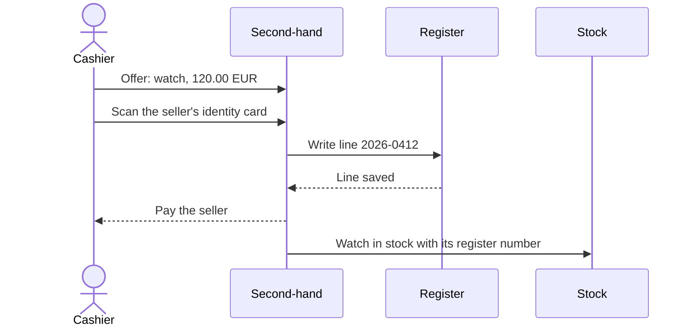

🏠 [Specs](../../../../README.md) › 🏷️ [Sectors](../../../README.md) › 🛍️ [SC02 Retail](../../README.md) ›
📝 [Use cases](../README.md) › 📝 [Use cases: FL-SC02-06 Books, furniture, second-hand and franchise](README.md) ›
📝 UC-SC02-18 Buy back second-hand goods

# 📝 UC-SC02-18 Buy back second-hand goods

**Status:** ✅ specified

## Summary

A shop buys second-hand goods from people (jewellery, instruments, phones, books) and resells them. Every purchase from
a person is entered in the second-hand register the law requires, with the seller's identity and a description of the
object, before the shop pays; the register can be shown to the authorities on request.

## Personas

- [U17 Cashier](../../../../01-users/personas/u17-cashier.md)
- [U23 Store manager](../../../../01-users/personas/u23-store-manager.md)

## Goal

Goods bought from people are traceable, the register is always complete and the shop can prove where each object came
from.

## Trigger

A person offers an object to the shop at the counter, or an authority asks to see the register.

## Frequency

Several purchases a day in a second-hand shop.

## Preconditions

- The shop is set up as a second-hand dealer in its settings.
- The tablet till has the register screen and a scanner for the seller's identity document.

## Postconditions

- **Succeeded:** the purchase is saved ([E-SC02-15 Second-hand purchase](../../data/e-sc02-15-second-hand-purchase.md))
  with its register line, the seller, the object and the payment; the object enters stock
  ([E-F7-06 Item](../../../../02-functional/f07-purchasing-and-stock/data/e-f07-06-item.md)) and can be priced.
- **Failed:** nothing is paid or put in stock; the missing element is shown and the offer is refused.

## Main flow

1. The cashier opens the second-hand screen
   ([S-SC02-18](../../screens/06-books-furniture-second-hand-franchise/s-sc02-18-second-hand.md)) on the tablet and
   describes the object (kind, brand, model, serial number, condition) with a photo.
2. The cashier scans the seller's identity document; the seller's name, address and document are filled in and the
   seller confirms.
3. The cashier enters the price agreed; SimpleERP checks the means of payment against the cash limit
   ([CR-FR-022](../../../../10-country-packs/france/payments/cr-fr-022-cash-payment-limit.md)).
4. SimpleERP writes the register line
   ([BR-SC02-18](../../business-rules/br-sc02-18-every-purchase-from-a-person-enters-the-police-register.md)) and only
   then lets the cashier pay.
5. The object enters stock with its cost and its register number and is priced for sale
   [UC-F7-03](../../../../02-functional/f07-purchasing-and-stock/use-cases/02-receive-and-store/uc-f07-03-receive-goods.md).
6. When the object is sold, the register line records the sale date and the buyer's type; the store manager can print or
   export the register for an authority.

## Alternative flows

- 3a. The payment exceeds the cash limit: the cashier pays by transfer or cheque instead, and the line records the
  means.
- 6a. An authority reports the object as stolen: the object is Withdrawn from sale and the report is kept with the line.
- 2a. The seller is a business: the purchase is an ordinary supplier purchase, with an invoice, and no register line is
  needed for it.

## Error flows

- 2e. The seller has no valid identity document: the purchase is refused and nothing is saved.
- 4e. The register cannot be written (offline without its local copy): the cashier cannot pay until it is saved.
- 6e. A register line is changed after the sale: the change is refused, only a dated correction line is allowed.
- Any step: a service does not answer; the call is retried first
  ([BR-F3-32](../../../../02-functional/f03-assistant/business-rules/br-f03-32-retry-before-an-error.md)), then the
  message follows the error pattern ([D122](../../../../06-decisions/ux/d122-error-message-standard.md)) and what the
  user typed stays on the screen.

## Business rules

- [BR-SC02-18](../../business-rules/br-sc02-18-every-purchase-from-a-person-enters-the-police-register.md)
- [BR-SC02-01](../../business-rules/br-sc02-01-retail-follows-the-country-pack.md)
- [BR-SC02-08](../../business-rules/br-sc02-08-one-stock-for-all-channels.md)

## Entities

- [E-SC02-15 Second-hand purchase](../../data/e-sc02-15-second-hand-purchase.md): created, changed
- [E-F7-06 Item](../../../../02-functional/f07-purchasing-and-stock/data/e-f07-06-item.md): created, the object in stock
- [E-SC02-01 Store](../../data/e-sc02-01-store.md): read, the shop that bought

## Permissions

Cashier records purchases; store manager reads and exports the register. No other role reads the sellers'
identities; the owner reads the register through the store manager.

## Notifications

Store manager, in the app: a purchase waits for a price, or an object has been unsold for 90 days.

## Audit events

Each register line created; each correction as a dated new line; each export or print, with who and when.

## AI involvement

No AI step of its own. The AI assistant may open the screen and prefill it from the user's words; the user checks and
confirms
[BR-F3-07](../../../../02-functional/f03-assistant/business-rules/br-f03-07-no-deletes-no-irreversible-acts.md).

## API, MCP and A2A exposure

T5 operations of the capability for the personas above: create, read, update and list. The MCP tool of the
capability may read and propose, never confirm alone. No A2A skill.

## Screens

- [S-SC02-18](../../screens/06-books-furniture-second-hand-franchise/s-sc02-18-second-hand.md)

## Flowchart

See
[FL-SC02-06 Books, furniture, second-hand and franchise](../../flows/fl-sc02-06-books-furniture-second-hand-franchise.md#flowchart).

## Sequence diagram

## Acceptance criteria

1. **Given** a seller with a valid identity document and a watch bought for 120.00 EUR **when** the cashier confirms
   **then** register line 2026-0412 is written and the payment is allowed.
2. **Given** a seller without an identity document **when** the cashier tries to confirm **then** the purchase is
   refused and nothing is paid.
3. **Given** a purchase above the cash limit **when** the cashier chooses cash **then** it is refused and a transfer is
   proposed.
4. **Given** a saved register line **when** someone changes the object's description **then** the change is refused and
   a dated correction line is offered.

## Non-functional notes

The screen answers within 2 seconds for 10,000 records; every change is audited.

## Regulatory references

A dealer who buys second-hand goods from people keeps a numbered register in which each purchase shows the
object, its description, the price, the date and the seller's identity as checked on a document; the register is kept
for a legal period and shown to the authorities on request. The France-pack rule is listed below. Related:
[CR-FR-022](../../../../10-country-packs/france/payments/cr-fr-022-cash-payment-limit.md),
[CR-FR-052](../../../../10-country-packs/france/data-protection/cr-fr-052-storage-limitation.md).

- France-pack rule:
  [CR-FR-228 Second-hand purchase register](../../../../10-country-packs/france/trade/cr-fr-228-second-hand-register.md)

## Related use cases

- [UC-SC02-17 Sell made-to-order furniture](uc-sc02-17-sell-made-to-order-furniture.md)
- [UC-SC02-19 Run a franchise network](uc-sc02-19-run-a-franchise-network.md)
- [UC-SC02-13](../05-unsold-goods-and-performance/uc-sc02-13-handle-unsold-goods.md)
- [UC-F7-03](../../../../02-functional/f07-purchasing-and-stock/use-cases/02-receive-and-store/uc-f07-03-receive-goods.md)

## Open questions

None.

---

⬅️ [UC-SC02-17 Sell made-to-order furniture](uc-sc02-17-sell-made-to-order-furniture.md) · ⬆️ [Up](README.md) ·
➡️ [UC-SC02-19 Run a franchise network](uc-sc02-19-run-a-franchise-network.md)
