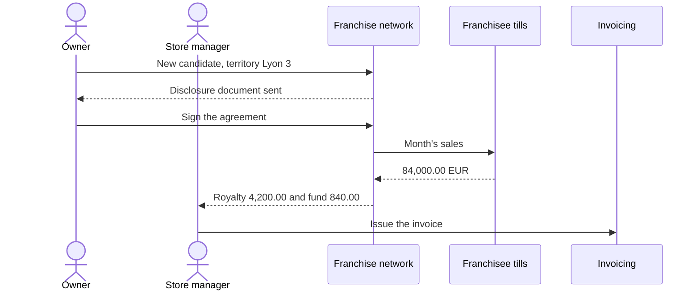

🏠 [Specs](../../../../README.md) › 🏷️ [Sectors](../../../README.md) › 🛍️ [SC02 Retail](../../README.md) ›
📝 [Use cases](../README.md) › 📝 [Use cases: FL-SC02-06 Books, furniture, second-hand and franchise](README.md) ›
📝 UC-SC02-19 Run a franchise network

# 📝 UC-SC02-19 Run a franchise network

**Status:** 🔄 waiting for the owner

## Summary

A retail brand runs a franchise network. The owner signs franchise agreements with franchisees, who run their own shops
under the brand. Each month the franchisee's sales come in from their tills, the royalties and the marketing fund
contribution are computed from the agreement, and the franchisor invoices them.

## Personas

- [U13 Owner](../../../../01-users/personas/u13-owner.md)
- [U23 Store manager](../../../../01-users/personas/u23-store-manager.md)

## Goal

Every franchisee is under a written agreement, reports their sales and pays the royalties the agreement sets, and the
franchisor sees the whole network.

## Trigger

A candidate wants to join the network, the month ends, or an agreement ends.

## Frequency

A few new franchisees a year; one statement per franchisee each month.

## Preconditions

- The franchisee is a company with its identifiers
  ([E-F6-24](../../../../02-functional/f06-customers-and-sales/data/e-f06-24-company-identifier.md)), or a candidate who
  will form one.
- The brand's agreement template exists
  ([E-F9-19](../../../../02-functional/f09-hr-and-projects/data/e-f09-19-contract-template.md)) with the royalty rates.

## Postconditions

- **Succeeded:** the franchisee is saved ([E-SC02-16 Franchisee](../../data/e-sc02-16-franchisee.md)) with its agreement
  and rates; each month's statement is issued as an invoice and paid or followed.
- **Failed:** the candidate stays a Candidate, no royalty is computed, and the missing paper is listed.

## Main flow

1. The owner opens the franchise network screen
   ([S-SC02-19](../../screens/06-books-furniture-second-hand-franchise/s-sc02-19-franchise-network.md)) and creates a
   candidate with its territory and the proposed rates.
2. The disclosure document is sent to the candidate and the date is recorded; the agreement can be signed only after the
   minimum delay ([BR-SC02-19](../../business-rules/br-sc02-19-royalties-follow-the-franchise-agreement.md)).
3. The agreement is signed with the e-signature
   [UC-F6-04](../../../../02-functional/f06-customers-and-sales/use-cases/02-quote-to-order/uc-f06-04-accept-or-sign-a-quote.md);
   the franchisee becomes Active and its shop is created as a store
   ([UC-SC02-01](../01-set-up-the-stores/uc-sc02-01-set-up-stores-and-their-assortments.md)).
4. At each month's end, SimpleERP reads the franchisee's sales from their tills and computes the royalty and the
   marketing contribution from the agreement's rates.
5. The store manager of the franchisor checks the statement against the sales reported and issues the invoice
   [UC-F6-06](../../../../02-functional/f06-customers-and-sales/use-cases/03-invoice-and-get-paid/uc-f06-06-invoice-deposits-progress-and-final.md).
6. When an agreement ends, the franchisee is Ended, the last statement is issued and the shop leaves the network.

## Alternative flows

- 4a. The franchisee has not sent its sales: the statement is estimated from the previous months, marked estimated, and
  corrected when the sales arrive.
- 5a. The franchisee disputes the statement: the dispute follows the usual process
  [UC-F6-24](../../../../02-functional/f06-customers-and-sales/use-cases/08-collect-and-settle/uc-f06-24-handle-a-disputed-invoice.md)
  and the disputed amount is held.
- 3a. The agreement has a lower rate in the first year: the rate steps are in the agreement and applied by month.

## Error flows

- 2e. The agreement is submitted for signature before the minimum delay after the disclosure document: the signature is
  blocked and the date it opens is shown.
- 4e. The sales read from the till are not complete for the month (a till never closed): the statement waits and the
  missing days are listed.
- 6e. An agreement ends with unpaid statements: the franchisee stays Active until they are settled or disputed.
- Any step: a service does not answer; the call is retried first
  ([BR-F3-32](../../../../02-functional/f03-assistant/business-rules/br-f03-32-retry-before-an-error.md)), then the
  message follows the error pattern ([D122](../../../../06-decisions/ux/d122-error-message-standard.md)) and what the
  user typed stays on the screen.

## Business rules

- [BR-SC02-19](../../business-rules/br-sc02-19-royalties-follow-the-franchise-agreement.md)
- [BR-SC02-01](../../business-rules/br-sc02-01-retail-follows-the-country-pack.md)

## Entities

- [E-SC02-16 Franchisee](../../data/e-sc02-16-franchisee.md): created, changed
- [E-F6-05 Invoice](../../../../02-functional/f06-customers-and-sales/data/e-f06-05-invoice.md): created, the royalty
  invoice
- [E-SC02-01 Store](../../data/e-sc02-01-store.md): created, the franchisee's shop
- [E-F6-24](../../../../02-functional/f06-customers-and-sales/data/e-f06-24-company-identifier.md): read, the
  franchisee's identifiers

## Permissions

Owner signs and ends agreements; store manager of the franchisor checks and issues statements. A franchisee
sees only their own agreement and statements, through the portal.

## Notifications

The franchisee, by email and in the portal: the statement is issued, a payment is late. The owner: an agreement ends in
90 days.

## Audit events

Each candidate, disclosure date, signature, rate change, statement and end, with who and when.

## AI involvement

No AI step of its own. The AI assistant may open the screen and prefill it from the user's words; the user checks and
confirms
[BR-F3-07](../../../../02-functional/f03-assistant/business-rules/br-f03-07-no-deletes-no-irreversible-acts.md).

## API, MCP and A2A exposure

T5 operations of the capability for the personas above: create, read, update and list. The MCP tool of the
capability may read and propose, never confirm alone. No A2A skill.

## Screens

- [S-SC02-19](../../screens/06-books-furniture-second-hand-franchise/s-sc02-19-franchise-network.md)

## Flowchart

See
[FL-SC02-06 Books, furniture, second-hand and franchise](../../flows/fl-sc02-06-books-furniture-second-hand-franchise.md#flowchart).

## Sequence diagram

## Acceptance criteria

1. **Given** a rate of 5 % and a marketing contribution of 1 % on 84,000.00 EUR of monthly sales **when** the statement
   is computed **then** the royalty is 4,200.00 EUR and the contribution 840.00 EUR.
2. **Given** a candidate whose disclosure document was sent today **when** the owner submits the agreement for signature
   **then** it is blocked until the minimum delay has passed.
3. **Given** a month with one till never closed **when** the statement is computed **then** it waits and lists the
   missing day.
4. **Given** a first-year rate of 3 % and a normal rate of 5 % **when** a statement of the first year is computed
   **then** the 3 % rate is applied.

## Non-functional notes

The screen answers within 2 seconds for 10,000 records; every change is audited.

## Regulatory references

Before a franchise agreement is signed, the franchisor gives the candidate a disclosure document with the
information the law lists, a set number of days before the signature or any payment; the agreement is written. The delay
is kept as data of the country pack. The France-pack rule is listed below. Related:
[CR-FR-175](../../../../10-country-packs/france/trade/cr-fr-175-unfair-b2b-practices.md).

- France-pack rule, (Proposed) until its law is read:
  [CR-FR-253 Franchise disclosure document](../../../../10-country-packs/france/trade/cr-fr-253-franchise-disclosure.md)

## Related use cases

- [UC-SC02-18 Buy back second-hand goods](uc-sc02-18-buy-back-second-hand-goods.md)
- [UC-SC02-01](../01-set-up-the-stores/uc-sc02-01-set-up-stores-and-their-assortments.md)
- [UC-SC02-14](../05-unsold-goods-and-performance/uc-sc02-14-follow-store-performance.md)

## Open questions

None.

---

⬅️ [UC-SC02-18 Buy back second-hand goods](uc-sc02-18-buy-back-second-hand-goods.md) · ⬆️ [Up](README.md)
