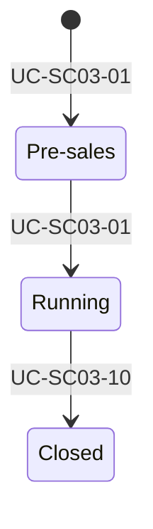

🏠 [Specs](../../../README.md) › 🏷️ [Sectors](../../README.md) › 💼 [SC03 Services](../README.md) › 🗃️ [Data](README.md) ›
🗃️ E-SC03-01 Engagement

# 🗃️ E-SC03-01 Engagement

**Status:** ✅ specified

## Purpose

A client engagement.

## Fields

| Name | Type | Required | Validation | Default | Example | Personal data | Custom fields |
|---|---|---|---|---|---|---|---|
| reference, client | text, contact | yes | unique | auto | E-207, Acme | no | no |
| model | time, fixed, milestones, retainer | yes | BR-SC03-06 | time | fixed | no | no |
| budget, estimate at completion | amounts | yes | - | - | 120 000, 128 000 | no | no |
| state | pre-sales, running, closed | yes | BR-SC03-02 | pre-sales | running | no | no |

## Relations

As its use cases.

## Lifecycle

## Indexes and search

By number, date, partner.

## Retention

Kept for the period of its kind of record in the country pack (D293), or else its kind's default in the
[retention schedule](../../../05-non-functional/data-retention.md).

## Audit

Every change.

## Import and export

CSV, FEC where relevant.

## Used by

- [UC-SC03-01](../use-cases/01-win-and-price/uc-sc03-01-win-an-engagement-and-write-its-statement-of-work.md)
- [UC-SC03-10](../use-cases/04-bill-and-recognise/uc-sc03-10-follow-the-engagement-s-budget-and-margin.md)
- [UC-SC03-15](../use-cases/03-deliver-and-record/uc-sc03-15-ask-the-assistant-about-an-engagement.md)

## Open questions

None.

---

⬆️ [Up](README.md) · ➡️ [E-SC03-02 Statement of work](e-sc03-02-statement-of-work.md)
