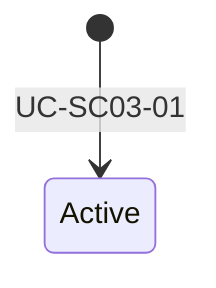

🏠 [Specs](../../../README.md) › 🏷️ [Sectors](../../README.md) › 💼 [SC03 Services](../README.md) › 🗃️ [Data](README.md) ›
🗃️ E-SC03-02 Statement of work

# 🗃️ E-SC03-02 Statement of work

**Status:** ✅ specified

## Purpose

What was sold.

## Fields

| Name | Type | Required | Validation | Default | Example | Personal data | Custom fields |
|---|---|---|---|---|---|---|---|
| engagement, version | records | yes | - | 1 | E-207, v2 | no | no |
| scope, deliverables | text, list | yes | - | - | 4 deliverables | no | no |
| signed | date, signatory | no | - | - | 3 Nov, client | yes | no |

## Relations

As its use cases.

## Lifecycle

## Indexes and search

By number, date, partner.

## Retention

Kept for the period of its kind of record in the country pack (D293), or else its kind's default in the
[retention schedule](../../../05-non-functional/data-retention.md).

## Audit

Every change.

## Import and export

CSV, FEC where relevant.

## Used by

- [UC-SC03-01](../use-cases/01-win-and-price/uc-sc03-01-win-an-engagement-and-write-its-statement-of-work.md)

## Open questions

None.

---

⬅️ [E-SC03-01 Engagement](e-sc03-01-engagement.md) · ⬆️ [Up](README.md) ·
➡️ [E-SC03-03 Rate card](e-sc03-03-rate-card.md)
