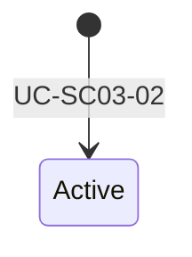

🏠 [Specs](../../../README.md) › 🏷️ [Sectors](../../README.md) › 💼 [SC03 Services](../README.md) › 🗃️ [Data](README.md) ›
🗃️ E-SC03-03 Rate card

# 🗃️ E-SC03-03 Rate card

**Status:** ✅ specified

## Purpose

Rates by role.

## Fields

| Name | Type | Required | Validation | Default | Example | Personal data | Custom fields |
|---|---|---|---|---|---|---|---|
| client or standard | record | yes | - | standard | Acme | no | no |
| role, day rate | text, amount | yes | > 0 | - | Senior, 950 | no | no |

## Relations

As its use cases.

## Lifecycle

## Indexes and search

By number, date, partner.

## Retention

Kept for the period of its kind of record in the country pack (D293), or else its kind's default in the
[retention schedule](../../../05-non-functional/data-retention.md).

## Audit

Every change.

## Import and export

CSV, FEC where relevant.

## Used by

- [UC-SC03-02](../use-cases/01-win-and-price/uc-sc03-02-set-rate-cards-and-pricing-models.md)

## Open questions

None.

---

⬅️ [E-SC03-02 Statement of work](e-sc03-02-statement-of-work.md) · ⬆️ [Up](README.md) ·
➡️ [E-SC03-04 Staffing assignment](e-sc03-04-staffing-assignment.md)
